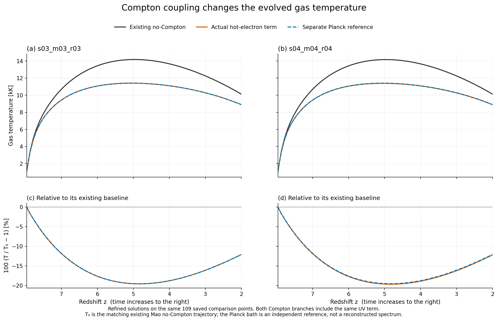
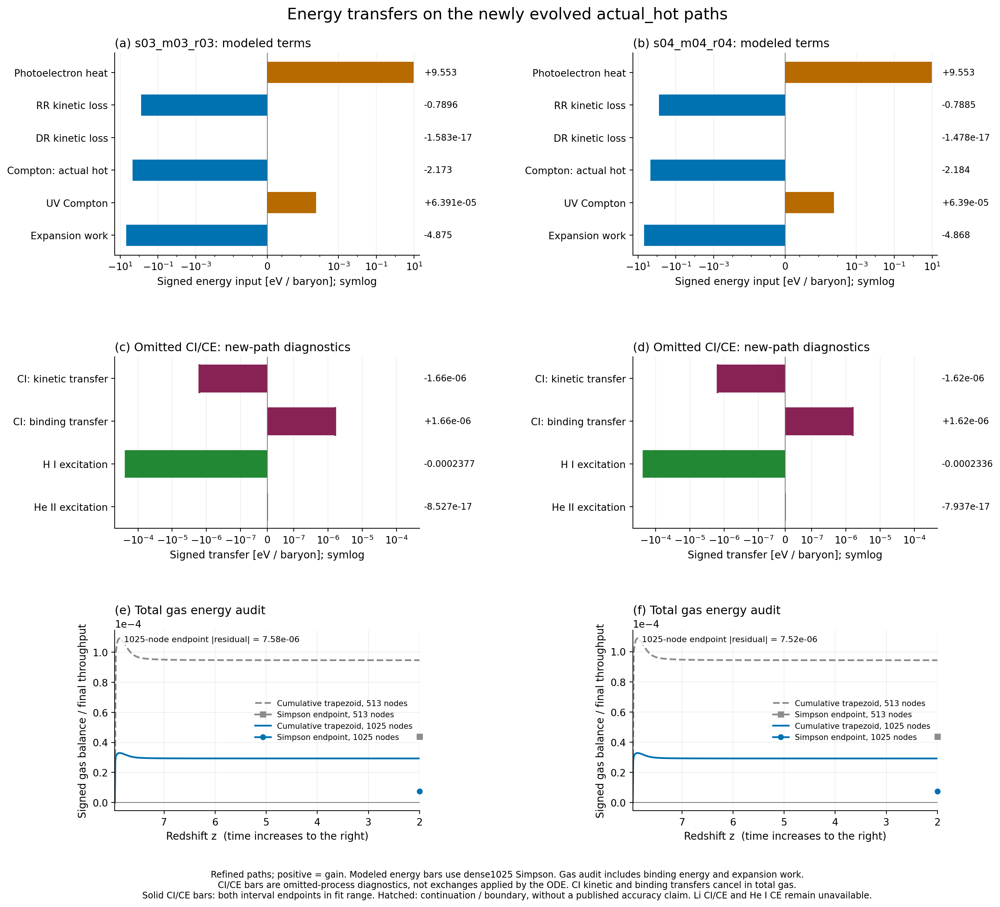
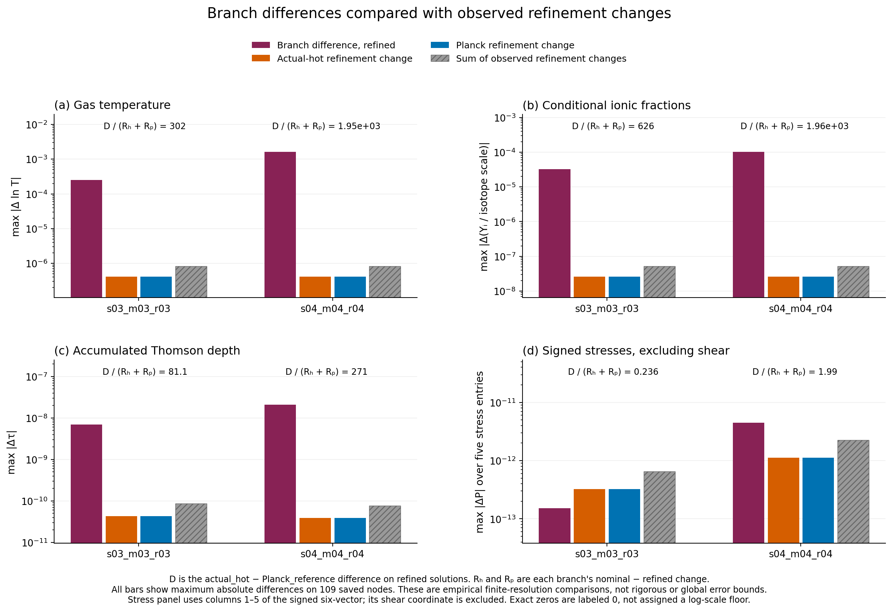

# Compton 결합 full63: 새 경로의 열·이온·불투명도 응답

## 결과

두 초기조건에서 Compton 열교환을 기존 원자망과 함께 풀자, 실제 광자 에너지
모노폴을 쓰는 `actual_hot` 분기의 z=2 기체 온도가 기존 계산보다
**12.08–12.17% 낮아졌다.** 새 경로에서 적분한 Compton 에너지 손실은
**2.173–2.184 eV/baryon**이다. 이전 고정 경로의 약2.58 eV/baryon은
새 해의 손실량과 구별해야 한다. 온도·재결합·광가열·전자수·opacity가 함께
변한 결과이며, 이전 직접 logT forcing을 온도 보정값으로 대입하지 않았다.

정해 둔 **8개 새 IVP**와 **4개 명목/강화 비교**를 완료했다. 각 사례의64개
검사가 모두 통과했고, 기존 IVP는 다시 풀지 않았다. 결과의 수치적 의미는
명시된 두 초기조건·두 복사 분기·재시작 이후 구간에 한정된다.

| 초기조건 | 복사 분기 | 기존 T(z=2), K | 새 T(z=2), K | 변화 | 새 경로의 1025점 최대 T, K |
|---|---|---:|---:|---:|---:|
| s03_m03_r03 | actual_hot | 10118.94877 | 8896.56883 | −12.080108% | 11409.57030 |
| s03_m03_r03 | planck_reference | 10118.94877 | 8896.96146 | −12.076228% | 11411.52629 |
| s04_m04_r04 | actual_hot | 10116.84675 | 8885.22091 | −12.174009% | 11389.29991 |
| s04_m04_r04 | planck_reference | 10116.84675 | 8895.92847 | −12.068170% | 11406.77694 |

표는 강화 설정의 결과다. 최대값은 저장된1025점에서 구한 값이며 연속 해의
엄밀한 최대값은 아니다. 같은109점에서 비교한 온도·이온·tau·signed 값,
513/1025점 에너지 자료, 실제 BDF accepted nodes를 모두 보존했다.
수치의 원자료는 [분석 요약](results/analysis_v1/SUMMARY.json),
[사례 표](results/analysis_v1/CASE_SUMMARY.csv),
[보고서 수치 추출](evidence/REPORT_FACTS.json)에 있다.

## 물리식에서 줄인 계산

상태는 기존 native full63을 유지한다. 기하학·복사40개, 원자/동위원소21개,
누적 Thomson 깊이1개와 logT1개다. 전자 비율 X=q·Y, 전체 기체 입자 비율
η=(1+q)·Y, K=σTc/(mec²)를 쓰면 추가 온도 소스는

$$
g_{\rm hot}=-\frac{8K U_\gamma X}{3H\eta},\qquad
g_{\rm ref}=\frac{8K U_{\rm ref}X}{3H\eta}
 \left(\frac{T_{\rm ref}}T-1\right),
$$

$$
g_{\rm UV}=\frac{2KX}{3H\eta}
 \left(\frac{M_{\rm UV}}{k_BT}-4U_{\rm UV}\right).
$$

`actual_hot`의 명시적 T가 logT 열용량으로 나누면서 소거되므로, Y와 기하학을
고정한 이 항의 logT 편미분은0이다. 전자·입자 비율과 H의 미분, 현재 광자
모노폴의 미분은 남는다. 중성 극한에서 X로 나누지 않는 형태로 이들을
계산했다. 추가 RHS와 Jacobian은 같은 현재 상태에서 마지막 행 하나만
바꾸며, 기존62개 행은 그대로다. 온도가 원자율을 바꾸고 전자수가 opacity를
바꾸는 실제 결합은 전체63개 방정식에서 유지된다.

기존71개 UV bin의 두 에너지 모멘트는 초기화할 때 한 번 계산하고, 이후에는
규정된 시간별 진폭을 적용한다. 새 Compton 행의 Hubble gradient는 필요한
4개 성분으로 직접 계산해 별도의 전체 기하학 Jacobian 재구성을 피한다.
전자수·열용량·복사장을 고정한 Compton 부분 문제는 dT/dt=−AT+B의 정확한
지수 완화해를 갖는다. 이를 부호·편미분·극한 검산의 기준해로 사용했다.
실제 시간 적분기는 모든 결합을 포함한 BDF이며, 이 기준해를 평형 강제나
분할 적분기로 대신 사용하지 않았다.

직접 유도와 코드 연결은 [THEORY_KO.md](THEORY_KO.md)에 있다.
[Scott–Moss 원문](https://arxiv.org/pdf/0902.3438v2)의 식(1)–(2)에서
Planck bath 결합 계수와 입자수 정규화, redshift 부호를 확인했다.
Exa·SciSpace discovery, Seager–Sasselov–Scott 원문과 이전 kernel 근거의
재사용 범위는 [출처 기록](provenance/COMPTON_SOURCES.json)에 구분했다.
Wolfram Language는26개 잔차/조건에0 또는True를 반환했지만 제거 가능한
극한 계산의 경고도 냈다. 응답과 한 번의 제한된 진단을 보존했고, 독립적인
직접 미분 및 수치 검사를 함께 사용했다.

## 복사 에너지의 소유권과 보존식

두 분기는 서로 다른 복사 가정을 갖는다. `actual_hot`은 현재 적분 중인
photon raw_state[4]로 Uγ를 계산하는 leading thermal Compton 항이다.
실제 grey 광자의 recoil·induced 항이나 스펙트럼 전체를 복원하지 않는다.
`planck_reference`는 Tref=2.7255K/a, Uref=aR Tref⁴인 독립적 등방 Planck
bath를 선택한다. 이를 실제 Bianchi 스펙트럼으로 재해석하거나 Einstein
에너지 밀도에 추가하지 않는다. 두 분기를 동시에 더하지 않았고, 동일한
외부 UV Compton 항은 각 분기에 포함했다.

기체의 baryon당 에너지와 저장량 변화는

$$
u_g=\frac32k_BT\eta+I\cdot Y,
\qquad
\frac{du_g}{dx}
=\frac{Q_{\rm abs}-Q_{\rm escape}+Q_C+Q_{\rm UV,C}}{n_bH}
 -3k_BT\eta .
$$

결합 에너지를 기체 저장량 안에 두고, 기존 Li core·재결합 escape·입자수
소스의 소유권을 유지했다. 독립적으로 계산한 kinetic+binding source와
absorbed−escape+Compton source가 일치한다. 반대 bath 원장
−QC, −Qabs−QUV,C와 escape를 더한 국소 소스 합도0이다.

이번 계산은 선택한 **test-fluid gas-energy 근사**다. 반대 radiation 소스는
장부에 기록하지만 광자 계층이나 Einstein 방정식에 동적으로 넣지 않는다.
원장 적분값은 복사장의 팽창·비등방 일을 처리한 광자 에너지 밀도가 아니다.
작은 원장 잔차만으로 완전한 복사 에너지 보존 모형이 성립했다고 주장하지 않는다.

## 새 경로에서의 에너지와 누락 충돌항

다음 표는 강화 actual_hot 해의 dense1025 Simpson 적분이다. 양수는 기체
획득, 음수는 손실이다. CI/CE 행은 새 경로에 평가한 누락항 진단으로,
현재 ODE에 실제 적용한 교환량과 구별된다.

| 항, eV/baryon | s03 | s04 | 해석 |
|---|---:|---:|---|
| 1차 광전자 가열 | +9.552639 | +9.552607 | 현재 모형의 열 소스 |
| RR 운동에너지 냉각 | −0.789557 | −0.788513 | Mao-factor 에너지/원래 수율 혼합 |
| 선택된 Compton | −2.172816 | −2.184126 | 새 해에 실제 포함 |
| UV Compton 합 | +6.390889e−5 | +6.389741e−5 | recoil과 thermal 성분을 따로 보존 |
| 기체 팽창 일 | −4.875392 | −4.867576 | 같은 경로의3kBTη |
| H/He CI 운동→결합 전달 | −1.660207e−6 | −1.619936e−6 | 누락항 진단; 총 기체 에너지는 내부 전달로 상쇄 |
| H I CE escape | −2.377255e−4 | −2.336070e−4 | 누락항 진단 |

Compton 손실은 새 경로의1차 광전자 가열의 약22.7–22.9%다. 기존 고정
경로에서 얻은 약30%와 다르다. 직접 소스의 크기만으로 온도 응답을 정하지
않고 원자율·열용량·가열의 결합을 다시 계산해야 한다는 점을 보여준다.

공급된 H/He 충돌항의 크기는 이 두 새 경로에서도 더 작다. 하지만5개
empirical fit 모두를 명시적인 analytic continuation으로 평가한 구간이
있으며, 각 격자의 domain·underflow·available mask를 저장했다. actual_hot
강화 해에서 CI 운동에너지 적분의 약5.7%는 지원 구간 밖 또는 경계 구간에
해당한다. H I CE의 해당 비중은 약7.5×10⁻⁷이다. 이 비중은 양의 가중치
trapezoid의 절대 throughput으로 계산했고, Simpson 적분값과 혼동하지
않았다. 구간 support는 두 저장 끝점의 분류이며 구간 내부 전체의 보증이 아니다.

Li CI/CE와 He I CE는 여전히 unavailable이다. 공급되지 않은 채널에0을
대입하거나, 작은 공급 채널의 결과를 모든 충돌 과정의 중요도 상한으로
확대하지 않는다. CI의 입자수 열용량 항도 −ηdot/(Hη)로 따로 기록했다.
전체 CI/CE 직접 logT forcing은 이 경로에서 약−1.0×10⁻⁴지만, 이는 새
충돌항까지 결합해 푼 온도 차이나 엄밀한 오차 상한이 아니다.

## 전하 상태·광학깊이·두 복사 분기의 차이

온도 변화에 따라 원자율도 변했다. 기존 해와의 최대 조건부 이온분율 차이는
actual_hot에서 s03 0.0150736, s04 0.0151213이다. 각각 Li7IV와 Li6IV의
동위원소 내부 분율에서 z≈6.857에 나타난다. 이 수치를 전체 기체의 전자
분율1.5% 변화로 해석하면 안 된다. Li는 미량 원소이며, 비교 변수는 각
동위원소 총량으로 정규화한 조건부 분율이다.

actual_hot의 z=2 누적 tau는 s03 0.06936655152, s04 0.06925070429다.
기존 해와의 차이는 각각 −2.65504×10⁻⁶, −2.66159×10⁻⁶이며, 전체 누적값의
약−0.00383%다. 재시작 이후 증가량을 분모로 삼으면 약−0.00514%다.
기존 donor z=20에서 이어진 시간과 tau를 그대로 가져왔고 초기화하지 않았다.
elapsed_Myr는 그 donor 이후의 누적 고유시간이며 우주의 나이가 아니다.

두 복사 분기의 강화 해에서 actual_hot−Planck 온도 종점 차이는
s03 −0.392634K, s04 −10.707565K다. Planck−actual 소스 차이를 같은
actual_hot 경로에서 분해하면 다음과 같다.

| 소스 차이의 원인, eV/baryon | s03 | s04 |
|---|---:|---:|
| Uγ를 Uref로 바꾼 부분 | −0.00186486 | +0.01507260 |
| 참조 Planck recoil/induced 보정 부분 | +0.00408758 | +0.00408234 |

이 표는 한 경로 위의 두 후보 소스 항등식이다. 서로 다르게 진화한 두 해의
에너지 차이를 이 두 수로 전부 설명하거나 실제 grey 복사장의 누락 recoil로
식별하지 않는다. 해석에 필요한 두 구별을 모두 보존했다.

두 분기 차이 D와 각 분기의 관측된 명목/강화 변화 Rh,Rp를 비교했다.
109점 최대 차이의 비 D/(Rh+Rp)는 다음과 같다.

| 비교 변수 | s03 | s04 | 유한 비교의 판정 |
|---|---:|---:|---|
| lnT | 약302 | 약1954 | 두 초기조건에서 관측된 refinement 변화보다 큼 |
| 조건부 이온분율 | 약626 | 약1962 | 두 초기조건에서 큼 |
| 누적 tau | 약81.1 | 약271 | 두 초기조건에서 큼 |
| 응력5성분, shear 제외 | 약0.236 | 약1.99 | s03 구별 미확보; s04 관측 변화보다 큼 |

shear를 포함한 signed6 전체 최대값에서는 두 초기조건 모두 refinement
변화가 더 커서 분기 차이를 구별했다고 판정하지 않았다. s04 응력만의
약2배 비도 전역 오차 보증이나 확률적 유의도가 아니다.
[분기 비교 원자료](results/analysis_v1/BRANCH_COMPARISONS.json)는 이
구분을 변수별로 기록한다.

## 검증의 근거와 범위

실행 전 검사는 저자 검사와 저자와 분리된 검토를 구분했다. 저자9개 검사는
추가 Jacobian 행756개 성분, 전체63차원 방향미분36개, 온도 열12개,
원래62개 행의 보존, 중성·FLRW·고정계수 극한과 원장을 포함한다.
별도 검토자는4개의 전체63×63 유한차분 Jacobian을 계산했고 최대
entry-scaled 차이는1.90774×10⁻⁸로 기준3×10⁻⁶ 안에 있었다.

실제 적분 후에는8개 사례의32개 저장 집합, 총16170개 진단 행을 검사했다.
이 집합에는2994개 accepted BDF node와 사례별109/513/1025점이 들어 있다.
서로 겹치는 격자점도 포함한 행 수이며 독립 표본 수가 아니다.

| 검사 | 관측된 최댓값/최솟값 | 채택한 기준/의미 |
|---|---:|---|
| 같은 분기 max ΔlnT | 4.13116e−7 | <3e−5 |
| 같은 분기 조건부 분율 변화 | 2.59172e−8 | <3e−5 |
| 같은 분기 tau 변화 | 4.32528e−11 | <3e−7 |
| 같은 분기 signed6 변화 | 5.68589e−9 | <3e−7 |
| 1025점 기체 적분 잔차/절대 throughput | 7.57897e−6 | <3e−4 |
| 513→1025 net 적분 차이/1025 throughput | 3.63811e−5 | 별도 격자 진단; 전역 상한 아님 |
| 국소 source/transfer 원장 잔차 | 3.98452e−16 | <5e−12 |
| baryon 보존 잔차 | 8.88178e−16 | <2e−8 |
| 동위원소 보존 잔차 | 2.08982e−15 | <2e−7 |
| scaled population 최소 | 0 | ≥−2e−8 |
| Einstein 내부 constraint 잔차 | 5.86625e−16 | <2e−13 |
| sampled angular weight 최소 | 0.390289 | >−2e−7 |

저장된 중성자·삼중수소 좌표는 정확히0이다. 이것은 선택한 원자망과 초기
상태의 성질이며 실제 핵생성률이0이라는 결론이 아니다. 지원 온도 구간
100–1e6K를 유지했고 온도 바닥값이나 clipping을 넣지 않았다.

독립적인 결과 재계산은 RHS/Jacobian/ODE를 호출하지 않고 저장 배열에서
gas store·work·Compton power, HG97 계수·채널·지원 구간, refinement를
재구성했다. 최대 power 상대 차이는 약1.82e−15, HG97 계수 차이는 약7.87e−14였다.
출력 byte/SHA와 입력/원천 소유권을 함께 확인했다. 실제 검토 근거는
[independent_review](evidence/independent_review)에 보존했다.
검증은 내부 Newton trial의 positivity나 시간 연속체 전체의 admission을
주장하지 않는다.

## 실행 비용과 다음 단순화

수치 thread1개로 직렬 실행했다. 240초의 사례별 cooperative cap,
1200초의 활성 campaign allocation을 사용했다. 첫 사례를 정확한 identity로
재사용해 나머지7개를 실행했고, campaign이 실제 차감한 시간은309.202초다.
8개 사례별 wall 합은308.216초이며 적분58.179초, 진단·저장249.053초다.
사례별 최대71.087초, 관측 process peak RSS79588KiB였다.
추가 분석 내부 시간56.854초와 process 전체87.683초는 별도로 기록했다.

따라서 이 실행에서는 적분보다 반복 진단·저장 비용이 컸다. 특정 함수가
가장 큰 병목이라는 주장은 아직 계측하지 않았다. 다음 제안은 같은 raw state의
진단 동등성을 먼저 검사하고, 중첩 dense513의 점별 자료를 dense1025에서
재사용하는 것이다. 기존 두 저장 제품에는 최대2.78e−17의 상태 반올림 차이가
있어 byte-identical이라고 부르지 않는다. 513점 누적 적분·Simpson·gate·지원
구간은 해당 격자에서 다시 계산해야 한다. 기체 원장을 검산하는 두 독립
합산식도 유지해야 한다. [NEXT_UNIT_CONTRACT.md](NEXT_UNIT_CONTRACT.md)는
새 IVP0개인 유한 동등성·계측 단위를 제안한다. 구현이나 성능 향상 측정이
이미 끝났다는 주장은 없다.

## 실패·수정 기록과 최종 범위

실행기 검토에서 불완전한 출력 재사용, 누락 dense 파일, 다른 초기 상태의
refinement 비교, 마지막 후처리의 시간 한도 누락을 실제로 재현했다.
4개 실패를 보존한 뒤 동일6개 검사가 통과했다. 분석기에서도 stale
refinement 및 잘못된 label/branch/tolerance/case hash를 허용하는6개 사례를
재현하고 고쳤다. 동일6개 검사와 정상 입력 control을 보존했다.
이 수정들은 새 과학 적분 전에 완료됐거나, ODE와 분리된 후처리만 바꿨다.

저자 초기 fixture2개는 지원 구간/입자수 설정 오류를 교정했으며 런타임
방정식과 기준을 바꾸지 않았다. 독립 결과 checker의 초기 비교는 상쇄된
매우 작은 잔차에 상대오차를 적용해 중단됐다. 이를 물리 잔차의 절대
정규화로 비교하도록 고쳤고 기존3e−4 물리 gate는 그대로 유지했다.
그림v1의 상단 symlog 눈금 겹침과 writable cache 경고를 보존하고
그림v2에서 배치·cache 설정을 교정했다. 완성된 ODE나 분석을 재실행하지 않았다.

현재 최대 |QC|/(HUγ)는 약5.27e−7, 그 x 적분은 약3.47e−7이며 trace-energy
비율은 약2.18e−8이다. 이는 선택한 경로에서 교환·기체 에너지의 규모를
보여주는 진단이다. 누락된 spectral/angular/Einstein backreaction의 엄밀한
오차 상한은 아니다. 실제 광자 recoil/induced closure, 추가 충돌 채널과
핵반응 결합은 별도 원천 계약이 필요하다.

**완료 판정은 COMPLETE_SCOPED_COMPTON_PILOT**이다. Physical HOLD,
production NOT_APPROVED, global convergence NOT_RUN,
REI_activation=false, U5 CLOSED_HOLD_NOT_RESET을 유지한다.
strong no-go는 제출하지 않았다. 과학 결과·검토·다음 계약을 고정한
초안 PR과 최종 백업의 실제 완료 여부는 해당 제공자 응답·복구 감사·전체
다운로드 검증 receipt로 확인한다.
