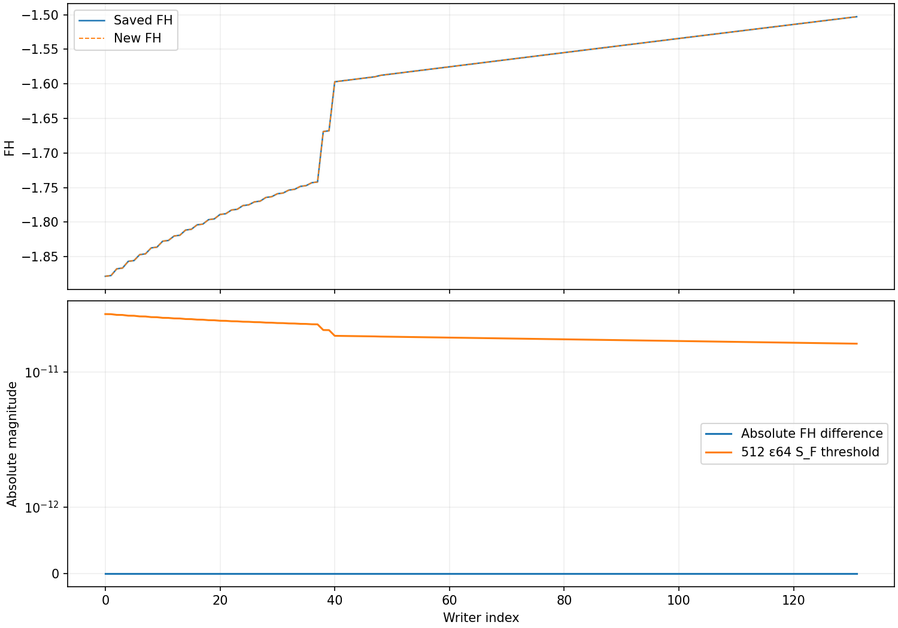
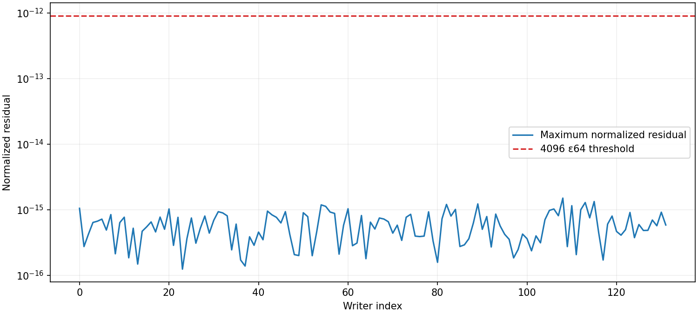

# REC-H5-ELECTRON-FIELD01 과학 결과 보고서

## 결과와 채택 범위

원 HyRec의 FULL 분기에서 명시적인 incoming radiation을 받는 전자 point 성분을 구현했다. 저장된 He-neutral final writer 132개에서 새 구현의 FH, real 변수 264개, virtual 변수 41,052개가 원 저장값과 모두 비트 단위로 일치했다. 독립 Decimal80 검증의 정규화 block residual 최댓값은 1.4989401807314334e-15였으며, 동결된 기준 4096 eps64 = 9.094947017729282e-13 아래다.

별도 nonauthor R6 이론 검토와 C9 최종 source·구현·실행 검토는 PASS_SCOPED다. C9는 CLOSED이며 미해결 blocker는 없다. 채택 범위는 FULL/H_STEADY/He-neutral/xe=xHII/fsR=meR=1의 point Fe=FH다. 중앙 DAG는 **28/88, 증가 0**, physical은 **0/313**이다. [채택 기록](SCIENTIFIC_ADMISSION.json) · [C9 독립 검토](reviews/C9_REVIEW_KO.md)

이 보고서는 완전한 과학 SOURCE의 내용 snapshot이다. C10의 실제 업로드·중앙 반환·최종 ACK는 생성 이후의 별도 delivery 기록과 최종 handoff가 식별한다. 과학 결과와 그 뒤의 전달 영수증을 구별하며, ZIP 안에 자기 업로드 ACK가 들어 있다고 주장하지 않는다.

## 조사 범위와 단위 선택

접근 가능한 소유자 저장소 51개의 메타데이터를 확인하고, 관련 17개 저장소의 브랜치 1,823개와 열린 PR 목록을 페이지 끝까지 수집했다. 열린 PR은 1,100 수신 행이며 중복 제거 후 1,099개다. 2026-10-27 이후 갱신된 PR 64개와 REC 판단에 필요한 원문을 우선 읽었다. 백업 보존 목록은 Dropbox 122,004개, Drive 1,568개, Library 7,045개의 고유 메타데이터를 포함한다. 남아 있던 실제 검색·목록 커서는 끝까지 이어 읽었다.

10:27:55 UTC에 같은 17개 저장소의 PR을 다시 확인하고 새 head의 선택 결과를 읽었다. 기존 PR 이름과 대응되지 않던 BASS_HE 최신 날짜 브랜치 6개도 10:30:52 UTC에 현재 ref, tip 변경 경로와 핵심 결과를 읽었다. REI의 moving-knot caloric 준비 및 비보정 source, BASS의 static-lapse memory, BASS_CR의 조건부 energy support, WU의 조건부 forcing, HE의 TANGENT13 결과는 각 상태·clock·가정의 범위를 유지한다. 현재 읽은 자료에서 이 REC point 성분을 직접 대체하는 입력은 확인되지 않았다.

목록의 완결성과 모든 원문의 검증은 다르다. 1,823개 branch의 모든 과학 diff, 모든 대화의 전문, 모든 archive의 전체 bytes를 읽었다고 주장하지 않는다. 전체 대화 transcript 열거 API는 제공되지 않았고, Drive 폴더 목록에는 완결 신호가 없었다. 문서 검색은 ZIP 목록을 완전히 대체하지 못했다. [조사 종합](survey/COMPREHENSIVE_SURVEY_KO.md) · [최종 최신성 확인](survey/FINAL_FRESHNESS_KO.md) · [보존 목록 설명](survey/inventory/README.md)

BGJET 배경 jet, native 경로·incoming, thermal 성분 residual과 QSS03 계약을 재사용했다. 다음 빠진 연결로 실제 electron point component를 선택했으며 기존 full-history integration이나 완료된 캠페인을 다시 실행하지 않았다.

## 이론: 고정 point의 명시적 incoming 의존성

시간 변수는 eta=ln(a), 수소 이온화도는 p=xHII, 중성 수소 분율은 x1=1-p다. Point 입력 P는 원 capture의 xe,p,nH,H,TM,TR,fsR,meR이며, incoming u는 virtual 311개와 Lyman 2개다. nH는 cm^-3, H는 s^-1, 온도는 eV다. H_STEADY는 원 temperature closure의 이름이며 FH가 0이라는 뜻이 아니다.

원 source의 Saha 조합 s와 Delta=xe*p-s*x1를 사용하면 두 real source 성분은

    c_i = nH [s*x1*DAlpha_i + Alpha_i*Delta]
        = nH [Alpha_i*xe*p - Alpha_i^eq*s*x1]

로 쓸 수 있다. 두 번째 등식은 실수 대수의 등식이다. 실행 코드는 첫 번째 원 source의 연산 순서를 보존했다. 최종 scalar도 원 grouping을 유지한다.

    FH = -(c0 - Beta0*xr0 + c1 - Beta1*xr1) / H.

원 block system은 M X=S이며 X=(xr,xv), M=[[A,B],[C,V]]다. A=Trr, B=Trv, C_bi=Tvr[i][b], V의 lower/upper band는 각각 Tvv[1]/Tvv[2]다. Point P와 원 initializer로 초기화한 table을 고정하면 M은 incoming에 의존하지 않고 S=S0+G*u다. Native V divisors와 Schur determinant가 0이 아닌 경우

    X = M^-1 (S0 + G*u)

이므로 FH는 incoming에 대해 실수 대수상 affine이다. P 전체에 대한 affine 주장이나 binary64에서의 exact affinity는 채택하지 않는다. Signed incoming/departure는 허용하며 clamp하지 않는다. [R5 유도](theory/R5_DERIVATION_KO.md) · [R6 검토](reviews/R6_REVIEW_KO.md)

R7에서는 새 scalar·Schur back-substitution·affine identities와 방향 오류 control을 Wolfram으로 실제 확인했다. 이 CAS 결과를 독립 model의 R6/C9 승인으로 세지 않았다. 앞선 BGJET CAS 결과도 재승인으로 중복 계상하지 않았다.

## 구현과 입력의 결속

원 native SOURCE는 110,654,069 bytes, SHA256 94b454c75b51f7c7af38126510cec609f5d7cfb2eb69ca78a491def54b31791c다. 원 ZIP을 재압축하지 않고 Drive 두 부분을 원 순서로 연결해 전체 bytes를 복원·검증했다. 과학 입력은 원 source/table 8개, capture 자료 7개, native_path 1개로 총 16개다. 모든 입력 identity를 확인했다. [입력 manifest](inputs/SOURCE_MANIFEST.json)

Binder는 LAST_WRITERS의 slot→id와 CALLS/QSS_WRITES/WRITES의 (id,slot)을 연결하고 native_path와 대조한다. Coefficient temperature는 **WRITES.jsonl**에 있으며, QSS_WRITES는 incoming/departure 자료다. 초기 문서의 locator를 C1에서 이 실제 저장 구조로 정정했다. 원 313 query, 626 endpoint 참조, geometric endpoints와 exact alpha는 유지했다. Native clock과 geometric clock을 같은 것으로 바꾸지 않았다.

C API는 원 ratio=TM/TR → rescale_T(TR) → TM=ratio*TR 경로를 한 번 수행한다. Original table initialization/A2s normalization, cubic interpolation, feature macros, optical-depth branch, calloc 초기화, assembly·solve·scalar 순서를 재사용했다. 각 point는 local 입력 복사와 fresh output을 사용하고 입력·table nonmutation을 확인한다. Point call은 history interpolation·integration·write와 파일 IO를 수행하지 않는다. Table 파일 IO는 context 초기화에 있다.

Divisor observer는 원 solve의 세 value-only hook과 outside diagonal 관측만 추가한다. Point마다 initial pivot 3, recursive pivot 237, outside diagonal 231, Schur determinant 1, 총 472개를 기록한다. TLS 진단 pointer를 저장·복원하고 추가 solve는 넣지 않았다. [최종 코드](code/electron_field.c) · [빌드와 계약 검사](C6_EXECUTION_KO.md)

## 실제 수치 결과

| 항목 | 실제 결과 |
|---|---:|
| Primary 새 point calls | 132 |
| FH parity | 132/132 PASS |
| Decimal80 block residual | 132/132 PASS |
| FH bitwise equality | 132/132 |
| xr bitwise equality | 264/264 |
| xv bitwise equality | 41,052/41,052 |
| 최대 FH 절대 차이 | 0 |
| 최대 정규화 residual | 1.4989401807314334e-15 |
| Residual 기준 | 9.094947017729282e-13 |
| Primary divisor events | 62,304 |
| Zero/nonfinite/overflow divisor | 0/0/0 |
| Primary 입력·table nonmutation | 각각 132/132 |
| Invalid/binding 사전 거부 | 24/24 |
| Saved-output mutation 검출 | 3/3 |
| 새 incoming controls | 9/9 |

FH 수용 기준은 |FH_new-FH_saved| <=512 eps64 S_F다. S_F는 원 scalar의 항별 절대 크기로 구성하며, zero scale에서는 exact zero를 요구한다. 독립 validator는 represented binary64를 Decimal.from_float로 가져와 80자리에서 sparse MX-S와 S_F를 구성한다. 각 행의 정규화 잔차 분모는 sum_l |M_kl X_l|+|S_k|다. Zero denominator도 exact-zero 규칙을 사용한다.

대표 indices 0,66,131의 40/80자리 계산은 같은 gate 판정을 보였다. B/C swap, lower/upper band swap, changed solution의 저장값 mutation은 모두 거부되었다. 이 mutation에는 새 solver 호출이 없었다.

Zero, signed-negative, doubled incoming을 대표 3점에 적용한 9회 새 control은 residual·nonmutation·divisor 조건을 통과했다. Incoming 변화에 FH의 응답이 관측되었다. 이 control은 source 대수의 확인이며 물리 spectrum positivity의 승인이 아니다. Binary64 affine second difference는 실측 보조값으로만 보존했다. [C8 보고서](C8_VALIDATION_KO.md) · [독립 수치 요약](execution/C8_VALIDATE_attempt001/independent/validation_summary.json)

그림은 저장된 primary와 validator 결과만 사용했다. Root가 실제 두 PNG를 열어 축·범례·값의 구분을 확인했다. 가로축은 writer index이며 연결선을 연속 물리 궤도나 whole-domain enclosure로 해석하지 않는다.

## 실제 비용과 보존한 실패

| 항목 | 실제 CPU s |
|---|---:|
| R7 Wolfram 보고값 | 0.062270 |
| C6 첫 실패 | 0.003394 |
| 단일 observer-only 진단 | 0.065527 |
| C6 성공 retry: build/bind/controls | 0.907676 |
| C7 primary | 0.525494 |
| C8 독립 검증·9 controls | 0.888929 |
| C8 저장값 그림 | 2.251386 |
| Known scientific 합계 | **4.704676 /60** |

Local child 합계는 4.642406s이며 remote 보고값과 합산했다. 성공 child의 최대 관측 RSS는 130,600KiB, 최대 wall은 약 2.263843s였다. 각 child의 wall30s, RLIMIT_AS512MiB, single-thread 환경과 CPU allocation을 유지했다. 실제 native calls는 C6 2 + primary132 + C8 9 = **143/146**이고 unfinished API attempt는 0이다. 남은 known CPU는 55.295324s다. Parent/model/network/metadata/packaging의 미측정 비용은 UNKNOWN_NOT_ZERO이며 이 표가 전체 세션 비용이라는 뜻은 아니다. [누적 resource ledger](execution/RESOURCE_LEDGER.json)

C6 첫 실행은 namespace PID와 proc-visible PID가 달라 다른 프로세스의 누적 CPU를 읽고 중단되었다. 실제 child CPU0.003394s를 1105.53s의 잘못된 관측값으로 대체하지 않았다. 한 번의 짧은 진단으로 이 불일치를 확인하고, child가 기록한 /proc/self PID·starttime으로 family를 관측하도록 수정했다. wait4·killpg는 namespace PID를 유지한다. 실패와 진단 비용을 차감한 뒤 한 번의 retry가 성공했다. 수식·tolerance·cap은 바꾸지 않았다.

전달 과정의 실패도 보존했다. C4의 Dropbox FETCH_FAILED 두 번은 같은 ZIP bytes를 새 transport 경로로 복사한 뒤 성공했다. C6 metadata 저장 command가 길이 제한으로 시작되지 않은 오류는 문서별 저장으로 해결했다. C8 Dropbox의 ACK file-ID metadata lookup은 NOT_FOUND였으나 실제 목적 경로 조회가 같은 file ID와 크기를 반환했다. 원인은 별도로 확정하지 않았고 추가 업로드·재포장·과학 재실행은 없었다. 각 단계 delivery 기록이 이 구분을 보존한다.

## 독립 검토와 미공급 의무

R6 reviewer는 별도 fresh context에서 원 source와 Schur 관계를 먼저 유도한 뒤 최종 R5와 비교했다. C9 reviewer는 구현에 참여하지 않고 source, 최종 코드, 원 raw 기록, writer/query binding, 실제 controls 및 resource ledger를 검토했다. C9 요청 모델은 gpt-6-astra이며 실제 runtime model identity는 NOT_OBSERVED다. R6/C9의 역할 분리는 실제 수행했지만 다른 model-family identity가 관측되었다고 주장하지 않는다. CAS나 serial 검토의 독립 model 승인 credit은 0이다.

| 구분 | 유지 상태 |
|---|---|
| 중앙 canonical DAG | 28/88, 증가 0 |
| 별도 REI working | 33/88, 중앙과 합산하지 않음 |
| Reference mapping | 313/313 |
| Physical coverage | 0/313 |
| Physical query, K, M2, defect, L, tube, e0, epsilon, outgoing | 모두 null |
| H6/H7 | OPEN |
| L4 | false |
| REI activation | false |

Actual full-state coupled F, whole-domain total xe', initial error e0, model discrepancy, whole-domain defect, full-state norm, positive physical tube, physical curvature는 여전히 별도 공급 대상이다. Point의 작은 block residual은 전체 coefficient box의 nonsingularity, inverse gain, forward error, 물리 tube를 증명하지 않는다. 이번 결과를 전체 REC-H5 DAG 노드의 완료로 올리지 않았다.

이전 BGJET의 원 kernel·saved-endpoint supplement fresh 검토는 19/20 상태로 보존하고 원 SOURCE C10을 별도 미완으로 둔다. Native-path는 이전 실제 backlink와 전달에 따른 20/20을 유지한다. BGJET q 및 H'' 폭 보강과 원 audit 결과를 다시 계산하지 않았다. 기존 producer/reference/native full-history/oldtests/BGJET audit/QSS03 certificate/thermal residual의 재실행은 0이다.

## SOURCE 구성과 후속 경계

SOURCE는 16개 불변 입력과 manifest, 최종 코드, 실제 build/commands, C6 실패와 진단, C7 primary raw, C8 독립 검증·controls·그림, R6/C9 검토 및 단계별 delivery 근거를 포함한다. 원 ZIP이나 기존 capsule을 중첩·재포장하지 않는다. 48.6MB의 정리된 survey JSONL 전체는 이미 C5 capsule SHA256 578c2bd775649d1b4187a42b44ce70cd1086ab18ef05805f229d5a5516d0e94c에 보존했고, 이 SOURCE에는 그 index와 조사 설명·직접 인용 근거를 포함한다.

실제로 사용한 명령은 unit root에서 python3 code/run_stage.py C6, C7, C8이다. 성공 실행은 GCC13.3.0, -O3, -fno-fast-math, -ffp-contract=off를 사용했다. 원 native warning9개는 보존했다. 다음 소비자는 이 source-point API, 원 writer/query identity, 두 clock의 구분을 이어받아야 한다. 완료된 계산은 새 근거 없이 반복하지 않는다.

이번에 선택한 R1–R10/C1–C10 단위 뒤의 자동 다음 단위 실행은 OFF다. Main merge를 수행하지 않는다. 최종 전달 상태와 중앙의 한 속성 backlink는 실제 최종 영수증 및 handoff를 따른다.
