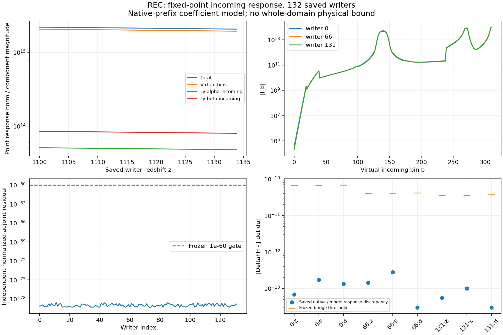
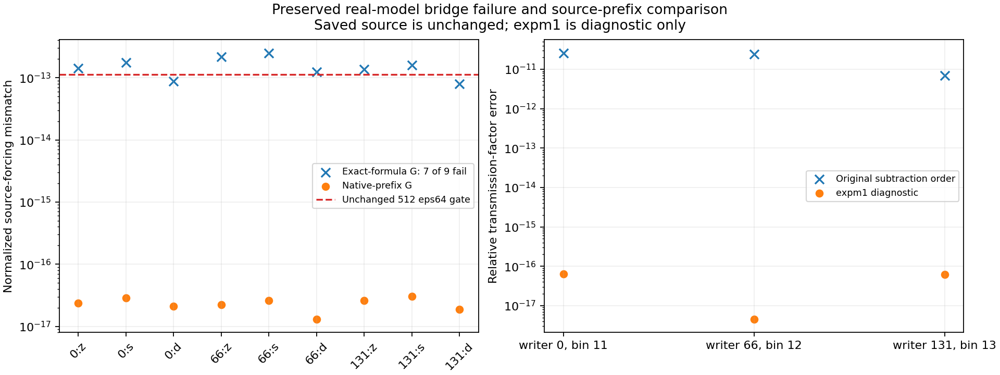

# REC-H5-ELECTRON-RESPONSE01

The fixed-P incoming-radiation response of the source-point electron field is
computed at 132 saved writers, with 313 coefficients per point. Read
[REPORT_KO.md](REPORT_KO.md) for the scientific result and limitations.

**Scoped outcome:** the adjoint and independent checks pass. The original
real-formula model's source bridge remains **2/9 PASS, 7/9 FAIL**. Binary64 source
reconstruction in the original operation order, including final rounded source
products and sums, has 44,133/44,133 saved source-entry bitwise parity. The
separately specified real model lifting those coefficient prefixes has 9/9
source/scalar bridge passes under the unchanged gates. This is a real
affine model at fixed P, not the derivative of the binary64 rounding map.

- Theory and frozen definitions: [THEORY.md](THEORY.md), [CONTRACT.md](CONTRACT.md),
  [MODEL_COMPARISON_CONTRACT.md](MODEL_COMPARISON_CONTRACT.md).
- Scientific admission: [SCIENTIFIC_ADMISSION.json](SCIENTIFIC_ADMISSION.json).
- Independent review: [R6](reviews/R6_REVIEW.md),
  [R6 prefix](reviews/R6_PREFIX_REVIEW.md), [C9](reviews/C9_REVIEW.md).
- Final figures and CSV: `execution/PLOTS_attempt002/`.
- Complete raw source: the hash-addressed SOURCE ZIP described by
  `delivery/FINAL_DELIVERY.json`; large inputs and response JSONL are in that ZIP.
- Next research specification: [NEXT_STEP_THEORY.md](reviews/NEXT_STEP_THEORY.md).
- Resume instructions: [HANDOFF_KO.md](HANDOFF_KO.md).

Known child CPU: 15.866848/60 seconds, including the retained failed attempt and
both plot runs. Native calls: zero. Canonical 28/88 +0; physical 0/313;
H6/H7 OPEN. No production HyRec change, main merge or central DAG mutation.
The first five run receipts lack execution-time code/environment snapshots;
later review snapshots are explicitly not retroactive. See C9-F01.

The complete capsule preserves all attempts. Existing attempt directories are
exclusive and must not be overwritten. A justified rerun must use a new attempt
number and obey the cumulative ledger. Dependencies observed at review are
Python 3.12.14, NumPy 2.3.5, SciPy 1.17.0, Matplotlib 3.10.8, glibc 2.39.

