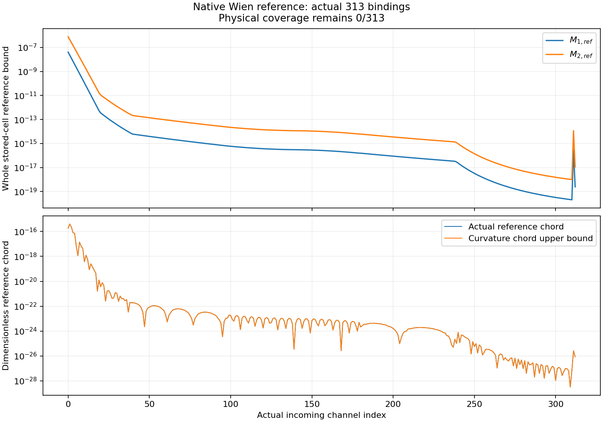
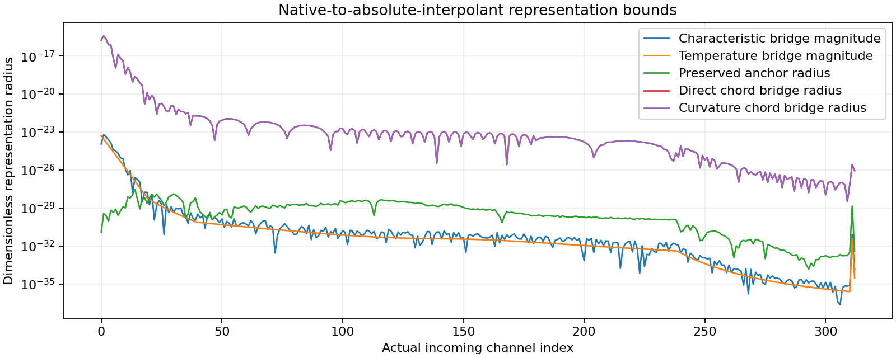

# REC-H5-NATIVE-REFERENCE01 최종 연구 보고서

## 결론과 승인 범위

실제 H5의 **313개 query에 대해 native Wien reference의 도함수, 전체 저장 cell의 curvature 상계, query·native temperature 표현 차이, 기존 anchor와의 정확한 조합을 구현하고 계산했다.** 독립 검토 판정은 **PASS_SCOPED**이며, 코드나 출력의 수정 및 추가 수치 실행을 요구하지 않았다.

이론 R1–R10의 유도·원전 대조·독립 검토·Wolfram 검산을 완료했고, 코딩 C1–C9에서 실제 코드·주 계산·대조 검사·과학적 대응·수치 재현성과 독립 검토를 완료했다. C10은 이 보고서, 소스 ZIP, 중앙 DAG 연결, 실제 게시·이중 백업 영수증과 handoff를 묶는 전달 단계다. 최종 전달 완료와 각 단계의 actual ACK는 delivery/FINAL_DELIVERY.json 및 delivery/stage_receipts/에 기록된다.

- 과학 승인 고정 commit: **f22d6548c7c5ed4e13e424dc3ec5c5ce5ea18001**.
- 중앙 DAG 반영 commit: **5cabe78f89f3ecd79d11faa29088bf30992a1017**.
- 공유 DAG: **28/88**, 이번 partial reference 단위의 canonical 완료 증가 **0**.
- 별도로 직접 확인한 PR240 작업본: **33/88**. 이전 작업본 32/88과 공유본 집계를 합산하지 않는다.
- 실제 reference 입력은 **313/313** 공급했다. 전체 물리 H5 오차 입력의 coverage는 **0/313**이다.

## 1. 무엇을 조사하고 재사용했는가

접근 가능한 관련 10개 저장소의 branch 목록 1,405개를 모든 페이지에 걸쳐 조사했고, 그중 과학 저장소 7개의 open PR 926개를 열거했다. 선택한 REC Dropbox subtree 203개, REI research subtree 305개, REI direct folder 41개는 terminal page까지 확인했다. Drive는 기존 폴더 5곳에 대한 갱신 검색으로 12개 metadata 결과를 얻었다. 연결된 개인 대화 검색은 실제로 unavailable을 반환했다.

이 수치는 모든 branch의 코드와 모든 과거 archive를 전부 읽었다는 뜻이 아니다. 전체 ref·PR 목록 조사, 이번 의존성에 필요한 실제 소스 확인, 선택한 backup 직접 복구의 범위를 survey/remote/SURVEY_SUMMARY.json과 SOURCE_SYNTHESIS_LATEST.md에 구분했다. 대화 검색 접근 공백도 숨기지 않았다.

HISTORY02R에는 이미 generic constant-shear native-Wien offset/JVP와 조건부 오차 전달이 있었다. 그 8개 scalar control은 다른 cosmology의 초기 history를 사용한다. 이를 재실행하지 않고 재사용했으며, 실제 이번 313개 H5 cell에 대한 전체 reference derivative·curvature·bridge 공급은 별도의 미충족 부분임을 직접 확인했다.

회차 중 새 병렬 결과도 반영했다. BASS의 기존 B3h 유한 QSS/non-Lyα transaction 완료가 공유 DAG를 27/88에서 28/88로 올렸다. 이후 HE의 5개 node에는 조건부 event/state/photon/angular 관측이 추가됐으나 완료 상태는 바뀌지 않았다. PR240의 직접 실행 승인 기록에서는 처음 보류됐던 20 cohort + 16 affine 검사가 실제 통과했다. 이 기록을 오래된 PR body보다 우선했다. 이 결과들은 각각 재사용하지만 REC313의 실제 physical defect·tube·stability·curvature 공급으로 확대하지 않는다.

문헌 조사에는 SciSpace와 Exa를 사용해 원 HyRec 논문을 대조했고, 실제 구현 convention은 2012 native C/Python 원본에서 확인했다. 2011 논문과 2012 code byte identity를 동일시하지 않았다. Wolfram은 단순 검색이 아니라 R7의 실제 기호 검산에 사용했다.

## 2. 고정 입력과 clock

고정 SOURCE_CONTEXT의 저장된 geometric endpoint \(a,b\), 기록된 query \(\hat q\), 정확한 유리수
\[
\alpha=\frac{\hat q-a}{b-a}
\]
를 사용했다. 앞 회차의 native-real clock 결과는 그 자체로 보존하며 이 clock을 대체하지 않았다. 이 구분은 R6의 유일한 표기 지적 F01을 수정하고 독립적으로 닫은 내용이다.

원 native 상수 \(k_N=\mathrm{float}(8.617343\times10^{-5})\ \mathrm{eV/K}\), 기록된 \(T_0\), channel energy, redshift와 모든 endpoint/query는 **해당 binary64 값이 나타내는 정확한 실수**로 해석했다. 현대 SI 상수나 literal decimal 모델로 교체하지 않았다. Photon occupation에는 population degeneracy factor를 삽입하지 않았다.

Tagged CSV의 VIRTUAL energy field와 META temperature를 올바르게 읽었다. Native radiation temperature
\(\widehat T_R=0.25882399309326415\ \mathrm{eV}\)의 represented 값과 실수 곱 \(k_NT_0(1+z)\)는 별개 입력으로 유지했다. 실제 prefix는 5127이며, 313 incoming과 314 outgoing source channel, 5개의 특수 Lyman route를 모두 연결했다.

주요 source SHA256은 다음과 같다.

| 입력 | SHA256 |
|---|---|
| SOURCE_CONTEXT.json |5ccd8955bc9ea7484ddc1fca1dcf8b5a0a789e07c36ce0af3e692b959f002fe8|
| target_native_snapshot.csv |3a95862b9cd4f924d63020f39fc537b371133af6160e88c3409d8c69fc0c34b7|
| history.npz |d4f82542e13fed4ff0bb60b17865d8b9de5e090a2366108169c3da7a21fcb4b1|
| hydrogen.h |e89a3a447928cbe31dc273c11c4a8bc7f7a8e297be4a11270e453c101f96ccba|
| original_hyrec_native.py |d7bc38346281951fdd5f2677e25f3b558333124a2319786b9b7afb0ab1f7a89c|

## 3. 완성한 이론 결과

\[
x_E(\eta)=\frac{E e^\eta}{k_NT_0},\qquad
w_E=e^{-x_E},\qquad
G_E(\eta,f)=f-w_E.
\]

직접 미분하면
\[
w'=-xe^{-x},\quad
w''=(x^2-x)e^{-x},\quad
w'''=(-x^3+3x^2-x)e^{-x}.
\]

따라서 전체 cell의 \(\sup|w'|\)는 끝점과 포함된 \(x=1\)에서, \(\sup|w''|\)는 끝점과 포함된 \(x=(3\pm\sqrt5)/2\)에서 비교하면 된다. 표본 grid의 최댓값으로 대체하지 않았다. 실제 313개 cell 모두에서 \(x(a)>(3+\sqrt5)/2\)를 interval로 증명했으므로 두 reference envelope는 왼쪽 끝점에서 정해진다.

Exact reference translation \(y=f-w\)와
\(F_y(\eta,y)=F_f(\eta,y+w)-w'\)에 대해
\[
\hat y'-F_y(\eta,\hat y)
=\hat f'-F_f(\eta,\hat f)
\]
이다. 같은 고정 norm의 state error, state-Lipschitz bound, translated tube radius도 보존된다. 이 정리는 실제 \(F_f\), path와 tube가 주어졌을 때 적용되며, 없는 물리 입력을 생성하지 않는다.

Target/source energy \(E_t,E_s\)에 대해
\[
q_*=-\ln[(1+z)E_s/E_t],\quad
x_t=\frac{E_t}{k_NT_0(1+z)},\quad
\delta q=\hat q-q_*.
\]
두 표현 차이를
\[
B_{\rm char}=e^{-x_t}\operatorname{expm1}[-x_t\operatorname{expm1}(\delta q)],
\qquad
B_{T_R}=e^{-x_t}-e^{-E_t/\widehat T_R}
\]
로 분리했으며, \(B_{\rm total}=B_{\rm char}+B_{T_R}=w_s(\hat q)-w_{\rm native}\)이다.

Reference chord와 보존된 signed anchor를
\[
J_{\rm ref}=(1-\alpha)w_s(a)+\alpha w_s(b)-w_s(\hat q),\qquad
r_a=\hat u-[(1-\alpha)y_L+\alpha y_R]
\]
라고 하면
\[
[\hat u+w_{\rm native}]-I[y+w_s]
=r_a-J_{\rm ref}-B_{\rm total},
\qquad
|J_{\rm ref}|\le
M_{2,\rm ref}\frac{(\hat q-a)(b-\hat q)}2.
\]
기존 anchor를 한 번만 사용해 deterministic representation radius를 합성했다.

물리적 조합식은
\[
y_j''=\partial_\eta F_j+(D_fF_j)F-w_s''
\]
이다. 이번에 실제로 공급한 것은 마지막 reference 항의 whole-cell bound다. 앞의 physical state-dynamics 항을 더 공급해야 전체 physical curvature가 정해진다.

## 4. 구현과 실제 수치 결과

6개 모듈이 source binding, Decimal80 outward arithmetic, finite extrema, bridge producer, 독립 Decimal140 원식 계산, 대조 검사, bounded 실행과 그림 출력을 담당한다. 독립 point evaluator는 production interval/producer 모듈을 import하지 않는다. 같은 Decimal backend를 사용하므로 독립된 식·정밀도 검산이며 별도 numerical backend 검증은 아니다.

기본 연산은 방향 반올림을 사용하고, 단조 초월함수는 correctly rounded endpoint를 이웃 representable 값으로 확장했다. \(\ln1=0,\sqrt0=0,e^0=1\)은 exact endpoint로 처리했다. 포함 가능성만 있는 critical point는 상한만 넓히며, 하한에는 실제 포함이 증명된 후보만 사용한다. Invalid/nonfinite/underflow/subnormal 등은 거부한다.

| 검증 항목 | 실제 결과 |
|---|---:|
| 실제 source·route·geometric alpha·anchor binding |313/313 PASS|
| 독립 140자리 point containment |10,016 PASS|
| Signed direct/decomposed bridge |313/313 PASS|
| Convex 및 왼쪽 끝점 최대 regime |313/313 증명|
| 관련 경계·임계점·항등식 대조 검사 |38/38 PASS|
| 최대 정규화 interval 폭 |\(6.2745288374\times10^{-60}\)|
| 실행 전 고정한 폭 기준 |\(10^{-40}\)|
| 과학 실행 후 수정·주 계산 재실행 |0|

다음은 표시용 근삿값이며, 실제 outward endpoint는 REFERENCE_PACKET.json과 NUMERICAL_FINDINGS.json의 decimal 문자열이 기준이다.

| 수량 | 관측된 최소 | 관측된 최대 |
|---|---:|---:|
| \(M_{2,\rm ref}\) |\(9.85136\times10^{-19}\)|\(7.76391\times10^{-7}\)|
| \(J_{\rm ref}\) |\(3.23570\times10^{-29}\)|\(3.94685\times10^{-16}\)|
| Curvature chord bound |\(3.24431\times10^{-29}\)|\(3.95010\times10^{-16}\)|
| Signed \(B_{\rm char}\) | \(-6.06714\times10^{-24}\)|\(4.18457\times10^{-24}\)|
| Signed \(B_{T_R}\) |\(2.51705\times10^{-36}\)|\(5.03841\times10^{-24}\)|
| Signed \(B_{\rm total}\) |\(-3.26118\times10^{-24}\)|\(6.17866\times10^{-24}\)|
| Curvature 기반 representation radius |\(3.24448\times10^{-29}\)|\(3.95010\times10^{-16}\)|

모든 실제 cell에서 reference chord는 양수이고, 직접 native-to-absolute-interpolant 차이는 음수였다. Signed bridge는 두 부호를 가지므로 절댓값 하나로 원인을 합치지 않았다. Represented reconstruction의 positivity도 313개에서 확인했지만 이를 physical ODE tube라고 부르지 않았다.

## 5. 독립 검토와 예산

Astra가 계약과 최종 판정을 맡고 lower-tier 구현자에게 구현·제한 실행을 위임했다. 별도 Astra 검토자는 구현하지 않은 코드와 원자료를 검토했다. 요청된 tier와 실제로 관측 불가능한 runtime model identity를 구분했다.

C9은 소스와 두 실행 receipt의 6개 code hash, 원 binding 313개, 유한·순서가 맞는 serialized interval 11,581개, 저장된 point containment 10,016개와 exact-rational radius/chord invariant 313개를 확인했다. Production 코드를 import하거나 primary/control 계산을 다시 실행하지 않았다. 판정은 PASS_SCOPED이며 blocking/nonblocking code finding은 없었다.

실행 전에 회차 local 계획 상한 600 CPU초, 구현·실행 subtotal 300, 독립 검토 120, packaging 60을 선언했다. 실제 primary는 90 CPU초/180 wall초, controls는 60 CPU초/120 wall초, 각각 1 thread·2 GiB로 더 작게 제한했다.

| 실제 실행 | CPU초 | Wall초 | Peak RSS |
|---|---:|---:|---:|
| primary001 |8.352353|8.397565|91,816 KiB|
| controls001 |0.130654|0.169862|13,696 KiB|
| C9 저장 원자료 audit |0.560852|0.567817|21,868 KiB|

Primary + controls의 실측 child CPU 합계는 **8.483007초**다. 설명용 extrema 추출의 process checkpoint는 0.124992초이며 그 안의 0.061850초 block을 중복 합산하지 않았다. Remote CAS CPU는 UNKNOWN_NOT_EXPOSED, 측정하지 못한 metadata·startup·serialization tail은 UNKNOWN_NOT_ZERO로 남겼다. 알려지지 않은 비용을 0으로 처리하거나 이전 예산을 초기화·전용하지 않았다.

게시 helper의 문자열 문법 오류와 C8 draft patch 형식 오류는 과학 실행 전후의 별도 운영 기록으로 보존했다. 과학 primary와 controls에는 실패·repair·재실행이 없었다.

## 6. 보존한 제한과 정확한 다음 입력

전체 physical_query_bounds, full_state_K, physical_M2, physical_defect, stability_L, positive_uniform_ode_tube, initial_error, physical_epsilon, physical_outgoing_bound는 모두 **null**이다. H6/H7은 OPEN, L4와 REI activation은 false다. 유도 승인과 representation 계산 승인을 physical epsilon 승인으로 확대하지 않았다.

원 photon history archive에는 all-time \(x_e,x_{\rm HII},T_M,H\) state trajectory가 없다. CSV의 한 target face는 전체 cell/tube의 physical defect와 stability를 대신하지 못한다. 다음 단계는 기존 REC-H5 안에서 실제 coupled trajectory/accepted segments, native \(F\), state norm, initial/model error, whole-domain defect·stability 및 positive uniform tube를 공급하는 것이다. 그 뒤 이번 reference 항을 조합해 physical curvature와 conditional H5 epsilon을 계산할 수 있다.

기존 REC-HD-ADAPTER의 고정 LAMDA parser와 과거 검증은 재사용했다. 9개 준위, 8개 전이, 분리된 2개 collider와 50/100/200 K grid를 보존했다. 온도 범위 밖 extrapolation/clamping과 p/o-H2 혼합은 도입하지 않았다. 원 35 Hz source gate의 7/8 FAIL 기록과 이전 완료 계산·실패·예산도 보존했다.

## 7. 게시·백업·중앙 통합과 재개

각 R/C 단계마다 최신 AGENTS·owned HEAD·병렬 PR metadata를 확인하고 expected-SHA, force=false로 게시했다. 단계 ZIP은 byte manifest/CRC/SHA 확인 후 Dropbox와 Google Drive에 저장했으며 actual ACK와 별도 size readback을 남겼다. 원격 HEAD 변경 중에는 직접 delta를 복구해 기존 병렬 결과를 보존했다.

중앙의 기존 REC-H5 node에는 owner_return_native_reference01_20261027 포인터 하나만 추가했다. 이를 제거하면 전체 원 DAG가 같고, 나머지 87개 node를 포함한 88개 계약·17개 edge·예산·status가 보존된다. CURRENT_STATUS는 수정하지 않았다. 중앙 완료 수는 28/88로 유지된다.

소스 ZIP에는 이번 회차의 코드·계약·유도·원자료·그림·검토·기존 단계 영수증, 원본 SOURCE_CONTEXT/CSV/history NPZ와 native C/H/Python 의존성을 넣는다. ZIP 자신의 hash와 나중 provider ACK는 외부 companion에 보존해 재포장에 의한 자기참조를 피한다. 최종 checksum·provider file ID와 20개 단계 ACK는 delivery/FINAL_DELIVERY.json, delivery/SOURCE_BACKUP_RECEIPT.json, delivery/stage_receipts/를 참조한다.

다음 대화는 HANDOFF_KO.md를 읽고 위 과학 commit과 packet SHA를 먼저 확인한다. 완료한 313개 계산과 검토는 재실행하지 않는다. 새 물리 입력을 실제로 공급하는 범위와 실행 한도를 먼저 선언한 뒤, 가장 이른 미충족 입력부터 이어간다.

## 근거 파일과 원전

- FROZEN_CONTRACT.md, CODING_CONTRACT.md, theory/THEORY.md
- theory/REVIEW_R6.json, theory/WOLFRAM_R7.json
- results/primary001/REFERENCE_PACKET.json, POINT_REFERENCE140.jsonl, SOURCE_BINDINGS.json
- results/controls001/CONTROLS.json, 두 RUN_RECEIPT.json
- review/REVIEW_C9.json, review/TARGETED_SAVED_ARTIFACT_AUDIT.json
- SOURCE_SYNTHESIS.md, SOURCE_SYNTHESIS_LATEST.md, BUDGET_LEDGER.json
- 원 HyRec: Ali-Haïmoud & Hirata, Phys. Rev. D 83, 043513 (2011), DOI10.1103/PhysRevD.83.043513, https://arxiv.org/abs/1011.3758
- Python Decimal: https://docs.python.org/3.12/library/decimal.html
- libmpdec square root: https://www.bytereef.org/mpdecimal/doc/libmpdec/arithmetic.html#square-root
