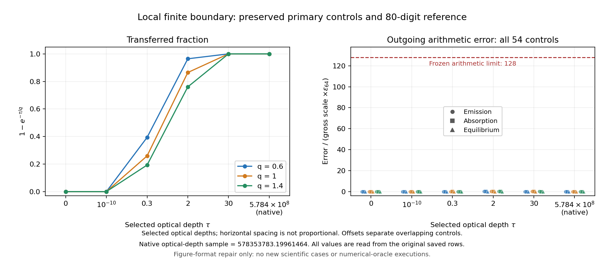
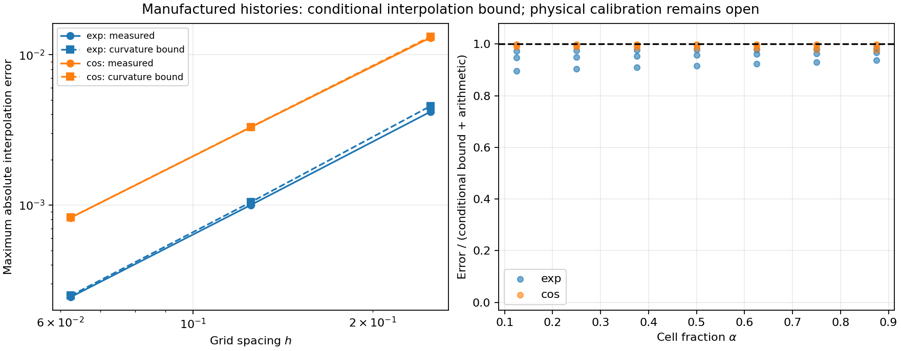

# REC-HISTORY-01

> **전달 상태 갱신 (2026-10-23 18:49:46 UTC):** 과학·독립 검토는 PASS_SCOPED다. GitHub 쓰기 호출이 응답 없이 중단됐고 두 target branch의 실제 readback은 404다. 새 commit/PR 및 중앙 DAG 게시는 **미완료**다. R10/C10은 인계 준비 완료·게시 미완료로 기록한다. `delivery/PUBLICATION_STATE.json`이 이 전달 상태의 기준이다.

Source-bound finite native-history boundary adapter, selected by the fixed
2026-10-23 orchestration handoff. The scientific unit is
`COMPLETE_SCOPED_BOUNDARY`; parent `REC-HISTORY` remains `PARTIAL`.

- [결과 보고서](REPORT_KO.md) and [이론/source mapping](THEORY.md)
- [동결 계약](FROZEN_CONTRACT.md) and [실행 전 precision/domain addendum](PREEXEC_ADDENDUM.md)
- [Primary608 checks](results/attempt001/SUMMARY.json), [independent review](evidence/independent_review/FINAL_REVIEW.md)
- [Claim gates](CLAIM_GATES.json), [global dependency status](GLOBAL_DAG.json), [R/C evidence map](LOOP_PROGRESS.json)
- [Cumulative budget](BUDGET_LEDGER.json), [next input contract](NEXT_INPUT_CONTRACT.md), [한국어 인계](HANDOFF_KO.md)
- [LINE02 final receipt audit](provenance/DELIVERY_AUDIT.json); actual provider/Git receipts are under delivery/

## Reproduction identity

Parent commit: `a7c46fd8338971e2cefa776f5dd7b25a46974990`.
The sibling `rec_line_native_owner_20261023` supplies its immutable CSV,
PREPARED_BLOCKS.npz, hydrogen.c and hydrogen.h. The original LINE02 preparer and
runner are never invoked. The header in vendor/ is the pinned h4 header for
manufactured C interpolation only, not an inferred clock for the z≈1100 state.

Observed runtime: Python3.12.14, numpy2.3.5, scipy1.17.0, mpmath1.3.0,
matplotlib3.10.8 and the C compiler recorded in native_oracle/BUILD.json.
Set the six BLAS/OpenMP thread controls to1; run_bounded.py also sets them.
The original mpmath was supplied by `PYTHONPATH=/tmp/rec_history_deps`.

Executed primary command from repository root:

```bash
PYTHONPATH=/tmp/rec_history_deps python3 research/rec_history_boundary_20261023/code/run_bounded.py --label primary001 --timeout 90 -- python3 research/rec_history_boundary_20261023/code/run_history_checks.py --output research/rec_history_boundary_20261023/results/attempt001
```

Completed receipts/output directories are create-only. This command is recorded
for reproducibility, not a request to rerun adopted evidence. Continue from
NEXT_INPUT_CONTRACT and the remaining allocation after checking source identity.
Any diagnosed affected repair receives its own unique directory and cumulative charge.
The independent script supports `REC_HISTORY_UNIT_ROOT` for a relocated unit;
its output remains under its own reviewer directory.

## Scope and preserved evidence

Primary608/608 plus independent14/14 are finite checks. Actual physical-history
interpolation calibration is INPUT_DEPENDENT_UNCALIBRATED. Directional Bianchi
propagation and full thermodynamic/geometry derivatives remain separate inputs.
New IVP0, native recombination runtime0, old LINE02/campaign replay0.

Original raw rows, NPZ, extracted C fragments, first PNG, execution source
snapshots and environment observations are retained. The first PNG's tick
layout was corrected using the same saved rows; use the representative figures:





The source-preserving central DAG update adds observed status for REC-LINE02 and
REC-HISTORY without rewriting the original authority contract or the fixed handoff.
All protected holds and no-merge/no-activation constraints remain in force.
