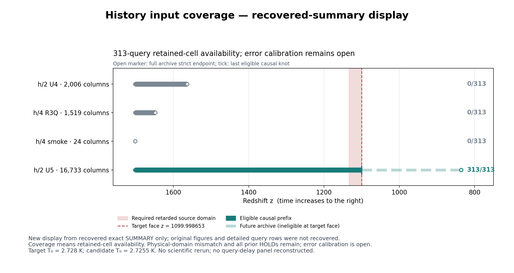

# REC-HISTORY-ADM01 — 실제 history 입력 admission

## 현재 결론과 전달 한계

**실제 입력의 source·시간 인덱스·저장 구간을 판정하는 유한 작업을 완료했다. h/2 U5는 고정 LINE02의313 query 모두에 실제 interpolation cell을 제공한다. 그러나 target과 물리 파라미터가 다르고 같은 도메인의 오차 보증이 없어, physical reference 및 H5 시간보간 오차 calibration은 admission하지 않는다.**

ADM01의 유한 판정은 `COMPLETE_SCOPED_INPUT_ADMISSION`, `physical_reference_admitted=false`, H5 `INPUT_DEPENDENT_UNCALIBRATED`, 부모 REC-HISTORY `PARTIAL`이다. Actual/finer 데이터가 없다는 주장이나 물리적 no-go가 아니다.

**전달 보존 상태는 `PARTIAL_AFTER_WORKSPACE_RESET`이다.** 최초 primary와 독립 review 완료 뒤 실행 환경이 재연결되며 로컬 작업 폴더가 비어 있는 것이 관측됐다. Dropbox StageA의45 source/contract 파일은 원 archive SHA256와 CRC를 확인해 복원했다. Primary [SUMMARY.json](results/primary001/SUMMARY.json)은 도구 기록에서 복원하여 원 SHA256 `6b21a45bb6c3ba2b2460c284e87ac224872226a0bb2aaa46ee4c948d05f8f84e`와 정확히 일치함을 확인했다. 독립 review와3 probe의 원문도 남은 기록에서 복원했다.

반면 **1,252개 primary 상세 row,313-query 원 테이블, 원 checks 파일·controller receipt 파일, 최초·수정 PNG/PDF는 복구하지 못했다.** 원 실행 관측과 검토 문서에 기록된 수치는 보존하지만 원 상세 파일까지 보존됐다고 주장하지 않는다. 검증 반복 금지에 따라 primary/probe를 재실행하지 않았다. 현재 coverage 그림은 정확히 복원된 SUMMARY를 표시한 새 전달물이다. 원 PNG의 byte 복구본이 아니다. 이 구분은 [RECOVERY_STATUS.json](delivery/RECOVERY_STATUS.json)과 [review 복구 기록](evidence/independent_review/RECOVERY_RECORD.md)에 남겼다.

## 1. source와 기존 결과 재사용

시작 source parent는 `a7c46fd8338971e2cefa776f5dd7b25a46974990`이며 고정 중앙 handoff는 `rei_bianchi@0f9d9df825be1dac9ca9bdf73cdc2e8908bcba17`이다. 원 HISTORY01의 현재 게시를 확인했다: `research/rec-history-boundary-20261023`, commit `93e1bdc8298db9a7c16f77d4bf64985a0c3f25aa`, draft [PR130](https://github.com/cosmosapjw-quantum/rec_bianchi/pull/130). 과거18:49 publication interruption 기록은 당시 기록 그대로 보존한다.

HISTORY01의608 primary+14 independent checks, LINE02의194 checks·202 rank queries·과거6 review probes는 재사용했고 이번 재실행은0이다. LINE02 원 final receipt SHA256 `140ce4227c907c2f4ae9c21989f98b9a5e6992082fb0307c8ff9dbaa51a1a0ad`를 발견·확인했다. 이 복구의 원 보고는 [BACKUP_INTAKE_REPORT.json](provenance/BACKUP_INTAKE_REPORT.json)이다.

원 HISTORY01 built-in1.0.0 실행은 그대로 보존했다. 이번에는 이용 가능한 PhysMath skill1.3.0의 selected-stage 규칙으로 R1/R2 intake와 필요한 유한 지원·한차례 독립 검토를 수행했다. 새 R1–R10/C1–C10 전체 주기를 실행했다고 기록하지 않는다. 별도 REC-HISTORY-02 characteristic/Wien-reference StageA의 구현·예산·owner도 인수하거나 완료로 승격하지 않았다.

## 2. 고정 query와 실제 후보의 coverage

대상은 원 CSV의 **z=1099.9986525171403**, eta=-7.003972912850124 face다. Native source-owned scalar FLRW routing은

\[
1+z_s=(1+z_t)E_s/E_t,\qquad \eta_s=-\ln(1+z_s)
\]

를 쓴다.311 virtual incoming과 Ly-alpha·Ly-beta incoming을 합친313 query가 요구하는 source 구간은 **1100.092189396162 <= z_s <= 1133.87330719964**다. 후보를 통과시키려고 target face를 더 이른 epoch로 변경하지 않았다.

| 실제 후보 | outgoing 열 | 저장된 첫 z → 마지막 z | 해당 query coverage |
|---|---:|---:|---:|
| h/2 U4 | 2,006 | 1702.072263548342 → 1563.1172132810023 | 0/313 |
| h/4 R3Q event | 1,519 | 1702.072263548342 → 1648.0746029265927 | 0/313 |
| h/4 smoke | 24 | 1702.072263548342 → 1701.2410691467553 | 0/313 |
| h/2 U5 | 16,733 | 1702.072263548342 → 836.0767081706681 | **313/313** |

U5 전체 archive 중 target face 이전인 **10,277열**만 causal prefix로 사용했다. 두 보간 endpoint가 이 prefix에 모두 들어오는 cell에만 값을 계산했다. 최초 실행의 기록상 필요한 U5 global bracket 범위는46008..46720, local bracket 범위는9562..10274다. 미래 archive를 target의 입력으로 사용하지 않았다.

앞의 세 후보는 실제 데이터가 존재하지만 이 query까지 이어지지 않는다. h2 U4/h4가 공유하는 고정 query는0개다. 따라서 cross-grid discrepancy를 생성하지 않았다. 더 이른 공통 구간의 비교는 별도 질문이며 현재 target의 H5를 닫지 않는다.

Coverage는 retained cell의 존재를 나타낸다. 물리 오차 upper bound를 뜻하지 않는다. 새 그림은 복구된 SUMMARY로 만든 표시이며 수치 primary 재실행을 포함하지 않는다.

## 3. source·frame·photon clock

실제 producer에서 복원한 clock은

\[
z(g)=8001e^{-gh}-1,\qquad \eta(g)=-\ln8001+gh,\qquad j=g-g_0.
\]

h/2는 h=4.245e-5,g0=36446; h/4는 h=2.1225e-5,g0=72892다. 공통 eta0=-7.440189112850124다. Photon column은 **input state g**에서 평가한 outgoing이고 accepted thermodynamic state는 g+1이다. 마지막 accepted state를 아직 저장되지 않은 outgoing column으로 취급하지 않았다.

| 후보 | 마지막 photon global index | 마지막 accepted state index |
|---|---:|---:|
| h2 U4 | 38451 | 38452 |
| h4 event | 74410 | 74411 |
| h4 smoke | 72915 | 72916 |
| h2 U5 | 53178 | 53179 |

Native `interp_Dfnu`의 실제 query domain은

\[
\eta_0\le\eta_s<\eta_0+(N-1)h
\]

이며 마지막 저장 knot가 strict exclusive다. 이에 target 이전 causal prefix를 교차 적용했다. Retained prefix 이전 입력을 근거 없이0 또는 thermal 값으로 채우지 않았다.

Outgoing은311 virtual + Ly-alpha/Ly-beta/Ly-gamma의314개다. Virtual destination139,270,310은 각각 outgoing Ly-alpha/Ly-beta/Ly-gamma에서 온다. Incoming line311,312는 virtual140,271에서 온다. 나머지는 next-energy routing이다. `average_virtual`은 in-bin average라 outgoing history 대신 사용하지 않았다. Normal-frame scalar FLRW, source의 signed departure·reference occupation을 유지했다. Legacy shear_q=0와 local expansion ratio q=1은 서로 다른 변수다.

LINE02와 R3s의 `hydrogen.c`는 whole-byte 동일하다: SHA256 `421ad4678a9a2f00d54f72ebb841648f34a95a9892171c07af5f657a3b2a051b`. 실제 `two_photon_tables.dat`의311 energy는 target CSV와 binary64 값이 일치했다. May2012 주석과 October2012 archive 명칭의 차이를 source mismatch로 사용하지 않았다. [source mapping](provenance/source_mapper/SOURCE_MAPPING.md), [identity 목록](provenance/source_mapper/SOURCE_IDENTITIES.json), 원 source 파일은 StageA에서 정확히 복구됐다.

## 4. 실제 물리 parameter mismatch

Target CSV가 저장한 source-emitted TR,nH,fsR,meR에서 native 식으로

\[
T_0=\frac{T_{R,\mathrm{eV,rescaled}}f_{sR}^2m_{eR}}{k_{B,\mathrm{native}}(1+z)},\qquad
n_{H0}=\frac{10^6n_{H,\mathrm{cm}^{-3}}}{(1+z)^3}
\]

를 복원했다.

| 물리량 | 고정 target | 실제 candidate producer | 상대 차이 |
|---|---:|---:|---:|
| T0 [K] | 2.728 | 2.7255 | -0.0916422287% |
| nH0 [m^-3] | 0.18745798773143102 | 0.18971712352134673 | +1.2051424521% |
| omega_b h^2 | canonical fixture0.021976 | 0.0224 | 입력 불일치 |
| YHe | canonical fixture0.24 | 0.2454 | 입력 불일치 |

Target의 T0/nH0는 CSV에서 직접 확인된다. 나머지 canonical tuple은 fixture 값이며, 두 직접 관측량만으로 target의 전체 cosmology를 역추정했다고 주장하지 않는다.

Candidate full tuple은 actual caller·source factory·원 execution manifest·NPZ에 연결했다. U5 manifest SHA256 `b5c7c856f7517da4ebc8edae91d287333abf072eb9c8064aef202089bf58e7f2`가 원 verification의 capsule_source_closure와 일치한다. Manifest의 caller SHA와 cosmology source SHA도 실제 파일과 일치한다. Caller가 default cosmology를 생성하고 source factory 및 U5 integrator에 넘겨 해당 NPZ를 저장하는 경로를 읽었다. [원 manifest](provenance/u5_execution_binding/SOURCE_MANIFEST_V3.json), [actual caller](provenance/u5_execution_binding/verify_r3i_h2_u5_thermal.py), [독립 review F1 closure](evidence/independent_review/FINAL_REVIEW.md)에 근거가 있다. 이 두 추가 source 파일도 Git blob identity를 확인하며 정확히 복원했다.

독립 probe는 actual thermal event g53177의 Tm=2280.4085186856096K,z=836.1122428311476,delta=0.0005000545426558922에서

\[
T_0=\frac{T_m}{(1+z)(1-\delta)}=2.7255\ \mathrm K
\]

를 복원했다. 따라서 U5의 실제 온도 불일치는 default 추론에만 의존하지 않는다. [PROBE_RESULTS.json](evidence/independent_review/PROBE_RESULTS.json)은 당시 전체 도구 출력에서 내용 복원했다. 원 SHA가 남지 않아 해당 JSON의 원 byte 일치는 별도로 인증하지 않는다.

## 5. 아직 admission할 수 없는 오차

HISTORY01의 조건부 선형보간 식은

\[
e_u\le\frac{M_2h^2}{2}\alpha(1-\alpha)+(1-\alpha)e_L+\alpha e_R+e_{\rm arithmetic}
\]

다. M2는 같은 물리 문제·같은 departure 기준에 속하는 exact function의 실제 cell 내부 second-eta-derivative 상한이다. eL/eR도 같은 문제의 endpoint uncertainty여야 한다. 현재 입력에는 이 target cell의 정당화된 M2, endpoint uncertainty, independent reference uncertainty가 없다. 모두 `null`로 보존했다.

Same-h Python/native parity는 같은 이산화의 구현 비교이며, lossless storage equivalence는 저장 복원 비교다. 두 검사가 시간보간 오차를 certify하지 않는다. h2/h4 discrepancy도 reference 자체의 uncertainty나 정당화된 수렴 가정 없이 upper bound가 되지 않는다. 이번 고정 query에서는 U4/h4 overlap 자체가 없었다.

다음 실제 입력은 [NEXT_INPUT_CONTRACT.md](NEXT_INPUT_CONTRACT.md)에 명시했다. Matching-parameter history와 실제 source 구간의 independent reference/endpoint error 또는 정당화된 curvature bound가 필요하다. 별도 HISTORY02의 geodesic·direction·frame owner와 full thermodynamic Jacobian은 이번 scalar FLRW intake에서 닫지 않았다.

## 6. 실행과 한 차례 독립 검토

Primary는 한 번 실행했고386 checks가 통과했다. 이 수는 assertion 수이며386개의 독립 물리 model을 뜻하지 않는다. 당시4후보×313query의1,252rows를 기록했고, fresh-context reviewer가 이를 읽어 집계했다. Reviewer는 전체313-query primary를 반복하지 않고 선택된 U5 cell3개만 독립 재구성하는 등3 finite probes를 실행했다.

검토 중 actual U5 full tuple attribution, 그림 제목 겹침, U5 causal/future 표시의 세 지적을 같은 pass 안에서 닫았다. 당시 open finding0, scoped 결과의 material blocker0이었다. 환경 reset 이후에도 이 완료된 검토를 다시 실행하지 않았다. 새 전달의 상세 원자료 보존 한계는 별도 상태로 기록한다.

| 최초 완료 실행 | 관측 CPU [s] | 관측 execution wall [s] |
|---|---:|---:|
| primary001 | 0.575633290 | 0.616726234 |
| review001,3probes | 0.353870078 | 0.366098797 |
| figure001 | 1.770931510 | 1.819723548 |
| figure002, 같은 review의 표시 수정 | 1.539222720 | 1.569305728 |
| reset 전 누적 | **4.239657598** | **4.371854307** |

위 수치는 당시 controller tool 관측 및 독립 review에서 복원한 것이다. 원 controller 파일이 현재 살아 있다고 주장하지 않는다. 새 coverage 표시의 figure003만 별도의 실제 receipt로 추가하고, 누적 budget은 [BUDGET_LEDGER.json](BUDGET_LEDGER.json)에 반영한다. Cap20CPU/60wall,1thread,1GiB address space는 그대로다. reset 전 최대 RSS107564KiB였다. CPU/AS rlimit과 single-child wall timeout을 적용했고 종료 후 inclusive getrusage를 읽었다. Live aggregate telemetry를 수행했다고 주장하지 않는다.

HISTORY01의 이전 CPU4.848191s/wall4.736567968s는 닫힌 별도 배정으로 보존한다. New IVP0,native runtime0,dense solve0,old campaign/old boundary replay0이다. 다운로드·문서·게시·metadata I/O는 scientific execution과 구별한다. Reset과 복구를 예산·실패 초기화의 근거로 쓰지 않았다.

## 7. 보존 상태와 게시

Physical HOLD; REC_U5 HOLD_9_FAIL/HOLD_8_FAIL; CLOSED_HOLD_NOT_RESET;
global_convergence NOT_RUN; production NOT_APPROVED; REI_activation=false;
첫 실패 REI raw HISTORICAL_LOCAL_ONLY를 유지한다. 원 U5 verification FAIL도
[원 receipt](provenance/U5_ORIGINAL_VERIFICATION.json)에서 그대로 보존한다.

중앙은 기존40nodes/17edges, 모든 원 authority/contract/dependency, 고정handoff,
HE-X1 및 다른38nodes를 보존하는 REC-LINE02/REC-HISTORY wrapper observation만
준비·독립 검토했다. Whole assembler/renderer 재실행은0이다. 이 전달에는 원자료
부분 복구 상태도 추가한다. Merge와 activation은 수행하지 않는다.

REC evidence `5f9abb0a7e97ecfb19ad2f5b4a25d5fc3d2da527`는 draft PR131, 중앙 observation `44d0a6d8703f50bf3d7548812a1ab13d9b2c3877`는 draft PR223에 실제 게시됐고 readback을 마쳤다. 중앙은 최신 base `8b6e741ceb305cb0a6fde244ee002eb5926559fe`의 CR-N4·HE-ANG·HE-X1도 그대로 보존한다. 최종 실제 Git/provider 기록은 `delivery/PUBLICATION_STATE.json`과 companion receipt가 기준이다.

최종 ZIP은613,327bytes, SHA256 `199d28152b5e6065bc6c11e685705e4a59e43b5101ed955be6216b5a13b611f4`다. Dropbox `id:BSpOijBcT10AAAAAAD_6xg`에서 completed ACK와 현재 metadata, 단일 GET의 whole-byte·CRC·payload84/84 검증을 마쳤다. 최종 Drive 요청은 응답 전에 중단됐고 ACK/ID를 받지 못했다. 마지막 이름+folder 검색도 비어 있었다. Drive 성공이나 이중 provider 백업 완료로 표시하지 않는다. StageA Drive의 별도 과거 중단 기록도 그대로 남긴다.

이 ZIP은 provider ACK 전 봉인한 불변 묶음이다. 이후의 receipt-only Git commit과 provider IDs는 별도 companion receipt에 추가하며 원 ZIP을 바꾸지 않는다. 상세 원자료 보존 상태는 계속 `PARTIAL_AFTER_WORKSPACE_RESET`이다.
