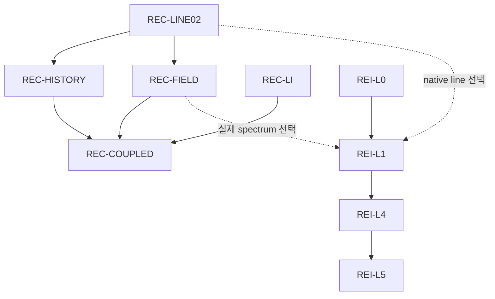

# 전체 목표 DAG 진척의 원문 기준 — a28ba 중앙 snapshot

## 1. 기준과 판정 단위

이 문서는 중앙 `rei_bianchi@a28ba343bb85addf1a7e9e58e75816ed3b75cd3b`의 `research/orchestration_longterm_20261023/assembly/DAG.json`을 읽고 작성한 해석이다. HEAD를 지금 새로 조회한 문서는 아니다. 해당 HEAD는 앞선 종료 재조회에서 확인했고, publication 직전의 실제 최신 HEAD 확인은 root가 별도로 수행한다. S0 조사에 고정된14976의 후속 delta인 a28ba를 별도 provenance로 유지한다. [S1, S4]

- 원래40개 contracts,17개 integration edges,7개 authority documents와 node ID/order를 보존한다. root `as_of=2026-10-23`은 보존된 계약 날짜이며 최신 관측 날짜로 다시 쓰지 않았다.
- `plan_status`는 중앙 plan 필드다. `contract.status`는 원 authority 계약의 동결된 표현이며, `observed_completion`/`observed_progress`는 별도 공급자 관측이다. 세 필드를 하나의 완료 판정으로 합치지 않는다.
- 실제 파일 전달·backup·draft PR·CI·consumer admission·physical admission은 서로 다른 사실이다. 이 표의 status 하나로 전부 완료되었다고 해석하지 않는다.
- 전체 물리 목표 완료율은 **산정하지 않는다(null / not established)**. 조건부 모델 선택, 미동결 observable·uncertainty·budget, 중앙 관측 누락이 있으므로 node 개수 비율은 전체 연구 완성도가 아니다. REI-L5의 contract도 명명한 observable/domain과 별도 physical/numerical uncertainty를 요구한다. [S1: nodes39]

## 2. 정확한 plan_status 집계

| plan_status | Node 수 | 해당 범위 |
|---|---:|---|
| `PROPOSED` |34| 아래 원순서 표에서 확인 |
| `COMPLETE_SCOPED` |2| `CR_N4_C23B_CUTOFF_BINDING`, `HE-X1` |
| `PARTIAL` |2| `CR_N4_STOPPING_KERNEL`, `CR_N5_ATOMIC_ISOTOPE_COVERAGE` |
| `OWNER_DELIVERY_PENDING` |1| `REC-LINE02`의 보존된 중앙 plan field |
| `SOURCE_INPUT_PENDING` |1| `HE-ANG` |
| **합계** |**40**| 개수 집계이며 physical completion 비율이 아님 |

| 저장소 | 노드 수 | plan_status 분포 |
|---|---:|---|
| WU088_HH | 6 | PROPOSED 6 |
| bass_cr | 6 | COMPLETE_SCOPED 1, PARTIAL 2, PROPOSED 3 |
| rec_bianchi | 6 | OWNER_DELIVERY_PENDING 1, PROPOSED 5 |
| BASS_HE | 6 | COMPLETE_SCOPED 1, SOURCE_INPUT_PENDING 1, PROPOSED 4 |
| bass | 5 | PROPOSED 5 |
| vigilode | 5 | PROPOSED 5 |
| rei_bianchi | 6 | PROPOSED 6 |

## 3. 40개 node — 기존 JSON 배열 순서

**아래 행 순서는 원 DAG의 `nodes` 배열 순서다.** 저장소별 묶음 순서를 보존했으며 전역 topological order라고 부르지 않는다. 예를 들어 conditional integration edge `REC-LINE02`(13행) → `WU_SPECTRAL_GEOMETRY_COUPLING`(6행)는 이 배열에서 역방향이다. 마지막 열의 층은 4절에 명시한 conditional-union 해석의 별도 계산이다.

`—`는 현재a28ba node에 그 부가관측 field가 없다는 뜻이다. 실제 다른 branch의 연구 미실행 또는 과학 실패를 뜻하지 않는다. 특히 REC 관측은 별도 donor PR227에 있으며5절에서 구별한다. 관측 status는 최상위 값 그대로이고 child 완료가 parent 전체 완료를 뜻하지 않는다. [S1, S2]

| 원순서 | Node ID / 역할 | plan_status | 현재 node의 부가관측 status | local_dependencies (원순서 행번호) | 도출 층 |
|---:|---|---|---|---|---:|
| 1 | `WU_CE83_OWNER_COMPLETION` — H I CE83 공급자 완료 결과 재사용 | `PROPOSED` | `observed_completion`: `REUSED_COMPLETE_SCOPED` | — | 1 |
| 2 | `WU_LI_SOURCE_UNCERTAINTY` — Li 원자료 불확도 | `PROPOSED` | — | — | 1 |
| 3 | `WU_HE_LI_CX_STATE_ENERGY` — He/Li CX 상태별 사건 에너지 | `PROPOSED` | — | — | 1 |
| 4 | `WU_D_PI_RR_MATCHED` — D PI/RR 일치한 수·에너지 모멘트 | `PROPOSED` | — | — | 1 |
| 5 | `WU_NUCLEAR_PARTICLE_OWNERSHIP` — 핵반응 생성물·입자 소유권 | `PROPOSED` | `observed_completion`: `PARTIAL_CONDITIONAL_BARE_CHILD_COMPLETE` | — | 1 |
| 6 | `WU_SPECTRAL_GEOMETRY_COUPLING` — 원자·스펙트럼·기하 결합 | `PROPOSED` | — | 1: `WU_CE83_OWNER_COMPLETION`, 3: `WU_HE_LI_CX_STATE_ENERGY`, 4: `WU_D_PI_RR_MATCHED`, 5: `WU_NUCLEAR_PARTICLE_OWNERSHIP` | 2 |
| 7 | `CR_N4_C23B_CUTOFF_BINDING` — C23B source와 cutoff 연결 | `COMPLETE_SCOPED` | `observed_completion`: `COMPLETE_SCOPED` | — | 1 |
| 8 | `CR_N4_STOPPING_KERNEL` — 물리적 저에너지 stopping kernel | `PARTIAL` | `observed_progress`: `PARTIAL` | 7: `CR_N4_C23B_CUTOFF_BINDING` | 2 |
| 9 | `CR_N5_ATOMIC_ISOTOPE_COVERAGE` — 원자·동위원소 공급 범위 | `PARTIAL` | `observed_progress`: `COMPLETE_SCOPED` | — | 1 |
| 10 | `CR_N6_CONSERVATIVE_COUPLING` — 보존적 열화학 결합 | `PROPOSED` | — | 8: `CR_N4_STOPPING_KERNEL`, 9: `CR_N5_ATOMIC_ISOTOPE_COVERAGE` | 3 |
| 11 | `CR_N7_NEW_PARCEL` — 새 입력 parcel/control | `PROPOSED` | — | 10: `CR_N6_CONSERVATIVE_COUPLING` | 4 |
| 12 | `CR_BETA_FULL_OWNER` — beta spectrum·생성물 owner | `PROPOSED` | — | — | 1 |
| 13 | `REC-LINE02` — 완료된 native line owner 재사용 | `OWNER_DELIVERY_PENDING` | — | — | 1 |
| 14 | `REC-HISTORY` — 실제 outgoing/incoming history | `PROPOSED` | — | 13: `REC-LINE02` | 2 |
| 15 | `REC-C3` — 동일 상태 primitive 공유 | `PROPOSED` | — | — | 1 |
| 16 | `REC-LI` — source-resolved Li yields | `PROPOSED` | — | — | 1 |
| 17 | `REC-FIELD` — 실제 spectrum·thermal ledger | `PROPOSED` | — | 13: `REC-LINE02` | 2 |
| 18 | `REC-COUPLED` — 선택한 물리계의 self-consistent control | `PROPOSED` | — | 16: `REC-LI`, 17: `REC-FIELD`, 14: `REC-HISTORY` | 3 |
| 19 | `HE-X1` — 출사 angular moment-cone | `COMPLETE_SCOPED` | `observed_completion`: `COMPLETE_SCOPED` | — | 1 |
| 20 | `HE-ANG` — source-qualified H1 각분포 | `SOURCE_INPUT_PENDING` | `observed_completion`: `SOURCE_INPUT_PENDING` | 19: `HE-X1` | 2 |
| 21 | `HE-EXCHANGE` — 유한질량 종별 elastic exchange | `PROPOSED` | — | — | 1 |
| 22 | `HE-RESERVOIR` — thermal/UV reservoir | `PROPOSED` | — | — | 1 |
| 23 | `HE-CLOSURE` — 종별→전체 gas closure | `PROPOSED` | — | 20: `HE-ANG`, 21: `HE-EXCHANGE`, 22: `HE-RESERVOIR` | 3 |
| 24 | `HE-FEEDBACK` — gas→metric feedback | `PROPOSED` | — | 23: `HE-CLOSURE` | 4 |
| 25 | `B1-G1B-recover` — source-qualified continuum 복구 | `PROPOSED` | — | — | 1 |
| 26 | `B2-G1B-curved` — 선택 curved-domain 유한창 수렴 | `PROPOSED` | — | 25: `B1-G1B-recover` | 2 |
| 27 | `B3-fourforce-owner` — four-force·source owner | `PROPOSED` | — | 26: `B2-G1B-curved` | 3 |
| 28 | `B4-production-restart` — 고정 scale의 restart client | `PROPOSED` | — | 27: `B3-fourforce-owner` | 4 |
| 29 | `B5-domain-validation` — 명시한 물리·수치 domain admission | `PROPOSED` | — | 26: `B2-G1B-curved`, 27: `B3-fourforce-owner`, 28: `B4-production-restart` | 5 |
| 30 | `V1-affine-native` — native adaptive physical norm | `PROPOSED` | — | — | 1 |
| 31 | `V2-session-fatal` — transactional restart/session | `PROPOSED` | — | — | 1 |
| 32 | `V3-affine-quotient` — 정확한 affine/harmonic subflow | `PROPOSED` | — | — | 1 |
| 33 | `V4-causal-polynomial` — causal polynomial action | `PROPOSED` | — | — | 1 |
| 34 | `V5-sphere-production` — 물리적 spherical transport | `PROPOSED` | — | 30: `V1-affine-native`, 31: `V2-session-fatal`, 33: `V4-causal-polynomial` | 2 |
| 35 | `REI-L0` — source exchange·signed stress | `PROPOSED` | — | — | 2 |
| 36 | `REI-L1` — 선택한 gas/radiation provider pair | `PROPOSED` | — | 35: `REI-L0` | 3 |
| 37 | `REI-L2` — 선택적 n/T beta 채널 | `PROPOSED` | — | — | 2 |
| 38 | `REI-L3` — 선택적 비등방 baryon pressure | `PROPOSED` | — | — | 3 |
| 39 | `REI-L4` — 닫힌 gas+radiation+geometry pilot | `PROPOSED` | — | 35: `REI-L0`, 36: `REI-L1` | 4 |
| 40 | `REI-L5` — 명명한 observable의 물리적 admission | `PROPOSED` | — | 39: `REI-L4` | 5 |

현재 부가관측이 실제 들어 있는 node는7개다. WU CE83는 plan PROPOSED여도 관측은 REUSED_COMPLETE_SCOPED이다. CR N5는 plan PARTIAL이고 observed_progress.status는 COMPLETE_SCOPED인 child 기록이다. 이 차이는 개별 evidence의 범위를 보존하는 표현이며 한 필드에 맞춰 다른 값을 수정할 근거가 아니다. BASS/Vigil의 최신 branch 결과가 이40node의 부가관측으로 모두 반영되었다고 주장하지 않는다. [S1; 별도 SURVEY_GITHUB_KO.md]

## 4. 명시적으로 도출한 의존 순서

원 assembler/renderer를 실행하지 않았다. 읽은 JSON에서 다음 internal edges만 추출해 Kahn 방식의 선행층을 계산했다.

1. 각 node의 `local_dependencies`:31개.
2. `integration.edges`:17개. 각 edge의 원래 조건을 유지한다.
3. internal `conditional_dependencies`:2개, `REI-L2 → REI-L4` 및 `REI-L3 → REI-L4`.

합계50개의 서로 다른 internal directed edges이며 cycle은 없다. 이것은 **가능한 조건부 연결을 모두 포함한 설명용 union graph**다. 모든 물리 채널이나 모든 solver를 동시에 요구하는 실행계획이 아니다. external dependency placeholders는40개 node 밖의 입력 의무로 남겨두며, 아래19개 첫 층 node를 모두 즉시 실행 가능한 상태로 판정하지 않는다. [S1: integration.dependency_interpretation]

| 도출 층 | Node 수 | 해당 node(원순서 유지) |
|---:|---:|---|
| 1 | 19 | `WU_CE83_OWNER_COMPLETION`, `WU_LI_SOURCE_UNCERTAINTY`, `WU_HE_LI_CX_STATE_ENERGY`, `WU_D_PI_RR_MATCHED`, `WU_NUCLEAR_PARTICLE_OWNERSHIP`, `CR_N4_C23B_CUTOFF_BINDING`, `CR_N5_ATOMIC_ISOTOPE_COVERAGE`, `CR_BETA_FULL_OWNER`, `REC-LINE02`, `REC-C3`, `REC-LI`, `HE-X1`, `HE-EXCHANGE`, `HE-RESERVOIR`, `B1-G1B-recover`, `V1-affine-native`, `V2-session-fatal`, `V3-affine-quotient`, `V4-causal-polynomial` |
| 2 | 9 | `WU_SPECTRAL_GEOMETRY_COUPLING`, `CR_N4_STOPPING_KERNEL`, `REC-HISTORY`, `REC-FIELD`, `HE-ANG`, `B2-G1B-curved`, `V5-sphere-production`, `REI-L0`, `REI-L2` |
| 3 | 6 | `CR_N6_CONSERVATIVE_COUPLING`, `REC-COUPLED`, `HE-CLOSURE`, `B3-fourforce-owner`, `REI-L1`, `REI-L3` |
| 4 | 4 | `CR_N7_NEW_PARCEL`, `HE-FEEDBACK`, `B4-production-restart`, `REI-L4` |
| 5 | 2 | `B5-domain-validation`, `REI-L5` |

이 층에는 실행시간·남은 budget이 없다. 따라서 소요시간을 최소화하는 scheduling critical path는 계산할 수 없다. 아래 REC 경로는 **선행 의무의 경로**이며 시간 예측이 아니다.

중앙 계약의 선택 규칙은 다음과 같다. 요구사항은 선택한 모델 안에서 AND이고, 모든 공급자·수치 옵션 전체에 대한 AND가 아니다. REI-L1은 실제 활성화한 channel의 provider pair를 선택해 결속한다. REI-L4는 L0 + 선택한 완료 L1 pair + 호환되는 검증 geometry/solver를 필요로 하며, L2/L3 등 확장은 선택한 물리에 따라 추가된다. [S1: integration.dependency_interpretation]

### 17개 중앙 integration edges의 실제 조건

| 번호 | From → To | 원 조건 |
|---:|---|---|
| 1 | `HE-X1` → `REI-L0` | using angular-moment injection |
| 2 | `HE-ANG` → `REI-L3` | selecting anisotropic baryonic scattering transport |
| 3 | `HE-EXCHANGE` → `REI-L3` | selecting finite-mass baryonic pressure exchange |
| 4 | `HE-CLOSURE` → `REI-L4` | selecting nonzero baryonic anisotropic stress |
| 5 | `CR_N4_STOPPING_KERNEL` → `REI-L1` | claiming thermalization of supplied fast photoelectrons |
| 6 | `CR_N6_CONSERVATIVE_COUPLING` → `REI-L4` | selecting CR coupled radiation/deposition pathway |
| 7 | `WU_D_PI_RR_MATCHED` → `REI-L1` | claiming isotope-specific D PI/RR number and energy moments |
| 8 | `WU_NUCLEAR_PARTICLE_OWNERSHIP` → `REI-L2` | activating nuclear daughters/fast products |
| 9 | `CR_BETA_FULL_OWNER` → `REI-L2` | activating source-qualified beta partition and stopping |
| 10 | `REC-LINE02` → `REI-L1` | selecting native line source |
| 11 | `REC-LINE02` → `WU_SPECTRAL_GEOMETRY_COUPLING` | selecting native line in WU spectral coupling |
| 12 | `REC-FIELD` → `REI-L1` | selecting actual spectral radiation/Compton exchange |
| 13 | `B3-fourforce-owner` → `REI-L4` | selecting BASS four-force geometry feedback adapter |
| 14 | `B2-G1B-curved` → `REI-L5` | claiming curved Bianchi smooth-source domain |
| 15 | `V1-affine-native` → `REI-L4` | using native reduced30/full33 affine adaptive client |
| 16 | `V2-session-fatal` → `REI-L4` | using switching/restart driver |
| 17 | `V5-sphere-production` → `REI-L5` | claiming its physical spherical transport scheme |

## 5. REC의 실제 선행 의무와 중앙 관측 차이

현재a28ba의 REC-HISTORY plan은 PROPOSED이고 contract.status는 selected_next_not_run이다. 그러나 별도 중앙 PR227(`2cc58d209e149847e7d8545d26ef7bcc944229fa`)의 실제 observation dictionary에는 다음6개 완료된 유한 연구 단위가 있다. a28ba에 observations key가 없다는 이유로 이 과거 완료를 되돌리면 안 된다. [S2]

| 관측 child | 보존된 scoped status |
|---|---|
| HISTORY01 | `COMPLETE_SCOPED_BOUNDARY` |
| ADM01 | `COMPLETE_SCOPED_INPUT_ADMISSION` |
| HISTORY02R | `COMPLETE_SCOPED_CHARACTERISTIC_ADAPTER` |
| REFINE01 | `COMPLETE_SCOPED_STORED_HISTORY_ENVELOPE` |
| RESP01 | `COMPLETE_SCOPED_RESPONSE` |
| THERMO01 | `COMPLETE_SCOPED_THERMODYNAMIC_BLOCK` |

REC-HISTORY parent는 PARTIAL이다. HISTORY02의 RESERVED/OBSERVED_ONLY, 기존 실행 ledger, physical holds도 독립적으로 보존된다. THERMO01의 중앙 observation은 immutable S2 science18/20 시점이며, 사용자 handoff 및 별도 실제 최종 전달 receipt의20/20과 구별한다. 이 보고서에서는 진행 중인 KS01의 승인 전 과학 결과나 전달 완료를 추가하지 않는다. [S2; 사용자가 제공한 REC-HISTORY-THERMO01 재개 handoff]

### 실제 node 연결

실선은 현재 local_dependencies이고 점선은 현재 conditional integration edges10/12다. REI-L4의 추가 geometry/solver 및 선택적 물리 의무는 위17edge 표와 외부 입력에 남아 있다. REC-LINE02 → WU_SPECTRAL_GEOMETRY_COUPLING(edge11)도 native line을 선택할 때 필요한 별도 consumer 경로다.

**현재 graph에는 REC-HISTORY → REC-FIELD, REC-HISTORY → REI-L1, REC-COUPLED → REI-L4의 명시적 edge가 없다.** REC-HISTORY contract의 pass_action에는 FIELD/coupled dependency contract로 admission한다는 문장이 있지만, 이를 자동으로 새 DAG edge가 이미 존재한다고 표현하지 않는다. 이후 실제 consumer가 history-dependent model을 선택하면 그 binding을 별도로 명시해야 한다. [S1: nodes13, integration.edges]

### H5·H6·H7은 어디에 대응하는가

중앙40node/17integrationedge 안에 H5/H6/H7이라는 별도 node나 edge는 없다. 이들은 **REC-HISTORY 내부 admission obligations**이며, 아래 연결은 원 contract 및 THERMO01 observation을 대조한 의미적 대응이다. 원 DAG의17edge 수를 증가시키지 않는다. [S1: REC-HISTORY/REC-FIELD/REC-COUPLED contracts; S2: REC-HISTORY.observations.THERMO01]

| 의무 | 실제 현재 상태·입력 | 대응하는 원 DAG 관계 | 넘을 수 없는 판정 경계 |
|---|---|---|---|
| H5 history physical uncertainty | INPUT_DEPENDENT_UNCALIBRATED. Original/finer payload 존재. physical epsilon/reference/endpoint/validated curvature/absolute bound 모두 null. | REC-HISTORY contract의 interpolation-error allocation과 calibration gate; **REC-HISTORY → REC-COUPLED** local edge. REC-FIELD의 source/model interpolation calibration도 소비자 조건. | stored envelope, same-h parity, 다른 cosmology finer history 또는 payload identity만으로 physical time-interpolation bound를 확정하지 않는다. |
| H6 actual incident trace와 geodesic/frame/measure owner | 실제 incident trace binding과 geodesic/direction/frame/measure owner가 OPEN. actual source/volume/clock/query owner를 함께 결속해야 함. | **REC-LINE02 → REC-HISTORY → REC-COUPLED**의 source/boundary ownership 의무. BASS→REC-HISTORY의 명시적 cross edge는 현재17edge에 없음. | BASS angular child나 conditional model 결과를 actual REC incident trace로 자동 대체하지 않는다. 병렬 H6 retiming checkpoint의 판정은 해당 owner evidence에서 별도로 받아야 한다. |
| H7 coupled Jacobian | THERMO01 local primitive6column block COMPLETE_SCOPED. history pullback/retiming/geometry/thermal-ODE는 OPEN. Stable J_s와 같은 source/arithmetic K_s 결속은 THERMO01 시점 OPEN. | REC-HISTORY의 실제 history map differentiation; **REC-HISTORY → REC-COUPLED**, **REC-FIELD → REC-COUPLED** local gates. | 기존 RESP01 K0 norm certificate를 stable K_s로 자동 전용하지 않는다. 진행 중 KS01의 accepted result가 도착해야 그 scoped child만 갱신할 수 있다. |

원 history actual-payload admission은 H5의 identity/domain 부분을 개선하고, same stable K_s + operator norm은 H7의 표현 일치 및 incoming-response 부분을 개선하는 다음 유한 단계다. 둘 다 자체로 H6 actual incident trace, H5 physical epsilon, full coupled thermal/geometry ODE 또는 global physical completion을 완료시키지 않는다. 이 문장은 작업 범위의 의존관계 분석이며 KS01 실행 결과 판정이 아니다.

### 유지되는 상위 판정

Physical HOLD; REC_U5 HOLD_9_FAIL/HOLD_8_FAIL; CLOSED_HOLD_NOT_RESET; global_convergence NOT_RUN; production NOT_APPROVED; REI_activation=false; 최초 실패 REI raw HISTORICAL_LOCAL_ONLY. 단위별 scoped PASS, 단계별 actual backup/publication, 전체 physical admission을 각각 보고한다. 새 IVP/native runtime/merge/activation 승인은 이 보고서에서 발생하지 않는다. [S2: inherited_holds]

## 6. 원문·해석 provenance

- [S1] 최신으로 확인했던 중앙 snapshot: https://github.com/cosmosapjw-quantum/rei_bianchi/blob/a28ba343bb85addf1a7e9e58e75816ed3b75cd3b/research/orchestration_longterm_20261023/assembly/DAG.json
- [S2] 과거 REC 관측 donor: https://github.com/cosmosapjw-quantum/rei_bianchi/blob/2cc58d209e149847e7d8545d26ef7bcc944229fa/research/orchestration_longterm_20261023/assembly/DAG.json
- [S3] 고정 authority: https://github.com/cosmosapjw-quantum/rei_bianchi/blob/0f9d9df825be1dac9ca9bdf73cdc2e8908bcba17/research/orchestration_longterm_20261023/assembly/DAG.json
- [S4] S0의14976 이후 CR 전달 delta: https://github.com/cosmosapjw-quantum/rei_bianchi/commit/a28ba343bb85addf1a7e9e58e75816ed3b75cd3b

로컬 raw source는 `central_source_reads/current_a28ba_DAG.json`, `central_source_reads/prior227_DAG.json`, `central_source_reads/fixed_0f9d_DAG.json`이다. 현재 plan counts와 40행은 source의 기존 순서에서 직접 생성했다. 31+17+2 conditional-union edge 및5층은 이 문서를 위한 read-only structural interpretation이며 원 DAG에는 쓰지 않았다.

고정7authority documents:
- `atomic/LONGTERM_CONTRACTS.json`, SHA256 `8b35b738eb5c01baf68c62d9ddd320f7302639393e8137848f85a406681d5ac8`.
- `thermal/rec_bianchi_LONGTERM_CONTRACTS.json`, SHA256 `c116f64c33d966fa81a74e13657735044a6f20a2365b00a3ee79338c0297e44f`.
- `thermal/BASS_HE_LONGTERM_CONTRACTS.json`, SHA256 `ac8cdf8edfa8790e8561e996fea84ecefbfb936b263d73a66acc79e9f03c842d`.
- `numerics/BASS_CONTRACTS.json`, SHA256 `777b303f98430fcda6eed35d99c55932427c033346bb9bb7cdba8216c3eeee52`.
- `numerics/VIGILODE_CONTRACTS.json`, SHA256 `a8921015bebbaaedaf572193fb23b2de95dc4b82f84deb20f1ff038649280843`.
- `rei/CONTRACTS.json`, SHA256 `c618a2296eb5a6ad8f4f14ee8e93cd382f3364af1843cb4342489f0a6f407958`.
- `rei/INTEGRATION_EDGES.json`, SHA256 `2668db10ecc70cc435e9e4ccd7eef796a2c3739e5f696013c59f5323dfbe23b5`.

생성 범위: report interpretation only. Science execution0, DAG mutation0, assembler0, renderer0, provider mutation0. 내장 physmath-research-loop1.0.0/v0.2를 유지했다.
