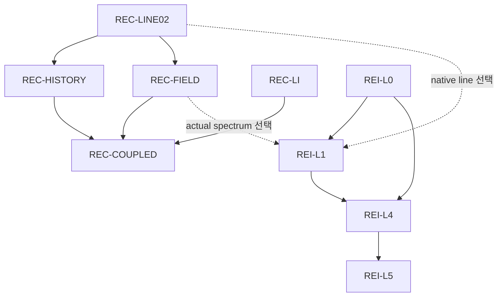

# 전체 목표 진행 — 중앙 b24a publication 기준 보완

이 문서는 새로 관측한 immutable 중앙 base를 반영하는 별도 보완이다. 원 03:06 survey 및 8e 기반 보고서를 수정하지 않는다. Root가 PB01 A–H scoped science를 수락했다. 이 문서는 scienceS2 18/20 상태를 반영하며 최종 전달은 receipts에서 닫는다.

- Canonical HEAD: `b24a9daee54fc0860c4cf299c4ea5f2a977c0fd4`
- Tree: `210f15423ab8f79f691ae8a1a6cc7128b1094bff`
- HEAD 관측: `2026-10-25T07:49:37.077Z` (1회)
- 원 40 contracts / 17 integration edges / 7 authorities와 전체 plan status를 보존했다.
- Global physical completion: `null`; 단위별 scoped observation과 전체 계획 상태는 별도다.

## plan_status 정확한 집계

| Status | Count |
|---|---:|
| PROPOSED | 34 |
| COMPLETE_SCOPED | 2 |
| PARTIAL | 2 |
| OWNER_DELIVERY_PENDING | 1 |
| SOURCE_INPUT_PENDING | 1 |

## 원 nodes 배열 순서의 40개 상태

원 배열은 전역 topological order가 아니다. 이전 31 local + 17 integration + 2 internal conditional = 50 links 및 5개 선행층(19/9/6/4/2) 증명을 재사용한다. 원 dependency/edge 전체가 동일함을 이번 source 비교로 확인했으며 새 assembler/renderer 또는 topology 계산은 하지 않았다.

| # | Node | plan_status | 현재 관측의 위치와 범위 | 선행층 |
|---:|---|---|---|---:|
| 1 | `WU_CE83_OWNER_COMPLETION` | PROPOSED | 기존 observed_completion 보존 | 1 |
| 2 | `WU_LI_SOURCE_UNCERTAINTY` | PROPOSED | 8e와 동일; 새 중앙 관측 없음 | 1 |
| 3 | `WU_HE_LI_CX_STATE_ENERGY` | PROPOSED | 8e와 동일; 새 중앙 관측 없음 | 1 |
| 4 | `WU_D_PI_RR_MATCHED` | PROPOSED | 8e와 동일; 새 중앙 관측 없음 | 1 |
| 5 | `WU_NUCLEAR_PARTICLE_OWNERSHIP` | PROPOSED | HH90 conditional cell 관측을 포함해 현재 객체 그대로 보존 | 1 |
| 6 | `WU_SPECTRAL_GEOMETRY_COUPLING` | PROPOSED | 8e와 동일; 새 중앙 관측 없음 | 2 |
| 7 | `CR_N4_C23B_CUTOFF_BINDING` | COMPLETE_SCOPED | 기존 observed_completion 보존 | 1 |
| 8 | `CR_N4_STOPPING_KERNEL` | PARTIAL | 기존 observed_progress 보존 | 2 |
| 9 | `CR_N5_ATOMIC_ISOTOPE_COVERAGE` | PARTIAL | H1 spontaneous RR finite-chain child 추가; parent PARTIAL/OPEN 유지 | 1 |
| 10 | `CR_N6_CONSERVATIVE_COUPLING` | PROPOSED | 8e와 동일; 새 중앙 관측 없음 | 3 |
| 11 | `CR_N7_NEW_PARCEL` | PROPOSED | 8e와 동일; 새 중앙 관측 없음 | 4 |
| 12 | `CR_BETA_FULL_OWNER` | PROPOSED | 8e와 동일; 새 중앙 관측 없음 | 1 |
| 13 | `REC-LINE02` | OWNER_DELIVERY_PENDING | canonical observation 없음; PR228의 기존 8 fields 이월 준비 | 1 |
| 14 | `REC-HISTORY` | PROPOSED | canonical observation 없음; PR228의 기존 10 fields 이월; PB01 scoped science COMPLETE;18/20 전달 진행 | 2 |
| 15 | `REC-C3` | PROPOSED | 8e와 동일; 새 중앙 관측 없음 | 1 |
| 16 | `REC-LI` | PROPOSED | 8e와 동일; 새 중앙 관측 없음 | 1 |
| 17 | `REC-FIELD` | PROPOSED | 8e와 동일; 새 중앙 관측 없음 | 2 |
| 18 | `REC-COUPLED` | PROPOSED | 8e와 동일; 새 중앙 관측 없음 | 3 |
| 19 | `HE-X1` | COMPLETE_SCOPED | 기존 observed_completion 보존 | 1 |
| 20 | `HE-ANG` | SOURCE_INPUT_PENDING | finite-mass CBA scoped numerics 추가; 19/20, C8 export OPEN; physical provider 미채택 | 2 |
| 21 | `HE-EXCHANGE` | PROPOSED | 8e와 동일; 새 중앙 관측 없음 | 1 |
| 22 | `HE-RESERVOIR` | PROPOSED | 8e와 동일; 새 중앙 관측 없음 | 1 |
| 23 | `HE-CLOSURE` | PROPOSED | 8e와 동일; 새 중앙 관측 없음 | 3 |
| 24 | `HE-FEEDBACK` | PROPOSED | 8e와 동일; 새 중앙 관측 없음 | 4 |
| 25 | `B1-G1B-recover` | PROPOSED | 8e와 동일; 새 중앙 관측 없음 | 1 |
| 26 | `B2-G1B-curved` | PROPOSED | 8e와 동일; 새 중앙 관측 없음 | 2 |
| 27 | `B3-fourforce-owner` | PROPOSED | 8e와 동일; 새 중앙 관측 없음 | 3 |
| 28 | `B4-production-restart` | PROPOSED | 8e와 동일; 새 중앙 관측 없음 | 4 |
| 29 | `B5-domain-validation` | PROPOSED | 8e와 동일; 새 중앙 관측 없음 | 5 |
| 30 | `V1-affine-native` | PROPOSED | 8e와 동일; 새 중앙 관측 없음 | 1 |
| 31 | `V2-session-fatal` | PROPOSED | 8e와 동일; 새 중앙 관측 없음 | 1 |
| 32 | `V3-affine-quotient` | PROPOSED | 8e와 동일; 새 중앙 관측 없음 | 1 |
| 33 | `V4-causal-polynomial` | PROPOSED | 8e와 동일; 새 중앙 관측 없음 | 1 |
| 34 | `V5-sphere-production` | PROPOSED | 8e와 동일; 새 중앙 관측 없음 | 2 |
| 35 | `REI-L0` | PROPOSED | 8e와 동일; 새 중앙 관측 없음 | 2 |
| 36 | `REI-L1` | PROPOSED | DAG 객체는 동일; 별도 HI instantaneous strain leaf의 scoped admission 존재 | 3 |
| 37 | `REI-L2` | PROPOSED | 8e와 동일; 새 중앙 관측 없음 | 2 |
| 38 | `REI-L3` | PROPOSED | 8e와 동일; 새 중앙 관측 없음 | 3 |
| 39 | `REI-L4` | PROPOSED | DAG 객체는 동일; 새 HI leaf도 L4_ready=false 유지 | 4 |
| 40 | `REI-L5` | PROPOSED | 8e와 동일; 새 중앙 관측 없음 | 5 |

## 최신 owner 관측과 실제 전체 입력 의무

| Owner result | 실제 source 관측 | 남은 입력/전달 경계 |
|---|---|---|
| CR H1 RR–Milne | COMPLETE_SCOPED_CONDITIONAL; 최신 중앙 ancestor에 M2 `3ae1823…` 존재 | actual photon occupation/stimulated hazard/global physical error null; N4/N5 PARTIAL/OPEN. 원 return의 18/20 과학 동결 및 실제 M2 조건부20/20 문구는 그대로 보존 |
| HE finite-mass CBA | SCOPED_NUMERICS_ADMITTED_C8_PARTIAL; 19/20 | C8 export 자료 일부 OPEN; physical_provider_admitted=false; source-consistent physical joint outgoing law 필요 |
| REI HI instantaneous strain | ADMITTED_SCOPED_NATIVE_HI_STRAIN_RESPONSE; 실제 S `190e283…`, D `b24a9da…`가 현재 Git 계보에 존재 | 원 S18/20과 D조건부20/20 기록을 구분; actual HI history/density/stock/geometry/clock/collision/photon inputs OPEN; L4_ready=false |
| REC KS01 / 다음 PB01 | KS01 prior final20/20 재사용, source-owned PB01은 scoped science COMPLETE;18/20 전달 진행 | H5 actual physical bound, H6 source/incident trace 연결 및 나머지 H7 의무는 별도로 남음 |

## 원 17 integration 조건

| # | From → To | Condition |
|---:|---|---|
| 1 | HE-X1 → REI-L0 | using angular-moment injection |
| 2 | HE-ANG → REI-L3 | selecting anisotropic baryonic scattering transport |
| 3 | HE-EXCHANGE → REI-L3 | selecting finite-mass baryonic pressure exchange |
| 4 | HE-CLOSURE → REI-L4 | selecting nonzero baryonic anisotropic stress |
| 5 | CR_N4_STOPPING_KERNEL → REI-L1 | claiming thermalization of supplied fast photoelectrons |
| 6 | CR_N6_CONSERVATIVE_COUPLING → REI-L4 | selecting CR coupled radiation/deposition pathway |
| 7 | WU_D_PI_RR_MATCHED → REI-L1 | claiming isotope-specific D PI/RR number and energy moments |
| 8 | WU_NUCLEAR_PARTICLE_OWNERSHIP → REI-L2 | activating nuclear daughters/fast products |
| 9 | CR_BETA_FULL_OWNER → REI-L2 | activating source-qualified beta partition and stopping |
| 10 | REC-LINE02 → REI-L1 | selecting native line source |
| 11 | REC-LINE02 → WU_SPECTRAL_GEOMETRY_COUPLING | selecting native line in WU spectral coupling |
| 12 | REC-FIELD → REI-L1 | selecting actual spectral radiation/Compton exchange |
| 13 | B3-fourforce-owner → REI-L4 | selecting BASS four-force geometry feedback adapter |
| 14 | B2-G1B-curved → REI-L5 | claiming curved Bianchi smooth-source domain |
| 15 | V1-affine-native → REI-L4 | using native reduced30/full33 affine adaptive client |
| 16 | V2-session-fatal → REI-L4 | using switching/restart driver |
| 17 | V5-sphere-production → REI-L5 | claiming its physical spherical transport scheme |

REC의 local 선행 관계는 REC-LINE02 → REC-HISTORY 및 REC-FIELD, 그리고 REC-LI/REC-FIELD/REC-HISTORY → REC-COUPLED다. 선택한 native line/spectrum 경로는 REC-LINE02/REC-FIELD → REI-L1 → REI-L4 → REI-L5로 이어진다. H5/H6/H7/PB01은 REC-HISTORY 내부 의무이며 새 중앙 node로 추가하지 않는다.

Physical HOLD; REC_U5 HOLD_9_FAIL/HOLD_8_FAIL; CLOSED_HOLD_NOT_RESET; global_convergence NOT_RUN; production NOT_APPROVED; REI_activation=false를 유지한다. 최신 상세 source와 의존성 해석은 `SOURCE_BASE_PUBLICATION_DELTA.md`를 따른다.

## PB01의 실제 진척

R1–R9/C1–C9=18/20 과학·구현 완료. Source-owned fixed-chart pullback과
coordinate adjoint/exact mixed remainder/conditional box를 수락했다. H5물리bound와
H6actualtrace, H7retiming/geometry/thermal-ODE는 OPEN. Parent REC-HISTORY PARTIAL.
S0R/S1/S1F 실제 GitHub+Dropbox+Drive 전달 완료; scienceS2·중앙관측·companion/finalS3는
현재 delivery/PUBLICATION_STATE.json과receipt를 따른다. 전역physicalpercent=null.

이 도식은 REC 관련 local/conditional edge와 REI의 해당 선행관계만 표시한다.
40node 전체의 나머지 조건은 위40행/17edge 표와 고정DAG를 따른다.
