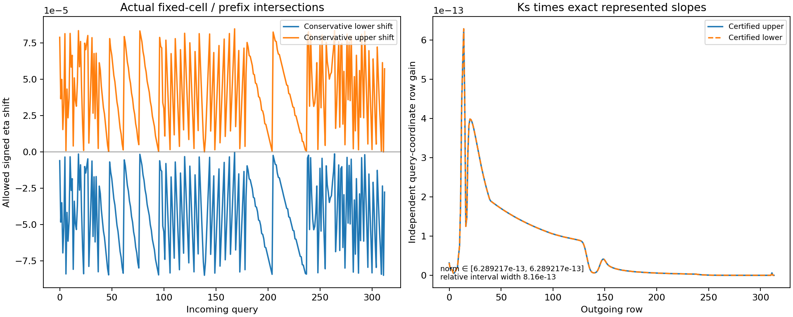
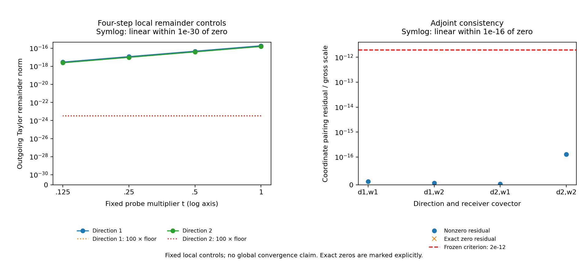

# REC-HISTORY-PB01 결과 보고서

## 결과

원 source의313개 history query에서626개 서로 다른 endpoint 좌표와 query좌표를
고정한 stable K_s에 합성했다. Endpoint/query pullback, coordinate adjoint,
정확한 bilinear finite remainder, outward query norm과 조건부 finite box를
완성했다. 독립 최종 검토는
**PASS_SCOPED_SCIENTIFIC_REVIEW_AFTER_TARGETED_SAVED_DATA_REPAIR**다.

과학·구현 범위는 **COMPLETE_SCOPED_SOURCE_HISTORY_PULLBACK**이다.
불변 S2 과학 snapshot은 R1–R9/C1–C9의 18/20이다. 중앙 실제 게시·보존 readback과
companion 실제 이중 ACK를 확보했다. 이 단일 최종 REC S3 후보가 실제 게시되면
R10/C10을 포함한 R1–R10+C1–C10=20/20 전달 마감이 성립한다. 게시 전에는 후보 상태다.
PUBLICATION_STATE와 delivery receipts가 그 조건과 근거를 기록한다.
부모 REC-HISTORY는 PARTIAL이고 Physical HOLD를 유지한다.

첫 primary는1회, exit2 FAILED_FROZEN_CRITERION으로 보존했다. 같은 사건의
energy scalar를 독립 합산한 값에서1–2ULP 부호쌍 차이가 발견됐다.
저장된32개 event vector에서 radiation값을 그대로 두고 atomic값을 정확한
음수로 결속하는 한정 교정으로8/8case를 수용했다. 수정된 전체 primary는
실행하지 않았다. 모든 다른 passing result와 원381개 raw/execution파일을
재사용했다.

## 조사와 다음 연구의 선택

2026-10-25 03:06UTC의 접근 가능한 repository/branch 목록은
51repos,2261branches,65pages이며 pagination51/51이 끝났다.
관련9repo의 최신PR96records와 변경 source를 대조했다. Branch별 모든 파일을
전부 읽었다는 뜻은 아니다. 대화 검색은 선택된10threads의 회수 결과이며,
전체 private conversation을 열거하는 API는 제공되지 않았다.

Dropbox는11개 직접 collection의16pages/4485entries, 별도 dossiers
6pages/3420entries와8개 검색을 대조했다. Drive는7개 직접 collection의
670entries와5개 검색을 읽었다. Drive 검색 결과에는 완전성 표시가 없었고
ZIP 검색 누락도 있어 검색0을 파일 부재의 증거로 사용하지 않았다.
B3E/HI archive의 실제 readback과 원 source를 읽었으며, 일부 최신
Vigil/HE backup은 metadata 수준으로 구별했다. 원 응답과 범위 표는
private full backup의 survey/에 있다.

기존 KS01은 actual original history admission과 stable K_s 인증을 완료했다.
그 입력과 계수를 재사용하면 history pullback은 새 solve 없이 직접 구성할
수 있다. H5 독립 reference와 H6 실제 incident trace는 다음 입력 의무로
남아 있으므로, 지금 확보된 원 history와 K_s로 닫을 수 있는 PB01을 선택했다.

게시 전07:49:37UTC에는 중앙PR222의 최신HEAD를 한 번 추가 확인했다.
최신base는 b24a9daee54fc0860c4cf299c4ea5f2a977c0fd4,
tree210f15423ab8f79f691ae8a1a6cc7128b1094bff다. 처음 조사한8e 이후
6commits/74paths가 추가됐고 DAG에는 CR H1 spontaneous RR와 HE finite-mass
CBA 관측이 더해졌다. 새 HI strain-response69paths도 해당 tree에서 상속한다.

| 관련 최신 성과 | 읽은 범위에서 제공한 내용 | REC 입력으로 남는 연결 |
|---|---|---|
| BASS189/B3E | positive angular selector와 scoped bounds | 실제 cohort/history/incident source |
| Vigil88/D5 | callback/stencil와 driver 계약 | 실제 물리 provider |
| HH147/HH90 | conditional covariance cell/consumer envelope | actual consumer ACK |
| CR H1 RR–Milne | saved8chains, prescribed10000K bath, spontaneous RR | photon occupation/stimulated hazard/global physical error |
| HE finite-mass CBA | finite-M Born/recoil/measure/fold numerics;19/20 | C8 export와 physical provider |
| REI HI strain | z2.479,4368atoms, coeval orthonormal-frame instantaneous strain/JVP | birth history/density/initial stock와 실제 Bianchi geometry/clock/photon 공급 |

새 HI 국소 응답은 해당 source 범위의 실제 성과다. 원 z≈1100 REC에 연결할
actual history와 H5 physical bound는 그 결과에서도 별도 입력으로 남는다.
각 source의 범위와 현재 HEAD는 SOURCE_BASE_PUBLICATION_DELTA 및
GLOBAL_PROGRESS에 연결했다.

문헌은 SciSpace/Exa로 Polavarapu et al., Tellus A48(1996),74–95,
DOI10.3402/tellusa.v48i1.11633의 interpolation linearization 논문을 찾고
abstract를 읽었다. 전체 정리를 전제로 수입하지 않았다. 공식
dolfin-adjoint verification 문서의 Taylor remainder 검증법도 확인했다.
Wolfram은 generic tangent, bilinear remainder, transpose identity에
각각 True를 반환했다. 새 strong no-go 주장은 없다.

## 실제 입력과 convention

| 항목 | Identity/값 |
|---|---|
| Source target | z1099.9986525171403,T0=2.728K,nH0=.18745798773143102m^-3,fsR=meR=1 |
| History | original pr05b2_source_history_v060.npz,35239470bytes |
| History SHA256 | d4f82542e13fed4ff0bb60b17865d8b9de5e090a2366108169c3da7a21fcb4b1 |
| Query/prefix |313queries; prefix5127; active626slots |
| Coordinate | dimensionless eta=ln(a); native signed Wien-departure samples |
| Source data reuse | KS01 science309776ec263f10853a7ed4c404387c1474994e96; finaldeliveryf9edbfe7b56ad002f1b7fb35d4c5aec4970682a4 |
| THERMO final |52226bb8d3ac99e7de2bd7934ab30e6fb3f257fe |
| Canonical23 source snapshot |adddf7381edfb7d670025c651cf813594107a260acce308702f33b1d415fad54 |
| Retained native scalar adapter SHA256 |f0858a0ef231c62cf29c8d03ca769d3e9f8539a7809f890be5f4e22aa5fa0600 |

Metric convention은 (-,+,+,+)다. 단위 변환이나 새 H/volume 계수를
도입하지 않았다. Incoming313/grid/source/frame/query owner와 frozen
thermodynamic coefficients는 유지했다. 실제 Bianchi retiming law는 선택하지
않았다. Endpoint와 query는 독립적인 수학 좌표다.

## 유도: source history에서 outgoing 변화까지

각 query의 native-order fraction을 a_j, cell spacing을 h, 두 history값을
 y_Lj,y_Rj로 쓴다. 이 binary64 저장값을 exact-real 상수로 두고

$$
H_j(dy,\xi)=(1-a_j-\xi_j/h)(y_{Lj}+dy_{Lj})
 +(a_j+\xi_j/h)(y_{Rj}+dy_{Rj})
$$

를 정의한다. 실제 source의 base incoming u0는
u_connected=u0+H(dy,xi)-H(0,0)로 보존한다.
P[j,2j]=1-a_j,P[j,2j+1]=a_j,
g_j=(y_Rj-y_Lj)/h,G=diag(g)라 하면

$$
dH=P\,dy+G\,\xi,\qquad
A=K_sP,\quad C=K_sG,\qquad
 d o=A\,dy+C\,\xi.
$$

A는314×626, C는314×313이다. Euclidean coordinate pairing에서 v=K_s^T w를
계산하면 endpoint cotangent는 P^T v, query cotangent는 Gv다. 물리적
angular/volume integral pairing에는 그 measure/Riesz map이 추가 입력이다.

직접 전개하면 다음 나머지식이 정확하다.

$$
H(dy,\xi)-H(0,0)-Pdy-G\xi=r,\qquad
r_j=\frac{\xi_j}{h}(dy_{Rj}-dy_{Lj}).
$$

따라서 frozen source에서 finite outgoing increment는
K_s(Pdy+Gxi+r)다. dy=t d,xi=t x에서는 r이 정확히 t²에 비례한다.
이 exact chart identity가 유도 근거이며,4개 step은 구현 판별 자료다.

### Endpoint norm의 보존

실제 source route가1..313의 permutation이고626개 endpoint slot이 다르므로
P의 서로 다른 행은 disjoint support를 갖는다. 0≤a_j≤1 아래 각 output row에서

$$
\sum_p |(K_sP)_{ip}|=\sum_j |(K_s)_{ij}|[(1-a_j)+a_j]
=\sum_j |(K_s)_{ij}|.
$$

따라서 ||K_sP||∞=||K_s||∞다. 같은 stable K_s의 기존 interval을 그대로
상속했다. Native K0의 예전 norm을 전용하거나 inverse certificate를 다시
실행하지 않았다. Shared support의 cancellation toy는 이 조건의 역할을
확인한다.

### 조건부 finite box

각 endpoint radius e_L,e_R와 fixed-cell query radius tau가 제공되면

$$
b_j=(1-a_j)e_{Lj}+a_je_{Rj}+|g_j|\tau_j
 +\frac{\tau_j}{h}(e_{Lj}+e_{Rj}),\qquad
|\Delta o_i|\le\sum_j W_{ij}b_j,
$$

W_ij=max(|Klo_ij|,|Khi_ij|)로 둘 수 있다. 실제 구현은 slope의 exact Fraction
변환과 outward interval 연산을 사용했다. 이번 입력 radius는 수치 control이고
physical uncertainty allocation은 null로 유지한다.

## Native arithmetic와 domain

Native alpha=(q-eta0)/h-k와 기존 KS admission의 (q-eta[k])/h는 binary64
연산 순서가 다르다. 실제 최대 alpha 차이는5.6877835774571395e-12였다.
Native-order base는 stored incoming과 정확히 일치했고, KS reconstruction의
normalized error는3.219042386314642e-15였다.

Finite q'에서는 실제 표현값의 exact 차이 xi=q'-q를 사용한다.
e_alpha=alpha_native(q')-a-xi/h를 기록하고
 e_alpha*(y'_R-y'_L)를 native fraction과 anchored chart 사이의 산술 bridge로
따로 둔다. 최대 bridge-corrected normalized error는
2.0119014914466513e-16로 frozen5e-12 안이다.

Chart, stored knot, native knot, strict-prefix margin의 보수적 교집합 안에서만
query를 움직였다. 최소 safe radius는5.278877512893132e-8eta이며
incoming311/cell5125에서 얻었다. Cell crossing, prefix endpoint, 잘못된 source,
shape/nonfinite input과 negative/nonfinite box radius를 거부했다. Exact knot의
query tangent는 기존 scalar 계약에 따라 거부하고 endpoint-only 선택은 보존했다.

## 실제 결과

| 항목 | 결과 | 기준/근거 |
|---|---:|---|
| Source census |313queries,626distinct slots | 실제 history/source permutation |
| Endpoint ||A||∞ |[1.17562722922718,1.1756272292401908] | disjoint positive-partition 유도와 KS01 interval |
| Independent query ||C||∞ |[6.289216981912579e-13,6.28921698191771e-13] | outward K_s×exact slope |
| Query norm relative width |8.159217035729894e-13 |≤1e-6 |
| Radius-scaled query norm |[2.126253353796309e-17,2.126253353797428e-17] | 각 row의 실제 safe radius로 scaling |
| 최대 outgoing JVP normalized error |1.330813018537134e-15 |≤2e-12 |
| 최대 VJP normalized error |1.1149933569780338e-15 |≤2e-12 |
| 최대 adjoint pairing normalized error |1.2903956815756356e-16 |≤2e-12,gross-pairing normalization |
| 최대 native bridge normalized error |2.0119014914466513e-16 |≤5e-12 |
| 최대 native bridge absolute error |1.8143800820083272e-29 | 저장된 actual inputs |
| Non-floor Taylor ratios |6/6,order1.9999999996573437–2.000000000685158 | frozen1.9–2.1 |
| Chart/native finite box |각8/8 | 제공된 수치 control radius |
| Domain controls |13refusals+2positive controls | saved exact/actual controls |
| Shared event canonical pairs |32/32;8/8case | 저장 radiation에서 exact sign flip |

Common-clock column C1은 independent query norm과 별도 배열로 보존했다.
기존 ionization/proper-time/Ly-alpha number/radiation/atomic response의 단위와
직접 incident subtraction을 유지했다. 관련 숫자와 위치는 SCIENTIFIC_METRICS,
results/primary001,repairs/event_pair001에 있다.

## 실패와 교정의 보존

1. Workspace 소실은 RUNTIME_INTERRUPTION_RECOVERY로 분류했다. 원인은
   UNRESOLVED다. S0Git은 남았고 원 S0 ZIP은 upload 전 소실됐다. 원문5파일,
   census identity,47provider objects를 회수했다. KS01 S2의206payload와 내부
   THERMO01의485payload를 복원 검증했고 완료 science는 재실행하지 않았다.
2. PREEXEC에서는 native JVP counter의 위치 한 곳을 호출 전으로 옮겼다.
   원 primary82e5368e…와 수정bc63fd…를 모두 보존했다.
3. 첫 primary는97operator/200event action을 완료하고 G gate에서 exit2였다.
   24개 최초검사 pair 중6개, 별도 explicit-tangent8개 중2개가1–2ULP 달랐다.
   저장 coefficient와 interval은 정확한 반대 부호다. 정확한 같은-event 관계
   E_atom v=−E_rad v를 구현해32개 저장 vector의 atomic만 radiation의 부호
   반전으로 결속했다. 첫 네 성분의 bytes와 원381개 raw/execution파일은 같다.
   원 독립 atomic값도 남겼다. 허용오차는 변경하지 않았다.
4. 첫 두 번째 PNG는 축과 제목이 눌려 H presentation FAIL이었다. 저장자료만으로
   명시적인 여백과4개 t눈금을 준 layout002를 만들었다. 최초 그림과 코드는
   보존했고, 첫 번째 PASS 그림은 다시 만들지 않았다.

Root와 동일 independent reviewer가 실제 두 번째 수정 PNG를 보았다.
세 review finding은 CLOSED다. 현재 primary는 same-event helper를 호출하도록
교정되어 있지만 그 전체 primary를 다시 실행하지 않았다. 실제 수락 근거는
보존한 최초 passing evidence와 saved-data repair의 합류다.

## 자원과 계산량

| 실행 | CPU s | execution-wall s | 상태 |
|---|---:|---:|---|
| Primary001 |1.026527|1.071611822|exit2 보존 |
| Saved-value 진단 |.115000|.165213826|PASS |
| Shared-event 교정 |.136499|.165103235|PASS |
| 첫 두 그림 |1.713277|1.753986694|첫 그림 PASS,둘째 layout FAIL |
| 둘째 그림 layout002 |1.246518|1.268530349|PASS |
| 통제 child 합계 |4.237821|4.424445926|5children |

별도 독립 readback의 관측 process CPU는.035253s다. 현재 알려진 CPU subset은
4.273074s, 이전 known32.168987486s와 합친 lineage subset은36.442061486s다.
최대 child RSS92200KiB,1thread다. 동결 cap50CPU/150execution-wall 안에서
primary30/90,repair5/15,figures10/30,review/diagnostic5/15 배분을 사용했다.

NewRHS0,solve0,inverse0,native0,IVP0,oldcampaignreplay0,primaryrerun0이다.
97operator/200event actions는 최초 실행에서 완료했고,10interval passes와
32scalar sign assignments를 별도로 기록했다. 준비·provider IO·wrapper·model
처리·remoteCAS·older unknown 비용과 전체 turn wall은 측정된 child 비용과
구분한다. Unmeasured를0으로 처리하지 않았다.

## 전체 DAG와 다음 입력

현재 중앙40node의 plan_status는34PROPOSED/2COMPLETE_SCOPED/2PARTIAL/
1OWNER_DELIVERY_PENDING/1SOURCE_INPUT_PENDING이다. Global physical completion은
null이다. 실제 child 성과와 plan_status를 GLOBAL_PROGRESS에서 함께 표기한다.
PB01은 REC-HISTORY 내부의 finite 단위이고 중앙 node를 새로 만들지 않는다.

실제 REC 선행관계는 LINE02→HISTORY→COUPLED,
LINE02→FIELD→COUPLED,LI→COUPLED다. Native line/spectrum을 선택하는 조건에서는
LINE02/FIELD→REI-L1→REI-L4→REI-L5가 연결된다. 원40contracts/17edges/7authorities,
다른38nodes,AGENTS와 고정handoff는 최신base에서 보존한다.

| 의무 | 현재 확보한 부분 | 다음 실제 입력/작업 |
|---|---|---|
| H5 | 원payload/prefix/query admission과 conditional propagation | 동일 cosmology의 독립 reference+불확도,endpoint uncertainty 또는 정당화된 whole-cell curvature/defect bound |
| H6 | 별도 HISTORY02 owner의 geodesic/reference/direction adapter 구현 존재 | 실제 incident trace와 선택 Bianchi geodesic/direction/frame/measure/volume/clock/source/query owner 결속 |
| H7 | local J_s/K_s와 이번 endpoint/query pullback,coordinate adjoint,finite remainder | 실제 DY,DQ,Dtheta와 reference variation,retiming/geometry/thermal-ODE 연결 |

물리 parameter p가 결속되면 Js Dtheta + A DY + C DQ와 필요한 reference항으로
연결한다. 새 물리 law나 output tolerance를 선택하기 전에 변경된 의존성과
actual input identity,error allocation,acceptance,cumulative budget을 동결한다.
다른 cosmology finer trajectory,same-h parity,storage equivalence는 H5 reference
의무를 채우지 않는다. 완료된 THERMO01/RESP01/LINE02/KS01/PB01은 재실행하지 않는다.

유지 상태: Physical HOLD; REC_U5 HOLD_9_FAIL/HOLD_8_FAIL;
CLOSED_HOLD_NOT_RESET; global_convergence NOT_RUN; production NOT_APPROVED;
REI_activation=false; first failed REI raw HISTORICAL_LOCAL_ONLY.
CI는 별도 publication readback에서 실제 run/attempt/실패 step을 기록한다.
Scoped science PASS와 CI 상태는 서로 다른 근거다.

## 실제 전달 현황 — 최종 S3 후보와 실제 게시 조건

ScienceS2는 Git `f9051f10f02582d6b339d8738f1e9796953941d4`와 draft PR137에
실제 게시됐다. Full raw archive는 69,336,495 bytes,
SHA256 `b43ec958374bb8ba97073c46355dc26131a64261cd5004fa64e65c6565da00d1`이다.
Dropbox `id:BSpOijBcT10AAAAAAD_-Dw` / rev `65ea5beccbee90af03d47`와
Drive `1eHZ_wuG_4J_mgDrBvtRGe2QBpx_kpCAw`의 실제 ACK가 있다.
다운로드한 전체 bytes/SHA, outer ZIP CRC, 712개 payload의 size/SHA/CRC가 PASS다.
내부 이전 KS01 ZIP은 outer member identity만 확인했고 이전 과학을 재검증하지 않았다.
근거는 `delivery/S2_RECEIPT.json`, `delivery/S2_REMOTE_READBACK.json`이다.
원 S2 ZIP은 변경하지 않았다. 별도로 남은 incomplete PENDING prefix는 두 번째
검증된 후보가 아니며, 원인은 미해결 상태로 `delivery/S2_PENDING_FILE_OBSERVATION.json`에 보존했다.

중앙에는 captured base `b24a9daee54fc0860c4cf299c4ea5f2a977c0fd4`에서
commit `219fe60a3f069dda26e109f6e0cd1fd339c83701`, tree
`8188397a0e94faac70c4352b14cc807b3e384843`로 게시했다.
[PR229](https://github.com/cosmosapjw-quantum/rei_bianchi/pull/229)는 open/draft다.
이전 18개 REC observation field와 PB01 관측, 정확한 이전 6개 return을 포함한
10개 경로의 실제 blob/size/mode 및 보호 subtree readback이 PASS다.
`delivery/CENTRAL_RECEIPT.json`과 `delivery/central/ACTUAL_REMOTE_READBACK.json`이
실제 게시 근거다. 원 40 contracts/17 edges/7 authorities, 다른 38개 node,
plan status, AGENTS, 고정 handoff를 보존했고 assembler/renderer/merge/activation은 0이다.
중앙 관측은 불변 scienceS2 18/20을 기록하며 최종 전달 20/20을 미리 주장하지 않는다.

실제 CI는 두 저장소 모두 RED다. REC S2는 `verify_repo.py --quick`의 whitespace·EOF
검사에서 실패했고 PB01 소유 evidence/vendor 11개 경로에 12개 진단이 포함된다.
중앙은 `cargo fmt --check`에서 실패했고 이번 중앙 projection의 Rust source 변경은 0이다.
수동 rerun은 하지 않았으며 frozen audit/vendor bytes를 CI 목적으로 수정하지 않았다.
실제 run/attempt와 실패 step은 `evidence/ci/S2_CI_READBACK.json`,
`evidence/ci/CENTRAL_CI_READBACK.json`에 있다. 과학 범위의 PASS와 CI 상태를 구분한다.

Companion의 실제 이중 전달이 완료됐다. 파일은 421,395 bytes,
SHA256 `e1c252ac62a97c86ab699e2b95111c8963a277c9a86620b6ce544376803d37fd`다.
Dropbox `id:BSpOijBcT10AAAAAAD_-Ew` / rev `65ea60534a9cd0af03d47`와
Drive `1HlxOZOEDLbfEbrtYwaau6pWtRqm11V-E`의 실제 ACK 및 metadata size가 PASS다.
Local whole SHA/CRC/152 payload 검증은 PASS이며 원격 whole SHA는 측정하지 않았다.
근거는 `delivery/FINAL_COMPANION_RECEIPT.json`이다.

R10/C10의 최종 마감은 이 실제 ACK를 담은 단일 REC S3 후보의 **실제 게시**를 조건으로 한다.
게시되면 R1–R10+C1–C10=20/20이다. 최종 S3 identity는 `CONTAINING_COMMIT`이며,
실제 SHA는 게시 후 PR137 본문과 최종 chat에 기록한다. 게시 전인 현재는 후보다.
S2와 companion의 포장 당시 18/20은 불변이다. Companion은 자신의 ACK나 미래 S3 SHA를
포함하지 않으며, ACK를 넣으려고 archive나 중앙 commit을 재생성하지 않았다.
Final S3 CI는 게시 후 별도 조회할 항목이며 지금 PASS/FAIL을 주장하지 않는다.

## 읽을 파일과 그림

- THEORY.md / FROZEN_CONTRACT.md: 정의·유도·동결 기준.
- CLAIM_GATES.json / SCIENTIFIC_METRICS.json: root 판정과 실제 숫자.
- evidence/independent_review/FINAL_REVIEW.md: 동일 reviewer의 최종 범위 검토.
- BUDGET_LEDGER.json / STAGE_PROGRESS.md: 누적 비용과 단계별 전달.
- NEXT_INPUT_CONTRACT.md / HANDOFF_FINAL_KO.md: 다음 실제 입력과 재개.
- delivery/PUBLICATION_STATE.json / S2_RECEIPT.json / CENTRAL_RECEIPT.json: 현재 실제 전달 근거.
- delivery/FINAL_COMPANION_RECEIPT.json: 실제 companion 이중 ACK와 로컬 검증, 원격 whole-SHA 미측정 범위를 기록한 최종 전달 근거.

## 출처

- Current source/identity: KS01 PR136, https://github.com/cosmosapjw-quantum/rec_bianchi/pull/136
- PB01 owned draft: https://github.com/cosmosapjw-quantum/rec_bianchi/pull/137
- Latest central base: https://github.com/cosmosapjw-quantum/rei_bianchi/commit/b24a9daee54fc0860c4cf299c4ea5f2a977c0fd4
- Interpolation linearization: https://doi.org/10.3402/tellusa.v48i1.11633 (abstract inspected)
- Taylor method: https://www.dolfin-adjoint.org/en/latest/documentation/verification.html
- Actual search/CAS/provider responses and full raw: scienceS2 private archive; identities in receipts.
