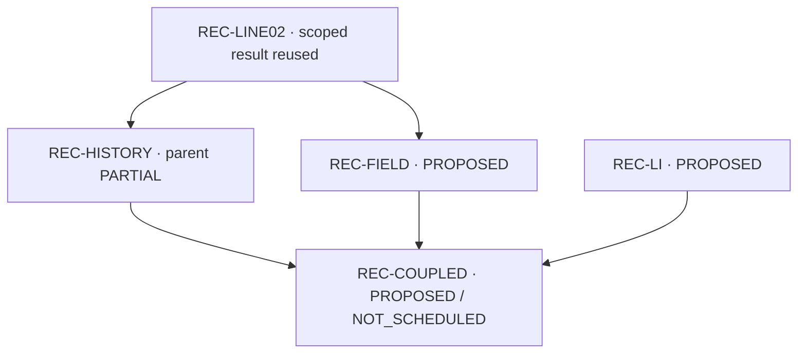

# Global progress — original author states and separate REC overlay

## Source and interpretation

Latest specified central pin: `c40d287874f72519103e68267e659fc022eba188`; exact local source: `provenance/post_reset_central_intake/DAG_latest_c40d287.json`. Source `as_of` remains `2026-10-23`. Fixed authority remains `rei_bianchi@0f9d9df825be1dac9ca9bdf73cdc2e8908bcba17`. This is a mechanical40-node/17-edge extraction from the final specified c40 pin, with earlier566f and fca9 source bytes separately retained. No further HEAD tracking was performed.

Original author `contract.status`, `plan_status` and existing observation status are distinct. Values and capitalization are copied verbatim. Missing fields remain explicitly absent/null and are not inferred to mean NOT_RUN. A scoped child observation may coexist with a PARTIAL parent. Only the named REC root overlay is added; other lanes are not promoted. New individual subunit observations are linked through `SURVEY_SYNTHESIS_KO.md` and `provenance/post_reset_central_intake/REPORT_c40d287_KO.md`; earlier `REPORT_KO.md` remains preserved.

**Physical completion percent: null. Overall goal completion percent: null.** Finite REFINE01 workflow is **20/20** after actual S0/S1/S2/S3 Git and Dropbox delivery, central draft observation publication, final report and handoff. The additional Drive upload remains explicitly UNKNOWN. This finite workflow count is not a physical-goal fraction.

## All40 nodes: original rows and separate overlay

| Node ID | Repository | Original contract.status | plan_status | local_dependencies | Existing observation status | Root current overlay / further observations |
|---|---|---|---|---|---|---|
| `WU_CE83_OWNER_COMPLETION` | `WU088_HH` | `"OPEN"` | `"PROPOSED"` | `[]` | `null` (observation field absent) | No new overlay; other subunits: SURVEY_SYNTHESIS_KO.md |
| `WU_LI_SOURCE_UNCERTAINTY` | `WU088_HH` | `"OPEN"` | `"PROPOSED"` | `[]` | `null` (observation field absent) | No new overlay; other subunits: SURVEY_SYNTHESIS_KO.md |
| `WU_HE_LI_CX_STATE_ENERGY` | `WU088_HH` | `"OPEN"` | `"PROPOSED"` | `[]` | `null` (observation field absent) | No new overlay; other subunits: SURVEY_SYNTHESIS_KO.md |
| `WU_D_PI_RR_MATCHED` | `WU088_HH` | `"OPEN"` | `"PROPOSED"` | `[]` | `null` (observation field absent) | No new overlay; other subunits: SURVEY_SYNTHESIS_KO.md |
| `WU_NUCLEAR_PARTICLE_OWNERSHIP` | `WU088_HH` | `"OPEN"` | `"PROPOSED"` | `[]` | `null` (observation field absent) | No new overlay; other subunits: SURVEY_SYNTHESIS_KO.md |
| `WU_SPECTRAL_GEOMETRY_COUPLING` | `WU088_HH` | `"OPEN"` | `"PROPOSED"` | `["WU_CE83_OWNER_COMPLETION","WU_HE_LI_CX_STATE_ENERGY","WU_D_PI_RR_MATCHED","WU_NUCLEAR_PARTICLE_OWNERSHIP"]` | `null` (observation field absent) | No new overlay; other subunits: SURVEY_SYNTHESIS_KO.md |
| `CR_N4_C23B_CUTOFF_BINDING` | `bass_cr` | `"OPEN"` | `"COMPLETE_SCOPED"` | `[]` | observed_completion.status=`"COMPLETE_SCOPED"` | No new overlay; other subunits: SURVEY_SYNTHESIS_KO.md |
| `CR_N4_STOPPING_KERNEL` | `bass_cr` | `"OPEN"` | `"PARTIAL"` | `["CR_N4_C23B_CUTOFF_BINDING"]` | observed_progress.status=`"PARTIAL"` | No new overlay; other subunits: SURVEY_SYNTHESIS_KO.md |
| `CR_N5_ATOMIC_ISOTOPE_COVERAGE` | `bass_cr` | `"OPEN"` | `"PARTIAL"` | `[]` | observed_progress.status=`"COMPLETE_SCOPED"` | No new overlay; other subunits: SURVEY_SYNTHESIS_KO.md |
| `CR_N6_CONSERVATIVE_COUPLING` | `bass_cr` | `"OPEN"` | `"PROPOSED"` | `["CR_N4_STOPPING_KERNEL","CR_N5_ATOMIC_ISOTOPE_COVERAGE"]` | `null` (observation field absent) | No new overlay; other subunits: SURVEY_SYNTHESIS_KO.md |
| `CR_N7_NEW_PARCEL` | `bass_cr` | `"OPEN"` | `"PROPOSED"` | `["CR_N6_CONSERVATIVE_COUPLING"]` | `null` (observation field absent) | No new overlay; other subunits: SURVEY_SYNTHESIS_KO.md |
| `CR_BETA_FULL_OWNER` | `bass_cr` | `"OPEN"` | `"PROPOSED"` | `[]` | `null` (observation field absent) | No new overlay; other subunits: SURVEY_SYNTHESIS_KO.md |
| `REC-LINE02` | `cosmosapjw-quantum/rec_bianchi` | `"science_complete_scoped_final_delivery_receipt_pending"` | `"OWNER_DELIVERY_PENDING"` | `[]` | `null` (observation field absent) | COMPLETE_SCOPED_REUSED; receipt FOUND_REUSED |
| `REC-HISTORY` | `cosmosapjw-quantum/rec_bianchi` | `"selected_next_not_run"` | `"PROPOSED"` | `["REC-LINE02"]` | `null` (observation field absent) | Parent PARTIAL; H01/ADM01/02R scoped complete reused; REFINE01 COMPLETE_SCOPED_STORED_HISTORY_ENVELOPE; H5 INPUT_DEPENDENT_UNCALIBRATED |
| `REC-C3` | `cosmosapjw-quantum/rec_bianchi` | `"planned"` | `"PROPOSED"` | `[]` | `null` (observation field absent) | No new overlay; other subunits: SURVEY_SYNTHESIS_KO.md |
| `REC-LI` | `cosmosapjw-quantum/rec_bianchi` | `"planned"` | `"PROPOSED"` | `[]` | `null` (observation field absent) | PROPOSED |
| `REC-FIELD` | `cosmosapjw-quantum/rec_bianchi` | `"planned"` | `"PROPOSED"` | `["REC-LINE02"]` | `null` (observation field absent) | PROPOSED |
| `REC-COUPLED` | `cosmosapjw-quantum/rec_bianchi` | `"input_dependent"` | `"PROPOSED"` | `["REC-LI","REC-FIELD","REC-HISTORY"]` | `null` (observation field absent) | PROPOSED; NOT_SCHEDULED |
| `HE-X1` | `cosmosapjw-quantum/BASS_HE` | `"current_unit_selected"` | `"COMPLETE_SCOPED"` | `[]` | observed_completion.status=`"COMPLETE_SCOPED"` | No new overlay; other subunits: SURVEY_SYNTHESIS_KO.md |
| `HE-ANG` | `cosmosapjw-quantum/BASS_HE` | `"planned"` | `"SOURCE_INPUT_PENDING"` | `["HE-X1"]` | observed_completion.status=`"SOURCE_INPUT_PENDING"` | No new overlay; other subunits: SURVEY_SYNTHESIS_KO.md |
| `HE-EXCHANGE` | `cosmosapjw-quantum/BASS_HE` | `"planned"` | `"PROPOSED"` | `[]` | `null` (observation field absent) | No new overlay; other subunits: SURVEY_SYNTHESIS_KO.md |
| `HE-RESERVOIR` | `cosmosapjw-quantum/BASS_HE` | `"planned"` | `"PROPOSED"` | `[]` | `null` (observation field absent) | No new overlay; other subunits: SURVEY_SYNTHESIS_KO.md |
| `HE-CLOSURE` | `cosmosapjw-quantum/BASS_HE` | `"planned"` | `"PROPOSED"` | `["HE-ANG","HE-EXCHANGE","HE-RESERVOIR"]` | `null` (observation field absent) | No new overlay; other subunits: SURVEY_SYNTHESIS_KO.md |
| `HE-FEEDBACK` | `cosmosapjw-quantum/BASS_HE` | `"input_dependent"` | `"PROPOSED"` | `["HE-CLOSURE"]` | `null` (observation field absent) | No new overlay; other subunits: SURVEY_SYNTHESIS_KO.md |
| `B1-G1B-recover` | `cosmosapjw-quantum/bass` | `"planned"` | `"PROPOSED"` | `[]` | `null` (observation field absent) | No new overlay; other subunits: SURVEY_SYNTHESIS_KO.md |
| `B2-G1B-curved` | `cosmosapjw-quantum/bass` | `"planned"` | `"PROPOSED"` | `["B1-G1B-recover"]` | `null` (observation field absent) | No new overlay; other subunits: SURVEY_SYNTHESIS_KO.md |
| `B3-fourforce-owner` | `cosmosapjw-quantum/bass` | `"planned"` | `"PROPOSED"` | `["B2-G1B-curved"]` | `null` (observation field absent) | No new overlay; other subunits: SURVEY_SYNTHESIS_KO.md |
| `B4-production-restart` | `cosmosapjw-quantum/bass` | `"planned"` | `"PROPOSED"` | `["B3-fourforce-owner"]` | `null` (observation field absent) | No new overlay; other subunits: SURVEY_SYNTHESIS_KO.md |
| `B5-domain-validation` | `cosmosapjw-quantum/bass` | `"planned"` | `"PROPOSED"` | `["B2-G1B-curved","B3-fourforce-owner","B4-production-restart"]` | `null` (observation field absent) | No new overlay; other subunits: SURVEY_SYNTHESIS_KO.md |
| `V1-affine-native` | `cosmosapjw-quantum/vigilode` | `"planned"` | `"PROPOSED"` | `[]` | `null` (observation field absent) | No new overlay; other subunits: SURVEY_SYNTHESIS_KO.md |
| `V2-session-fatal` | `cosmosapjw-quantum/vigilode` | `"planned"` | `"PROPOSED"` | `[]` | `null` (observation field absent) | No new overlay; other subunits: SURVEY_SYNTHESIS_KO.md |
| `V3-affine-quotient` | `cosmosapjw-quantum/vigilode` | `"planned"` | `"PROPOSED"` | `[]` | `null` (observation field absent) | No new overlay; other subunits: SURVEY_SYNTHESIS_KO.md |
| `V4-causal-polynomial` | `cosmosapjw-quantum/vigilode` | `"planned"` | `"PROPOSED"` | `[]` | `null` (observation field absent) | No new overlay; other subunits: SURVEY_SYNTHESIS_KO.md |
| `V5-sphere-production` | `cosmosapjw-quantum/vigilode` | `"planned"` | `"PROPOSED"` | `["V1-affine-native","V2-session-fatal","V4-causal-polynomial"]` | `null` (observation field absent) | No new overlay; other subunits: SURVEY_SYNTHESIS_KO.md |
| `REI-L0` | `cosmosapjw-quantum/rei_bianchi` | `"READY_THEORY_CONTRACT_FUTURE_EXECUTION"` | `"PROPOSED"` | `[]` | `null` (observation field absent) | No new overlay; other subunits: SURVEY_SYNTHESIS_KO.md |
| `REI-L1` | `cosmosapjw-quantum/rei_bianchi` | `"PARTIAL_DONORS_OPEN_BINDINGS"` | `"PROPOSED"` | `["REI-L0"]` | `null` (observation field absent) | No new overlay; other subunits: SURVEY_SYNTHESIS_KO.md |
| `REI-L2` | `cosmosapjw-quantum/rei_bianchi` | `"OPEN_PHYSICAL_INPUTS"` | `"PROPOSED"` | `[]` | `null` (observation field absent) | No new overlay; other subunits: SURVEY_SYNTHESIS_KO.md |
| `REI-L3` | `cosmosapjw-quantum/rei_bianchi` | `"CONDITIONAL_MOMENT_MODELS_PHYSICAL_TRANSPORT_OPEN"` | `"PROPOSED"` | `[]` | `null` (observation field absent) | No new overlay; other subunits: SURVEY_SYNTHESIS_KO.md |
| `REI-L4` | `cosmosapjw-quantum/rei_bianchi` | `"WAITING_SELECTED_PHYSICAL_BINDINGS"` | `"PROPOSED"` | `["REI-L0","REI-L1"]` | `null` (observation field absent) | No new overlay; other subunits: SURVEY_SYNTHESIS_KO.md |
| `REI-L5` | `cosmosapjw-quantum/rei_bianchi` | `"TARGET_AND_BUDGET_NOT_FROZEN"` | `"PROPOSED"` | `["REI-L4"]` | `null` (observation field absent) | No new overlay; other subunits: SURVEY_SYNTHESIS_KO.md |

## Dependency order within each lane

These topological layers use original local_dependencies only. A layer is a partial-order position, not an execution schedule or a requirement to activate every listed node. External and conditional providers remain the separate menu below.

| Repository / lane | Local dependency layers, left to right | Interpretation |
|---|---|---|
| `WU088_HH` | {WU_CE83_OWNER_COMPLETION; WU_LI_SOURCE_UNCERTAINTY; WU_HE_LI_CX_STATE_ENERGY; WU_D_PI_RR_MATCHED; WU_NUCLEAR_PARTICLE_OWNERSHIP} → {WU_SPECTRAL_GEOMETRY_COUPLING} | Partial order only; model selection and source admission remain separate. |
| `bass_cr` | {CR_N4_C23B_CUTOFF_BINDING; CR_N5_ATOMIC_ISOTOPE_COVERAGE; CR_BETA_FULL_OWNER} → {CR_N4_STOPPING_KERNEL} → {CR_N6_CONSERVATIVE_COUPLING} → {CR_N7_NEW_PARCEL} | Partial order only; model selection and source admission remain separate. |
| `cosmosapjw-quantum/rec_bianchi` | {REC-LINE02; REC-C3; REC-LI} → {REC-HISTORY; REC-FIELD} → {REC-COUPLED} | Partial order only; model selection and source admission remain separate. |
| `cosmosapjw-quantum/BASS_HE` | {HE-X1; HE-EXCHANGE; HE-RESERVOIR} → {HE-ANG} → {HE-CLOSURE} → {HE-FEEDBACK} | Partial order only; model selection and source admission remain separate. |
| `cosmosapjw-quantum/bass` | {B1-G1B-recover} → {B2-G1B-curved} → {B3-fourforce-owner} → {B4-production-restart} → {B5-domain-validation} | Partial order only; model selection and source admission remain separate. |
| `cosmosapjw-quantum/vigilode` | {V1-affine-native; V2-session-fatal; V3-affine-quotient; V4-causal-polynomial} → {V5-sphere-production} | Partial order only; model selection and source admission remain separate. |
| `cosmosapjw-quantum/rei_bianchi` | {REI-L0; REI-L2; REI-L3} → {REI-L1} → {REI-L4} → {REI-L5} | Partial order only; model selection and source admission remain separate. |

## REC dependency branch

Five connected REC nodes are shown; independent REC-C3 remains in the40-node table. Current overlay labels do not rewrite original author contracts.

H01, ADM01 and02R are completed scoped children reused without replay. REFINE01 is COMPLETE_SCOPED_STORED_HISTORY_ENVELOPE. H5 remains INPUT_DEPENDENT_UNCALIBRATED. REC-COUPLED is not scheduled.

## Existing17 conditional integration edges

Conditions, claim limits and pass actions below are copied verbatim. They are a provider/model menu. A condition applies only when its selected channel, numerical client or domain is activated; these alternatives are not a mandatory AND over every repository and provider.

| From | To | Condition, verbatim | Claim limit, verbatim | pass_action, verbatim |
|---|---|---|---|---|
| `HE-X1` | `REI-L0` | using angular-moment injection | Necessary PSD/moment-cone gate only; does not supply angular distribution or physical cross section | Bind reviewed prerequisite at exact source identity in consumer selected-model contract |
| `HE-ANG` | `REI-L3` | selecting anisotropic baryonic scattering transport | Source-qualified angular moments needed; event frequency is not l2 transport | Bind reviewed prerequisite at exact source identity in consumer selected-model contract |
| `HE-EXCHANGE` | `REI-L3` | selecting finite-mass baryonic pressure exchange | Momentum/energy and pair symmetry from supported physical model | Bind reviewed prerequisite at exact source identity in consumer selected-model contract |
| `HE-CLOSURE` | `REI-L4` | selecting nonzero baryonic anisotropic stress | Isotropic pi_b=0 minimal pilot does not require this extension | Bind reviewed prerequisite at exact source identity in consumer selected-model contract |
| `CR_N4_STOPPING_KERNEL` | `REI-L1` | claiming thermalization of supplied fast photoelectrons | Without provider, energy remains explicitly nonthermal; no instant heat | Bind reviewed prerequisite at exact source identity in consumer selected-model contract |
| `CR_N6_CONSERVATIVE_COUPLING` | `REI-L4` | selecting CR coupled radiation/deposition pathway | Source and gas use same event measure and valid domain | Bind reviewed prerequisite at exact source identity in consumer selected-model contract |
| `WU_D_PI_RR_MATCHED` | `REI-L1` | claiming isotope-specific D PI/RR number and energy moments | Equal-electronic isotope approximation remains distinct smaller model | Bind reviewed prerequisite at exact source identity in consumer selected-model contract |
| `WU_NUCLEAR_PARTICLE_OWNERSHIP` | `REI-L2` | activating nuclear daughters/fast products | Branch normalization, charge and energy carriers explicit | Bind reviewed prerequisite at exact source identity in consumer selected-model contract |
| `CR_BETA_FULL_OWNER` | `REI-L2` | activating source-qualified beta partition and stopping | One beta owner; total Q not all heat | Bind reviewed prerequisite at exact source identity in consumer selected-model contract |
| `REC-LINE02` | `REI-L1` | selecting native line source | Consume completed owner result only; active owner reservation remains | Bind reviewed prerequisite at exact source identity in consumer selected-model contract |
| `REC-LINE02` | `WU_SPECTRAL_GEOMETRY_COUPLING` | selecting native line in WU spectral coupling | One native line owner; no detached/native double counting | Bind reviewed prerequisite at exact source identity in consumer selected-model contract |
| `REC-FIELD` | `REI-L1` | selecting actual spectral radiation/Compton exchange | Planck and actual-monopole baths remain distinct | Bind reviewed prerequisite at exact source identity in consumer selected-model contract |
| `B3-fourforce-owner` | `REI-L4` | selecting BASS four-force geometry feedback adapter | Closed sum of sectors in matching frame/clock; signed stresses retained | Bind reviewed prerequisite at exact source identity in consumer selected-model contract |
| `B2-G1B-curved` | `REI-L5` | claiming curved Bianchi smooth-source domain | Not a prerequisite to all LRS selected flat pilots | Bind reviewed prerequisite at exact source identity in consumer selected-model contract |
| `V1-affine-native` | `REI-L4` | using native reduced30/full33 affine adaptive client | Actual full physical norm and inherited scales; other validated solvers remain available | Bind reviewed prerequisite at exact source identity in consumer selected-model contract |
| `V2-session-fatal` | `REI-L4` | using switching/restart driver | Accepted-state transactional semantics and all costs preserved | Bind reviewed prerequisite at exact source identity in consumer selected-model contract |
| `V5-sphere-production` | `REI-L5` | claiming its physical spherical transport scheme | Joint number/energy remap and source-appropriate stability; not all selected-model pilots | Bind reviewed prerequisite at exact source identity in consumer selected-model contract |

### Original dependency interpretation, verbatim

- **rule**: Requirements are AND within the selected model, not AND over every physical provider or numerical option.
- **REI_L1**: Choose and bind exactly the channels the model activates. Original external donor list is a provider menu; each source is required only if its channel/domain claim is selected.
- **REI_L4**: Always L0+one completed selected L1 pair+compatible validated geometry/solver. L2/L3/Li owner are conditional extensions. No requirement to complete all7 repositories before bounded safe algebra.

## Delivery and retained physical limits

Actual source branch is `research/rec-history-refinement-envelope-delivery-20261024`, draftPR133. Root reports S0/S1/S2 Git publication complete, S2 `c166b146e32fedb9e4b76e98f5f058a27d3b5e57` / tree `390937082c796a2f2cdfd38538a2bb7235f82f88`, with109/109readback PASS. S3 is published at `a67044c411b4bef8d5762b4171c0c088fa34f161` / tree `37b8ebc95a2bbd7a8d4056534f08471fa1c3e03f`, with145/145readback PASS and Dropbox completed ACK. Final report and handoff close the finite workflow; additional Drive remains UNKNOWN. The original S3 archive retains its18/20 freeze-time snapshot, and this D1 supplement records20/20 after the actual S3 ACK. Git contains core projection plus pointers; complete survey source text, large literature and raw NPZ remain in immutable full-stage ZIPs. Equal full-byte/full-text scope between Git and those ZIPs is not claimed.

Root scientific decision: `CLAIM_GATES.json`; fresh independent review: `evidence/independent_review/FINAL_REVIEW.md/json`; measured result: `results/primary001/SUMMARY.json`. ParentREC-HISTORY remainsPARTIAL, H5 INPUT_DEPENDENT_UNCALIBRATED, original-target coverage0/313, physical uncertainty/error fields null, productionNOT_APPROVED and REI_activation=false.

This document assembly changed no mathematical code, raw result, input, tolerance or figure and performed no numerical/scientific replay.

## Final specified central delta

The one fixed delta to c40 adds sparse TDCS54 detail under HE-ANG observed_completion; its full joint angular provider remains false. Original40contracts/17integrationedges are preserved, and REC H5 remains INPUT_DEPENDENT_UNCALIBRATED. Exact c40 DAG/commit metadata/delta/preservation/source findings and the earlier fca versions are retained under `provenance/post_reset_central_intake/`. Finite workflow progress is20/20 with actual primary delivery and handoff complete; additional Drive remains UNKNOWN, and physical and overall goal completion percentages remain null.
