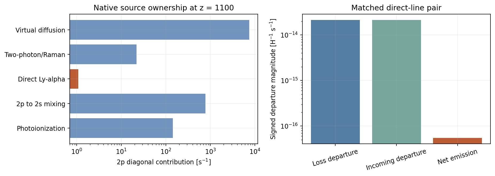
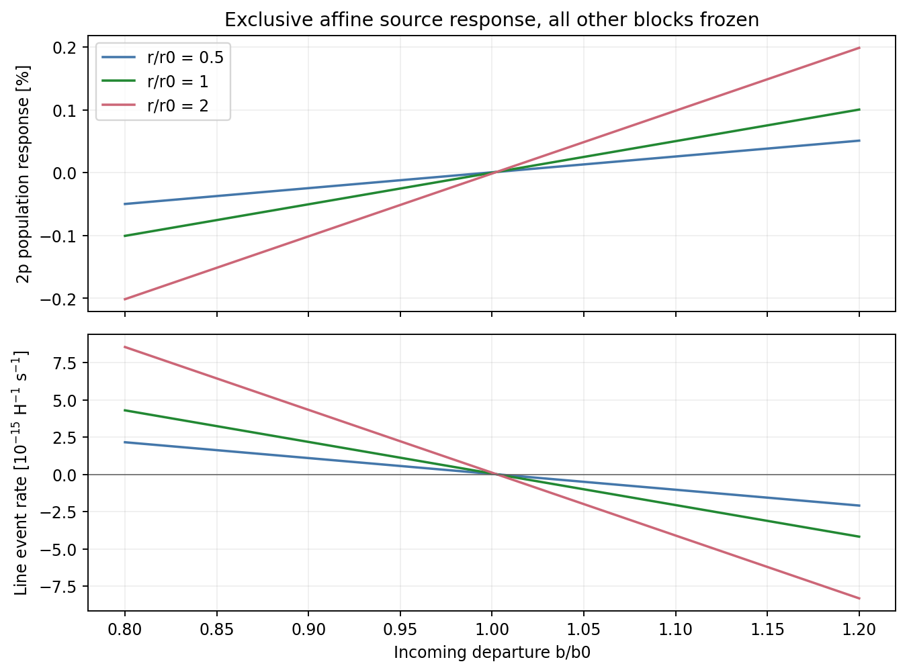
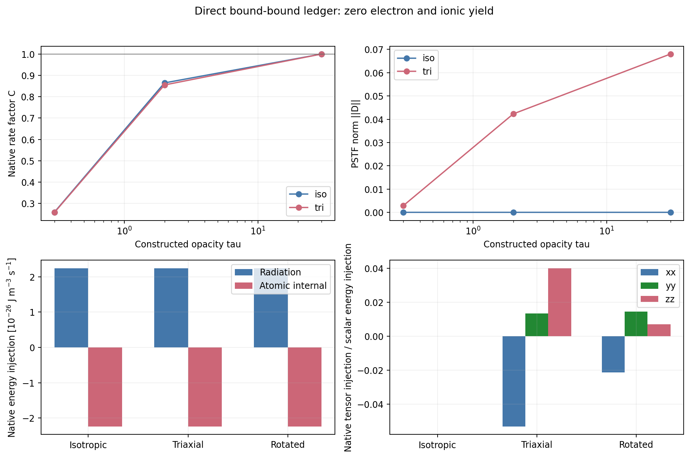

# LINE02 연구 반환 — native Lyα owner와 frozen source 응답

날짜: 2026-10-23, Asia/Seoul. REC PR129의 연구 단위
`research/rec_line_native_owner_20261023`.

## 1. 판정과 이번에 완료한 물리

이번 단위는 **고정된 native HyRec snapshot 하나에서 직접 Lyα 손실항과
blue feedback source를 함께 교체하는 배타적 source adapter**다.
실제 2개 excited departure와 311개 virtual radiation 좌표의 선형계를
한 번 준비하고, 이후의 source 변화는 정확한 rank-one 응답으로 계산한다.
Residual JVP, solved-state JVP, 원자수·광자수·에너지·ionic-yield 원장,
각도별 scalar/PSTF injection 및 유한 광학깊이 오차의 전파식을 구현했다.

새 코드의 첫 primary는 exit0, **194개 유한 수용 검사 PASS**다.
실행 전 고정한 7 owner, 12 JVP, 9 angular 조건과 183개 그림 표본을
완료했다. 새 native runtime, local/cosmological IVP, 과거 campaign 재실행은
모두 0이다. 원본 전체313 직접해와 complex-step reference는 이번 새로운
source adapter의 유한 검증이며, 이전 우주론 history 재실행이 아니다.

동일한 단일 독립검토는 COMPLETE_SCOPED_ADMISSION_FROZEN_SOURCE_ADAPTER로 완료됐고,
현재 범위의 material blocker는 0개다. 최종 독립검토 판정은 `evidence/independent_review/REVIEW_KO.md`,
`FINDINGS.json` 및 실제 PNG 열람 receipt가 authoritative하다.
이 보고서의 수치는 `results/attempt001`의 immutable 원자료를 읽어 집계했다.

**Physical HOLD, REC U5 HOLD_9_FAIL/HOLD_8_FAIL, CLOSED_HOLD_NOT_RESET,
global convergence NOT_RUN, production NOT_APPROVED, REI_activation=false**
유지. 기존 21-population/prescribed T·UV/조건부 atomic closure를 완전한
핵반응망 또는 열역학·복사·Bianchi metric closure로 승격하지 않는다.

## 2. 최신 자료와 재사용 선택

이번 intake는 REC128 최종 반환, REC119·REI220 최신 반환 및 HEAD를 읽고,
REC/REI 각각 최근 갱신 PR20개의 변화를 확인했다. 기존 조사 범위인
407 branches/347 PRs는 과거 inventory로 재사용했다. 모든 대화와 접근
불가능한 백업을 새로 전수 열람했다고 주장하지 않는다.

| 근거 | 확인한 상태 | 이번 사용 |
|---|---|---|
| REC119 | ad93fa1c71f8a2b2a0b19836be3c7b739b11b0c7, 125main+1control=126 | 완료 근거 재사용, 실행0 |
| REI220 | 8be7533cc97b3302bf42608699d6e8313ed6af8a, 127main+2oracle=129, 62→33 | 보존/축약 인터페이스 검토, 실행0 |
| REC128 LINE01 | 6d32330e7f45e7caa9840c558547880b7d28a069 | detached effective-line 이후의 owner 의무 선택 |
| REI221 ANGTHERM01 | 6daf382ee698835e7a141378c232d1d97c1c5cf1 | 새 방향별 thermochemistry 보고서/이론/117-file diff metadata를 읽음 |
| Native HyRec donor | REC114 df95a074730ea0d13d609cf88d448f01f4a47ef1 | May-2012 source·snapshot의 exact block 및 상수 |
| ANGULAR01 | escape_moments.py SHA f8a91ddad8833d4c0079025af81fb8df4b9423da3d87a8363093603922da0c2e | 변경 없이 scalar/PSTF moments 재사용 |

REI221의 새 보고는 10개 완료 trajectory와 별도 charged interrupted
attempt, isotope fraction21→9, photon packet192→24, 총221→41을 포함한다.
그 보고의 Li angular difference와 M8/M16 남은 차이는 이 단위의 새
측정치가 아니다. 결과·계수·실행 수를 LINE02 또는 REC126/REI129에 합치지 않았다.

PR220 compact33은 population/thermal 쪽 후속 donor다. Native excited2p와
311개 virtual radiation 좌표를 그대로 대체할 수 없으므로 이번 직접 구현
donor로 사용하지 않았다. 실제 재사용은 native CSV loader/dense assembly의
정확한 AST 노드, native source partition, 기존 ANGULAR kernel이다.
보존 법칙으로 차원을 줄이는 원칙과 서로 다른 물리 변수의 혼합을 구분했다.

Exa·SciSpace discovery에서 시작해 원전의 적용 범위를 확인했고,
Wolfram context1/evaluator2의 실제 요청·결과를 보존했다. 현행 공식
HYREC-2 master09e8243d0e08edd3603a94dfbc445ae06cafe139와 pinned May-2012
source는 서로 다르다. upstream 최신 코드를 조용히 치환하지 않았다.
독립 LICENSE/COPYING를 찾지 못했다는 조회 결과는 upstream 재허가를
뜻하지 않는다. 기존 소스 header와 출처를 그대로 보존했다.

원전:
- Ali-Haïmoud & Hirata, HyRec: https://arxiv.org/abs/1011.3758
  §V, 식71–94의 real/virtual block, coupled solve, history 연결.
- Lee & Ali-Haïmoud, HYREC-2: https://arxiv.org/abs/2007.14114
  effective real-state와 Sobolev rate, calibrated correction의 적용 범위.
- 현행 코드: https://github.com/nanoomlee/HYREC-2

원전의 virtual states는 radiation 전달을 위한 좌표다. 이를 물리적
311개 atomic species로 합산하지 않았다. HYREC-2의 recombination-history
정확도 주장을 개별 excited population의 같은 정확도로 전용하지 않았다.
관련 판정은 `provenance/PRIMARY_SOURCE_SYNTHESIS_KO.md`에 있다.

## 3. 실제 native source 소유권

보존된 z=1099.9986525171403 state에서

\[
r_0=\frac{4.662899067555897\times10^{15}H}
          {n_{H,\mathrm{cm}^{-3}}x_{1s}}
=1.0832181815556778\ \mathrm{s}^{-1},
\qquad
b_0=3x_{1s}Df^+_\alpha
=1.966063256108117\times10^{-14}.
\]

소스가 직접 소유하는 쌍은

\[
T_{rr,pp}\mathrel{+}=r_0,\qquad s_{r,p}\mathrel{+}=r_0b_0,
\qquad h_0=r_0(x_{r,p}-b_0).
\]

| native 2p diagonal의 기여 | s⁻¹ |
|---|---:|
| Photoionization Beta | 144.40669400086173 |
| 2p→2s mixing | 777.6751644808554 |
| **직접 Lyα** | **1.0832181815556778** |
| Two-photon/Raman | 21.95945159319399 |
| Virtual diffusion | 7508.946123866815 |
| 합 | 8454.07065212328 |

따라서 전체 2p diagonal을 교체하면 diffusion과 다른 물리도 제거된다.
코드는 직접 Lyα의 loss/source pair만 한 번 제거·교체한다.
다른 real source, Trv/Tvr/Tvv, sv, diffusion 및 incoming history는 고정한다.
새 source를 기존 native source 위에 더하는 경로는 거부한다.

xr와 Df는 부호 있는 departure다. 각각의 rxr, rb를 양의 미시적
gross emission/absorption 횟수라고 부르지 않는다.
실제 x2p는 native Wien convention으로 복원하며, 선택한 control에서
음의 물리 population이나 occupation clipping은 없었다.

Native LYA_FACT literal은 보존했다. 현대 exact-SI hc로 다시 만든
escape normalization은 native 값과 상대 −2.66165352758×10⁻⁷ 다르다.
이것은 machine roundoff가 아니므로 source parity의 허용오차로 흡수하지 않았다.
광자 에너지는 명시한 native E21=10.198714553953742eV와 SI eV/J 변환을 쓴다.

## 4. 물리에 따른 정확한 계산 단순화

Frozen block을

\[
T_{rr}x+T_{rv}z=s_r,\qquad T_{vr}^{T}x+Vz=s_v
\]

로 쓴다. 원본 Tvr 저장 shape는 (2,311)이므로 transpose가 필요하다.

\[
W=V^{-1}T_{vr}^{T},\quad u=V^{-1}s_v,\quad
K=T_{rr}-T_{rv}W,\quad j=s_r-T_{rv}u.
\]

이후 \(x_0=K^{-1}j\), \(v=K^{-1}e_p\), \(a=e_p^Tv\),
\(X_0=(x_0,u-Wx_0)\), \(w=(v,-Wv)\)를 한 번 준비한다.
직접 source의 새 계수 \(r\ge0,b\)에 대해

\[
\eta=1+(r-r_0)a,\qquad
\alpha=\frac{(r-r_0)(b_0-x_{0p})+r(b-b_0)}{\eta},
\qquad X_*=X_0+w\alpha.
\]

이는 frozen 선형계의 정확한 대수식이다. 유도와 determinant/JVP 식은
`THEORY.md`에 있다. 매번 313×313 또는 311×311 문제를 풀 필요가 없다.
실제 실행은 virtual band solve1회(3 RHS), real2 solve1회(2 RHS) 후
202개 rank-one query였다. 전체 state 반환에는 313성분의 선형 갱신이 필요하므로
전체 작업을 문자 그대로 O(1)이라고 부르지 않는다. 스칼라 계수만 갱신하며,
313차 재분해가 사라진다는 구조적 단순화다.

현재 \(a=0.004657725587093157\rm\,s\),
\(\gamma_0=r_0a=0.005045333040636401\), cond(K)=24.509360369477253다.
현재 frozen host inverse의 모든 성분은 0 이상이고,
\(0\le\gamma_0<1\)를 실제로 확인했다. 모든 r≥0의 이 연속 branch에서
\(\eta=1-\gamma_0+ra>0\)이지만 구현은 별도로
\(\eta>64\epsilon(1+|(r-r_0)a|)\) guard를 유지한다.
η는 rank-one denominator이며 전체 condition number와 구분한다.

큰 synthetic r에서는 Xp와 b를 직접 빼면 작은 net이 손실될 수 있다.
동일 대수식에서 얻은

\[
D_*=\frac{(x_{0p}-b_0)-(1-\gamma_0)(b-b_0)}{\eta},
\qquad h_*=rD_*
\]

를 사용했다. 반올림된 Xp−b도 conditioning 진단으로 저장했다.
이 안정식은 새로운 물리 근사가 아니다.

Residual과 solved-state tangent는

\[
\delta F=(M+(r-r_0)EE^T)\delta X+
E[(X_p-b)\delta r-r\delta b],
\quad
\delta X_*=\frac{w}{\eta}[(b-X_p)\delta r+r\delta b].
\]

TR, TM, x1s, nH, H, virtual blocks와 history를 고정한 partial JVP다.
전체 thermal/cosmological Jacobian으로 사용해서는 안 된다.

183표본은 r/r0=(0.5,1,2), 각 61개 b/b0∈[0.8,1.2]이다.
입사 departure가 증가하면 2p population이 증가하고 net 방출은 감소한다.
선택한 조건에서 순흡수로 부호가 바뀌어도 같은 signed 원장이 적용된다.
이 그림은 시간 진화 또는 새 cosmological trajectory가 아니다.

## 5. 각도 의존성과 energy/ionic-yield 원장

\(q(n)=1+S:nn>0\), S는 대칭 tracefree 전단/H라 하고,
native 규약을 보존하기 위해 τ=Aeff/r0를 사용한다.
Aeff=(6.2649e8+2×6.2648e8)/3 s⁻¹이다.

\[
C=\langle q(1-e^{-\tau/q})\rangle,\qquad
D=\langle(nn-I/3)q(1-e^{-\tau/q})\rangle.
\]

손실률과 유입항을 함께 r*=r0C로 수정한다. 균일하게 두꺼운 근사에서는

\[
C\to1,\qquad D\to2S/15.
\]

현재 native τ=5.783537831996146×10⁸이며 세 native 각도조건은
동일한 saved xr에서 평가했다. scalar 근사값은 동일하지만
S=diag(−.4,.1,.3)에 대해

\[
D=\mathrm{diag}(-.05333333333333334,\ .013333333333333336,\ .04)
\]

가 남는다. 회전된 tensor의 공변성 절대오차는 8.97206×10⁻¹⁸다.
Q는 escape probability의 moment이고, D=τQ는 rate-normalized coefficient다.
둘을 혼동하거나 D를 이미 진화된 radiation stress라고 부르지 않는다.

보존된 native xr에서의 직접 event는

\[
h=5.486650557167991\times10^{-17}\ \mathrm{H}^{-1}\mathrm{s}^{-1},
\quad R_\gamma=1.3726872952767989\times10^{-8}\ \mathrm{m}^{-3}\mathrm{s}^{-1}.
\]

| 원장 항목 | 변화율 |
|---|---|
| 2p number | −Rγ |
| 1s number | +Rγ |
| photon number | +Rγ |
| 원자 내부 에너지 | −2.242990553943301×10⁻²⁶ J m⁻³ s⁻¹ |
| 복사 에너지 | +2.242990553943301×10⁻²⁶ J m⁻³ s⁻¹ |
| kinetic heat | 0 |
| free-electron / ionic yield | 이 bound–bound event에서는 0 |

단위 시간은 comoving orthonormal frame의 proper second다.
전체 atomic kinetics의 free-electron evolution은 다른 channel 및
excited-state 변화에 의해 간접적으로 달라질 수 있다. 위 zero yield를
전체 recombination의 zero electron response로 해석하지 않는다.
원자 내부 에너지와 복사 에너지 교환을 gas heating으로 중복 계상하지 않았다.

저장된 snapshot과 새로 준비한 algebraic baseline은 분리했다.
전자의 backward residual은 3.06606×10⁻¹⁶이며,
두 state의 최대 component 차이는 9.45331×10⁻¹⁵다.
새 solved baseline의 h는 5.4866505571478246×10⁻¹⁷다.
작은 net source에서는 departure cancellation이 이러한 차이를 확대하므로,
native source-parity는 원본 decimal의 70-digit 기준과 gross scale로 검증했다.

위쪽 6개 finite-opacity control은 synthetic τ=.3,2,30과 iso/tri 조합이다.
아래쪽은 실제 native state의 iso/tri/rotated source다.
이 synthetic coefficient 비교를 여섯 개의 추가 saved cosmological state로
세지 않는다. 그림 PDF는 같은 figure에서 산출되었고 PDF raster review는 NOT_RUN이다.

## 6. 유한 오차 기준과 실제 결과

유한-opacity의 thick 오차는 \(\delta=e^{-\tau/q_{\max}}\),
\(\gamma=ra\)와 frozen response를 통해 전파한다.

\[
\|\Delta X\|_\infty
\le\frac{\|w\|_\infty r\delta |D_0|}{1-\gamma\delta},
\quad
|\Delta h|\le\frac{|h_0||1-\gamma|\delta}{1-\gamma\delta}.
\]

Tensor bound는 population response와 angular-shape error를 함께 포함한다.
코드는 매우 작은 native bound의 log를 보존한다.
native iso의 logδ=−5.783537831996146×10⁸이며,
tri의 logδ=−4.44887525538165×10⁸이다. Floating underflow를 수학적 0으로
표시하지 않는다. 이 bound는 frozen source의 오차이며 global history bound가 아니다.

| 검사 | 최대 관측 | 고정 기준 |
|---|---:|---:|
| Rank/full real component | 8.16419×10⁻¹⁵ | 5×10⁻¹⁰ |
| Rank/full virtual component | 7.71689×10⁻¹⁵ | 5×10⁻¹⁰ |
| Full component backward residual | 4.42332×10⁻¹⁶ | 5×10⁻¹² |
| Residual JVP scaled | 2.72176×10⁻¹⁴ | 5×10⁻⁹ |
| Solved-state JVP scaled | 3.30330×10⁻¹² | 5×10⁻⁹ |
| Source parity의 absolute error | 1.84173×10⁻³⁰ H⁻¹s⁻¹ | 2.13242×10⁻²⁶ |
| Native rotation covariance | 8.97206×10⁻¹⁸ | 5×10⁻¹⁰ C |

Number/energy와 PSTF trace는 64 machine-epsilon의 해당 exchange scale로
검사했다. Full state 오차는 component max(|reference|,1e−30)로 정규화하고,
backward residual은 |M||X|+|s|+tiny로 정규화했다.
JVP는 absolute와 scaled 값을 모두 보존했다. 허용기준을 사후에 넓히지 않았다.

Synthetic τ=.3,2에서는 state/flux bound가 roundoff 위여서 비교가 해상된다.
τ=30에서는 state/flux 차이가 binary64로 해상되지 않으며,
observed0와 bound_above_roundoff=false를 그대로 보존했다.
이 결과는 interval arithmetic의 엄밀한 부동소수점 증명이 아니다.
Truncation bound와 arithmetic resolution을 분리한 유한 수용 검사다.

| 실행 단위 | 수 |
|---|---:|
| Owner control | 7 |
| Full313 real reference / direct Schur2 | 각각 7 |
| JVP direction / complex full313 reference | 각각 12 |
| Angular source row | 9 |
| Propagated-bound subcase | angular 9 중 6 |
| 위 bound의 추가 rank query | 12 |
| Invalid rejection / sign·owner-pair mutation | 12 / 2 |
| Figure rank sample | 183 |
| **Rank query 총계** | **202 = 7+12+183** |
| 새 IVP / native runtime / historical replay | 0 / 0 / 0 |

Angular donor는 analytic thick3회와 quadrature6회, 총49152노드를 사용했다.
Primary의 내부 wall measurement2.077208s, threads1, timeout180s다.
Host inverse 진단용2×2 계산1회도 PREPARATION에 별도 기록했다.
하드웨어·동일정확도 비교 benchmark를 수행하지 않았으므로 speedup 배수를
주장하지 않는다. 실제 source 단순화·코드·그림을 우선했다.

## 7. 복구와 검토 근거의 정확한 보존 범위

긴 upload 응답 뒤 workspace 파일 부재가 관측됐다. 원인은 확정하지 않았다.
StageA Git와 Dropbox는 남아 있었고, 150879-byte ZIP의 SHA256, CRC,
26개 payload 전체 hash를 대조하여 원본 bytes를 복구했다.
복구 후 Drive 업로드도 성공했다. 그 시점까지 primary scientific run은 0이었다.

이전 구현의 최종 code hash와 독립검토 6개 off-grid probe의 full raw arrays는
확보하지 못했다. 이전 코드와 byte-identical이라고 주장하지 않는다.
원래 stdout/선택 출력에서 복원 가능한 evidence는 transcript reconstruction으로
표기했고, 새 코드의 numerical admission에서 제외했다.
그 6개를 반복하지 않았다. 새 코드 identity를 먼저 Git에 게시한 뒤
이번 단일 primary를 실행했다. 동일 독립 reviewer가 새로운 코드·raw·PNG를
읽어 같은 검토 pass를 마무리했다.

Source discovery 원래 manifest13개 중 source synthesis와 upstream identity
2개만 exact restored다. 나머지11 raw payload는 unavailable로 표시했다.
현재 보존 범위는 manifest의 과거 생성 기록보다 작다.
Root가 별도로 보존한 PR/delta responses와 pinned native 입력은 구별한다.
실제로 보유한 파일만 최종 manifest에 넣는다.
기존 첫 실패 REI raw의 historical local-only 범위는 이 사건과 별개로 유지한다.

`results/attempt001/SUMMARY.json`의 figure-review PENDING 및
`IMPLEMENTATION_REUSE.json`의 pre-execution NOT_RUN은 그 시점의 immutable
기록이다. 이후 실제 결과는 PRIMARY_EXECUTION_RECEIPT,
PRIMARY_ARTIFACT_INSPECTION 및 독립검토 receipt가 이어서 설명한다.
과거 시점의 원자료를 현재 상태에 맞추어 덮어쓰지 않았다.

## 8. 단계별 백업과 게시

| 단계 | Git checkpoint | ZIP/검증 |
|---|---|---|
| A source·theory·contract | c038340bb40a81b6a9c3ad3f2966f9d71ca47f23 | 150879B,26payload; Dropbox whole-byte+CRC+26hash PASS, Drive ACK+size |
| 재구성 코드 사전 게시 | 92b604ab696481ecc26ff0c09543c4735c3da6bd | 새 code hash 고정 후 첫 실행 |
| B primary raw·집계 | a06dd8b876ba116aadde02a35a2cf8bb2daaa03a | 428908B,55payload; dual ACK+size, local CRC+55hash PASS |
| C 검토·그림·보고·인계 | 최종 PR129 반환과 FINAL_DELIVERY_RECEIPT 참조 | 최종 Git 전체 blob 대조·dual backup·whole-byte 복구 receipt로 판정 |

A SHA256:
3e919b893a3d24d3373c7894202198bd9d30d7b4024d8f68c35a6b95d572f17e.

B SHA256:
f6dc25ef40380f5a6d741401c73da229f4254a6ad67080a70b6e50d50a7035ce.

A/B provider id와 반환 링크는 `delivery/STAGE_A_ACK.json`,
`delivery/STAGE_B_ACK.json`에 있다. 각 ZIP은 해당 시점의 immutable snapshot이다.
최종 archive 자신의 hash/remote id는 자기 내부에 재귀적으로 삽입할 수 없으므로,
최종 Git 및 archive의 delivery receipt와 PR 최종 댓글에 기록한다.
ACK+size와 실제 전체-byte readback을 같은 검증 수준으로 표현하지 않는다.

## 9. 전체 목표의 DAG와 다음 단일 의무

진척은 `GLOBAL_DAG.json`의 named obligation으로 표시한다.
파일 수나194검사 통과율로 전체 물리 연구의 완성도를 백분율화하지 않는다.

- REC119126, REI220129, warm729: 완료 근거 재사용.
- THERM02, ANGULAR01, LINE01: 각각 명시된 제한 범위 완료, 새 실행0.
- REI221 ANGTHERM01: prescribed background의 완료 보고 재사용, 새 실행0.
- **LINE02: frozen native direct-line owner·JVP·event ledger의 제한 범위 완료.**
- **다음: LINE_HISTORY_BOUNDARY — source와 일치하는 outgoing boundary/history owner.**
- Li charge/state/energy-resolved yield, 실제 field spectral/recoil/induced source,
  nuclear daughter/electron/neutrino/stopping 입력은 별도 미완료 의무.
- Self-consistent atomic/spectral/thermal/metric coupling: NOT_RUN.
- Global convergence: NOT_RUN. Production: NOT_APPROVED.

다음 물리적 출발식은

\[
d_{\rm out}(n)=d_{\rm in}+
\left[\frac{x_{r,p}}{3x_{1s}}-d_{\rm in}\right]
\left(1-e^{-\tau/q(n)}\right).
\]

현재 코드는 incoming history를 고정한다. 유한 source 계수만 바꾸고 기존
thick history output을 그대로 두는 것은 coupled history replacement가 아니다.
다음 loop에서는 원본 outgoing/incoming 저장·interpolation·시간 변수와
소유권을 읽고, 위 boundary와 affine core의 공통 number/energy 원장을 먼저
고정해야 한다. 그 뒤 기존 raw만으로 finite boundary fixtures와 잔차/tangent를
확인하고, 필요한 최소 신규 계산을 선택한다. 완료 campaign은 반복하지 않는다.

## 10. 실행과 재개

`python reproduce.py --prepare-only`는 새 임시 복사본을 만들고 immutable input
hash를 검사한다. `python reproduce.py`는 그 새 복사본에서 threads1,
timeout180s의 bounded primary를 실행한다. 이 명령들은 향후 재현 경로이며
현재 반환 중에 추가 실행하지 않았다. 납품된 성공 raw를 덮어쓰지 않는다.

새 코드 SHA256:
- native_line_owner.py: 96dbf48afa3a85e6a6d7f5a4affd03dec64f3647cbc6603fe7a55a51895d6197
- run_line02.py: 630261cd84ed3b5e58c2a5fd2b4792edbcab603b8781fa5fa718cfe2a5bb9e53
- native input CSV: 3a95862b9cd4f924d63020f39fc537b371133af6160e88c3409d8c69fc0c34b7

다음 대화의 복사 가능한 지시는 `HANDOFF_KO.md`와 PR129 최종 반환에 있다.

