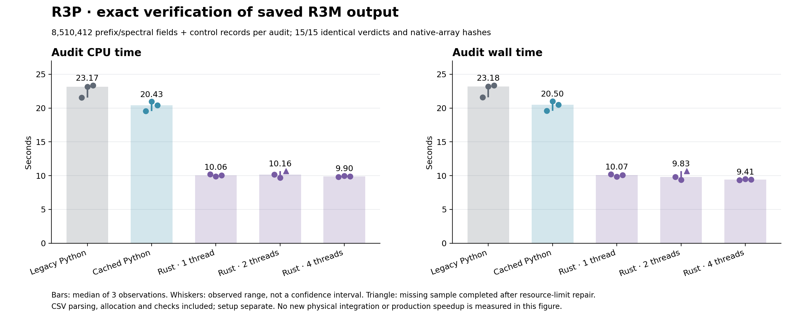

# R3P 정확 감사 가속 — 구현·이론·측정 보고서

## 결과와 적용 범위

완료된 R3M 5210-step 원시 결과를 재사용해 감사 비용을 줄였다. 실제 저장된 5,254,162개 prefix 값과 3,256,250개 spectral 값, 모든 control 행을 검증한 15개 실행에서 판정 JSON, 두 C 이력 배열의 binary64 bytes, 진단 파일 해시가 일치했다. 별도 fixture는 실제 prefix 7,536개와 실제 V ratio 623개를 CI에서 재사용한다. 새 전역 수렴이나 production speedup 결과가 아니다.

실제 실행 장소는 ChatGPT 샌드박스와 별도로 표시한 GitHub Actions이다. NCP 실행은 하지 않았다. 원격 백업을 먼저 조사하고 최신 PR109 및 VigilODE PR73–75/midcheck를 대조했다. 원래 인계 PR104 이후 완료된 R3M full 및 R3O 노드를 재사용했다. 조사 범위·pagination 완료는 receipts/INTAKE.json에 있다.

## 왜 감사부터 바꿨는가

기존 full 결과의 exclusive process-tree CPU는 37.588099초였고 그 중 native stream 감사가 21.409138초(56.9572%)였다. owned 적분 5.837440초, common-input oracle 3.661671초는 독립 항목이다. inclusive 적분 비용을 다시 더하지 않았다. 원래 atomic solve는 이미 80-bin tridiagonal과 2×2 Schur 구조이므로 일반 LU로 바꾸는 근거가 없었다.

원래 시간 재귀 `Y[n+1]=Y[n]+h*(1.25*F[n]-0.25*F[n-2])`는 predictor memory, 과거 광자 이력, stage 사건을 다음 단계에 전달한다. 서로 다른 시간 단계를 독립 작업으로 보내지 않았다. 이미 완성된 prefix의 서로 겹치지 않는 열에 대해서만 Rayon 병렬 map을 적용했다.

## 실제 도입

1. Python scalar 캐시는 같은 prefix 열의 redshift/온도와 같은 단계의 V/A Planck 값을 재사용한다. 원래 scalar libm와 연산 순서를 유지한다. 전체 온도 평가는 정적 개수 기준 5,254,162회에서 16,733회로 감소할 수 있고 V/A 중복 expm1 1,620,310회를 제거한다. watchdog/forensic callback 뒤에는 캐시를 무효화한다.
2. 불변 causal geometry는 정확 energy bytes/shape를 key로 갖는 최대 4개 cache다. 매 단계 활성·미래 인덱스 검사를 계속 실행한다. photon 결과 자체나 원자 연산 결과를 캐시하지 않는다.
3. Rust `rec-stream-audit`는 314 필드 prefix 열을 처리한다. 최대 64열, 4MiB text, 4 worker이며 기본 block은 32열이다. disjoint 출력, indexed collection 뒤 순서대로 오류를 선택하고 실패 block은 이력에 게시하지 않는다. 원래 `abs(py-C)>tol` gate를 ratio gate로 교체하지 않았다.
4. `rec_ratio_batch`는 이미 읽은 배열의 독립 lane에서 같은 binary64 비율을 계산한다. 실제 rustc1.94.1 산출물의 LLVM/assembly에서 128-bit packed double sub/mul/add/div가 관측되었다. FMA·horizontal sum·vector exp를 도입하지 않았다. 이 ratio API는 현재 전체 stream의 spectral loop에 연결하지 않았고 별도 호출 비용만 측정했다.
5. 고정 Rayon1.12.0 및 여섯 registry package 전체를 Cargo.lock, checksum, 원래 라이선스와 함께 vendor했다. 실제 오프라인 build에서 Rust18개 unit test와 C ABI smoke가 통과했다. NCP가 의존성 해석을 새로 할 필요가 없다.

VigilODE의 pinned `ParallelExecution`에서 로컬 pool, indexed output 순서 원칙을, PR73 exact cache에서 finite·정확 bits·실패 시 invalidate 원칙을 재사용했다. 실제 링크한 새 외부 패키지는 Rayon이며 기존 VigilODE pin `a21d573980f66fe02891bd216153443b5352f921`은 유지했다. upstream RODAS/coupled Newton, residual-first 방법과 PR73 banded LU를 HyRec 원래 재귀로 이식했다고 주장하지 않는다. faer0.24.4는 이전 R3O의 2×2 진단 재사용 범위다.

## 같은 입력의 반복 비용

주 분석은 중단 없이 완료된 두 round(각 backend n=2)이다. 비는 각 round의 legacy/candidate 비를 요약했다. 작은 표본의 관측 범위이며 신뢰구간이 아니다.

| 경로 | audit CPU 중앙값(s) | audit wall 중앙값(s) | paired CPU 비 중앙값 | paired wall 비 중앙값 |
|---|---:|---:|---:|---:|
| cached | 20.258670 | 20.297471 | 1.104082 | 1.102597 |
| legacy | 22.368621 | 22.380442 | 1.000000 | 1.000000 |
| rust1 | 10.027651 | 10.028265 | 2.232513 | 2.233571 |
| rust2 | 9.926133 | 9.610651 | 2.256684 | 2.331740 |
| rust4 | 9.888654 | 9.409341 | 2.261603 | 2.378037 |

같은 4 CPU affinity와 BLAS1, block32로 비교했다. Rust1은 direct serial이고 Rust2/4만 로컬 worker를 사용한다. audit interval에는 CSV 읽기, 할당, 모든 predicate·maxima·forensic 경로를 포함하며 setup/pool 생성은 별도로 남긴다. 메모리 peak는 대략 243–246MiB로, 전체 resident memory 감소를 입증하지 않았다. 실제 prefix 추가 array payload 최대 163,536bytes, text 최대 356,988bytes였다.

세 번째 round에서 마지막 worker만 상속된 CPU hard limit을 높이려다 계산 전 거절됐다. 실행기 초기화 오류를 보존하고 상속 한도를 낮춰 쓰도록 수정했다. 완료된 14개는 반복하지 않았고 누락된 Rust2만 재개했다. 총 263.522928 CPU초는 처음 배정 300초 이내다. plan-write→최종 continuation receipt의 filesystem 시각 범위 335.597115초는 480초 이내이며 중간 수정 시간을 포함한다. 세 round 결과는 보조 descriptive 자료이고 수정된 worker hash를 그대로 보존한다.

아래 그림은 세 round의 모든 관측을 보여 준다. 삼각형은 재개된 sample이다.

이 병목만 s배 빨라지고 나머지 exclusive 비용과 추가 overhead가 같다면 전체 CPU 모형은 `S=1/(1-f+f/s)`, f=21409138/37588099다. 이론상 상한은 2.323270264배이고 현재 Rust1 주 분석 비를 대입한 조건부 값은 1.4587배다. 이는 실제 전체 적분 측정값이나 wall-time 예측이 아니다.

## 벡터 계산의 실제 검증과 한계

실제 저장된 32개 단계×311 virtual-bin=9,952lane에서 scalar/NumPy/Rust 출력의 모든 비트가 같았다. 각 방법 6개 balanced trial×64회, 총 384회/3,821,568lane를 측정했다. 아래는 한 번의 9,952lane 호출당 중앙 비용이다. 입력 검증, 출력 할당, ctypes 호출 및 호출당 budget check를 포함한다.

| 방법 | CPU μs/호출 | wall μs/호출 | scalar/방법 CPU 비 |
|---|---:|---:|---:|
| numpy | 61.499 | 56.781 | 111.829 |
| rust | 62.461 | 61.682 | 110.108 |
| scalar | 6877.403 | 7067.811 | 1.000 |

이 입력에서는 NumPy와 Rust가 비슷했다. 배열이 이미 준비되어 있으면 NumPy elementwise 경로가 간단한 선택이다. 약 110배라는 수치는 Python scalar loop와 전체 native 배열 호출의 비교이며 SIMD만의 분리된 기여도도, 전체 CSV 감사/적분 가속률도 아니다. expm1은 측정 경계 밖에서 원래 scalar로 계산한 fbb를 그대로 사용했다. pool은 이 ratio 함수에 사용되지 않는다.

## 정확성 계약과 반례

정확 cache는 key equality가 모든 의미적 입력 equality를 보장해야 한다. 같은 h만으로 시간에 따라 바뀌는 행렬을 재사용하지 않는다. 각 독립 map의 입력 bits·연산 순서·libm·FP 환경이 같으면 연산 그래프의 귀납으로 각 출력 bits가 같고, indexed coordinator는 그 결과를 원래 순서로 게시한다.

유한 실수의 max 결합법칙은 NaN·signed zero·순차 합에 자동 적용되지 않는다. 예를 들어 `(2**53+1)-2**53`과 `2**53+(1-2**53)`은 binary64에서 다르다. d>1의 실수 지연 부등식도 floating subtraction에서 미래 인덱스가 생기지 않는다는 증명이 아니므로 기존 clamp/guard를 유지했다. Wolfram은 실수 항등식과 Amdahl 분수만 확인했고 발생한 MinValue/MaxValue 경고도 기록했다.

새 Python prefix는 원래 검사에서 빠질 수 있던 NaN/Inf를 명시적으로 거절한다. Rust는 canonical 네 필드 ASCII grammar와 유한·양의 Tr/energy 및 유한 tolerance를 요구한다. legacy가 우연히 허용한 trailing field나 잘못된 입력의 모든 예외 문자열과 같다는 계약은 아니다. Rust에 전달된 bounded block에서는 첫 logical row 오류를 고르되, resource/transport/크기 abort가 아직 검증하지 않은 앞선 행보다 먼저 발생할 수 있다.

실제 full saved stream의 두 forensic 파일은 빈 파일이었다. 비어 있지 않은 forensic 동작과 64/65 실패 경계는 합성 differential 테스트에서 확인한 범위이며 실제 full stream에서 발동했다고 쓰지 않는다.

## 실제 U5 smoke와 게시 상태

고정 source commit `e2b39e33e7c840fbe63024bf9e918ef5a1bfaf6d`에서 실제 검토된 U5 checkpoint의 16-step 실행을 완료했다. 종료 코드 0, 첫 실패 없음, 입력·소스 identity는 UNCHANGED였다. 원본 verification은 `SMOKE_ONLY`, 적분은 `HOLD_CAP_BEFORE_RT_BOUNDARY`, same-h 항목은 `PASS_PENDING_REVIEW`라는 원래 명칭을 유지한다. 독립 C9 후속 검토는 실제 소스 23개, frozen 파일 109개, 영수증 해시 연결을 확인하고 검토 범위의 남은 P1/P2 없이 닫혔다.

5,008 causal links, 10,000 spectral fields, 기존 prefix 5,254,162개를 검사했다. common-input oracle은 원래 두 sampled evaluation에서 PASS이며 이를 16개 전체 oracle 재검증으로 확대하지 않는다. average 최대 tolerance ratio는 2.1722981554269436e-5, virtual은 5.653137029811636e-6, lyman은 4.376735287656637e-6였다. original average failures는 빈 목록이다. 이 새 실행은 원본 C와의 tolerance gate 검증이며 saved-stream의 bitwise 비교와 구분한다.

전체 supervisor 측정은 CPU 8.826414초, wall 8.790703708초다. 입력 검사, C컴파일, 적분, 감사, worker closeout과 마지막 hash 검사를 포함한다. 마지막 supervisor receipt write만 2 CPU초/3 wall초 reserve로 남겼으며 실제 측정값으로 더하지 않았다. 메모리는 process별 2GiB AS 제한과 50ms sampled worker/descendant RSS이며 부모까지 합친 정확한 aggregate memory/peak가 아니다.

같은 코드의 GitHub Actions 전용 CI는 push와 PR에서 각각 Python 214개 모두 PASS였다. Rust18개 release 검사 및 C ABI는 실제 offline build에 포함됐다. 일반 회귀 CI는 각각 968 PASS, 102 SKIP, 72 subtest PASS다. 일반 CI에서 build receipt가 없어 건너뛴 R3P Rust binding 항목은 전용 CI가 실제 빌드와 함께 검증했다. 중복 실행을 새로운 고유 case 수로 합산하지 않는다.

[새 smoke 영수증](receipts/smoke16/verification.json), [전체 자원 감시](receipts/smoke16/supervision.json), [독립 최종 검토](receipts/C9_FINAL_REVIEW.md), [실제 CI 상태](receipts/STAGE2_CI.json), [원시 결과 복구 manifest](receipts/SMOKE16_RAW_ARCHIVE.json)에 원래 상태와 해시를 보존했다. 마지막 백업·readback·publication 상태는 BACKUP_ACKS.json과 DAG.json에서 확인한다.

## 보존한 과학적 상태

원본 ZIP `48cd5975…`, 검토 U5 `7aeec545…`, h=4.245e-5, 원래 atomic/thermal operator·stage boundary·같은-h gate를 유지한다. U5 원래 h는 HOLD_9_FAIL, h2는 HOLD_8_FAIL이며 기존 비용 장부는 CLOSED_HOLD_NOT_RESET다. REI_activation=false다. 새 full5210 재실행, Python h/h2/h4 전역 수렴, Bianchi/REI/CMB 예측과 production speedup은 이번 국소 검증으로 승인하지 않는다.

## 출처와 증거

- [전체 측정·차등 비교](receipts/AUDIT_COMPARISON.json), [ratio 측정](receipts/RATIO_BENCHMARK.json), [컴파일러 SIMD 증거](receipts/SIMD_COMPILER_EVIDENCE.json)
- [독립 C9 최초 검토](receipts/C9_STAGE1_REVIEW.md), [이론·원문·정확 source 검토](receipts/THEORY_REUSE_REVIEW.md), [VigilODE 실제 새 결과 조사](receipts/VIGILODE_INTAKE.md)
- [HyRec 원 논문](https://arxiv.org/abs/1011.3758), [HyRec2 원 논문](https://arxiv.org/abs/2007.14114): effective atom/희소 RT 구조와 별도 보정 기반 방법의 구분. HyRec2로 원래 October2012 operator를 대체하지 않았다.
- [Rayon1.12 ThreadPoolBuilder](https://docs.rs/rayon/1.12.0/rayon/struct.ThreadPoolBuilder.html), [IndexedParallelIterator](https://docs.rs/rayon/1.12.0/rayon/iter/trait.IndexedParallelIterator.html)
- [VigilODE exact cache source](https://github.com/cosmosapjw-quantum/vigilode/blob/3c0157910076ce552283c831c2be000c66671fab/crates/rodas5p-integrators/src/exact_band_cache.rs), [pinned parallel source](https://github.com/cosmosapjw-quantum/vigilode/blob/a21d573980f66fe02891bd216153443b5352f921/crates/rodas5p-integrators/src/parallel.rs)
