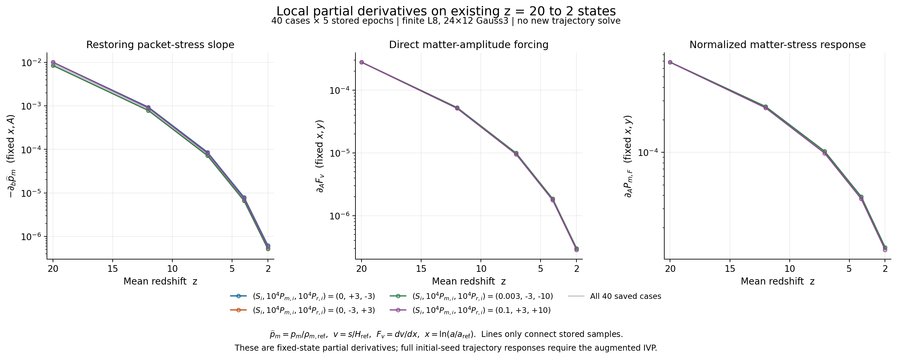
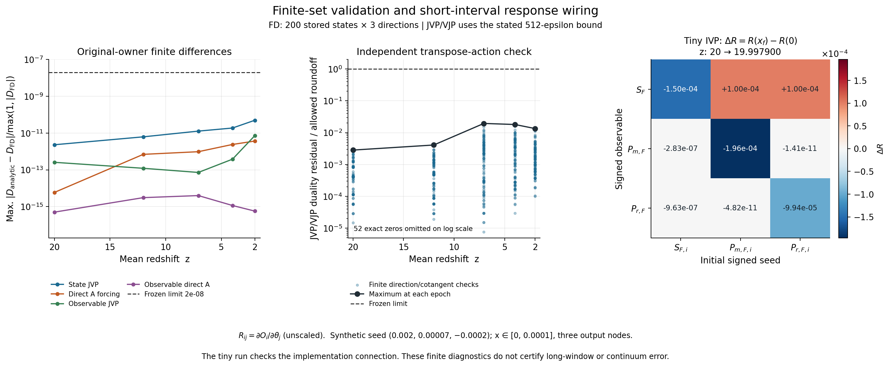

# REC → REI: 세 초기 성분의 analytic tangent adapter

## 완료한 연구 단위

고정 PR147 collisionless non-tilted LRS Bianchi I 모형의 **40-state RHS에 대한
matrix-free JVP/VJP와 독립 초기 세 seed의 160-state forward tangent 실행 경로**를
완성했다. 저장 200개 상태의 독립 비교, 8개 단위 검사, 아주 짧은 두 IVP의 연결
검사, 실행기의 보존·자원 배분 검사, 그림 두 장과 독립 코드 검토를 마쳤다.

실제 새 실행은 **ODE 2회(tiny parent 1 + augmented 1), NCP 0회, benchmark 0회**다.
새 interior 3개의 전체 `z=20→2` sensitivity 계산은 `READY_NOT_SUBMITTED`다.
기존 parameter sweep과 전체 시간 진화 그림은
[REC PR117](https://github.com/cosmosapjw-quantum/rec_bianchi/pull/117)의
175-case 결과를 재사용한다.

- [REC118](https://github.com/cosmosapjw-quantum/rec_bianchi/pull/118): draft.
- branch: `research/rec-rei-tangent-20261021`.
- stacked base: REC117 `research/rec-rei-trajectory63-20261021`.
- 최종 HEAD·tree·CI·archive ACK는 PR118의 최종 보존 댓글에 기록한다.
- [수학 유도](THEORY_KO.md), [사전 계약](CONTRACT_KO.md), [DAG](DAG.json).
- [NCP/Codex 인계](CODEX_HANDOFF_KO.md), [새 대화 인계](NEXT_THREAD_HANDOFF_KO.md).
- [결과 요약 JSON](results/SUMMARY.json).

## 먼저 확인한 새 결과와 선택

6개 관련 repository의 최근 PR 30개 metadata와 알려진 branch·PR의 delta를
조회하고, 이전 823-branch 조사에서 변하지 않은 근거를 재사용했다.
Dropbox의 관련 다섯 경로에서 701개 immediate-child metadata를 확인했다.
이 범위의 확인이며 모든 과거 대화·미게시 branch를 다시 완전 조사했다고
주장하지 않는다. Personal Context 검색은 실제 호출했으나 unavailable였다.
[조사](provenance/SURVEY_KO.md), [upstream](provenance/UPSTREAM_DELTA.json),
[백업·대화 접근](provenance/BACKUP_CONTEXT_DELTA.json)에 범위를 남겼다.

| 근거 | 읽은 상태 | 반영 |
|---|---|---|
| REI215 / BASS178 NCP native 반환 | compile 1 + 작은 2-step case 5, 40/40 gates PASS; scientific adjudication PENDING | warm kernel 근거 재사용; 이번 tangent의 NCP 검증으로 전용하지 않음 |
| BASS_CR93 C21N | massive moment derivative와 prepared-grid 연구 | 같은 finite packet의 미분식·geometry 재사용 |
| HH132 PHYS77 | S0 8-state whole-cell source enclosure 계약 진행 | 해당 작업을 보존하고 full40-state tangent 선택 |
| REI199 D8 | 기존 네 bracket의 owner publication | 저장 state만 재사용; 원 실패/124와 data-only recovery 보존 |
| REC116/117, REI213/216, HH130 | 알려진 완료 결과·head 재확인 | 완료 계산을 다시 제출하지 않음 |

moment/native, whole-cell enclosure, full-state tangent 세 후보 중 마지막 하나를 선택했다.
H feedback, 분포 amplitude 직접항, 초기 세 seed 미분을 연결한 새 API가
이번 단위의 기여다.

## 물리량·미분식

물리 source는 REI PR147 `3b85dedce84d37b3e165da00685a8a984950aafe`다.
원 코드 세 파일, background lock, MIT LICENSE를 byte-identical로 보존했다.
L=8, 40-state, massive matter fraction 0.1, `m/T_ref=30`,
24×12 cells와 subcell Gauss3, `ne_source=None`, viscosity 0을 고정한다.
Radiation은 photon과 massless-neutrino hierarchy를 합친 성분이다.
이 collisionless 모형을 warm C15 혹은 전체 cold EoR로 해석하지 않는다.

`x=ln(a/a_ref)`, `a_ref=1/21`,
`sigma=diag(-s,-s,2s)`, `pi_A=diag(-p_A,-p_A,2p_A)`다.
H와 s는 시간 역수, 물리 p_A는 J/m³, `kappa_t=8πG/c²`다.

```text
S_F = sqrt(6) s/H
P_A,F = sqrt(6) kappa_t p_A/H²
P_total,F = P_m,F + P_r,F
Sigma_F = abs(S_F), Pi_A,F = abs(P_A,F), Pi_total,F = abs(P_total,F)
```

half-contraction norm은 Frobenius 값을 sqrt(2)로 나눈다.
Signed tensor 성분을 더한 뒤 norm을 취한다.
0에서 절댓값의 일반적인 선형 미분은 없으므로 signed sensitivity를 저장한다.
S=0의 초기 미분은 명시적인 signed-shear smooth extension의 미분이다.

양의 conserved packet에서
`U=e^(-2x)q²e^(2b)(1−μ²)`, `W=e^(-2x)q²e^(-4b)μ²`,
`E=sqrt(m²+U+W)`, `d=e^(-3x)N(A)/N_ref(A)`이면,

```text
rho_b = -6 pi_s
pi_s,b = -sum d [(2U+8W)m² + U² + 14UW + 4W²] / (6 E³) <= 0
rho_bb = -6 pi_s,b >= 0
```

고정 분포의 에너지는 b에 대해 convex이고 stress slope는 restoring 부호다.
이것은 고정 finite packet의 구조이며 결합된 전체 계의 안정성 정리는 아니다.
Wolfram symbolic 검산과 원 packet 식·유한차분 비교를 보존했다.

초기 `theta=(S_F,i,P_m,F,i,P_r,F,i)`의 response는

```text
Z' = F_y Z + F_A A_theta
Z(0) = y0_theta
```

로 적분한다. Matter seed는 canonical 분포 amplitude A를 직접 바꾸므로
`F_A A_theta`를 포함해야 한다. `N(A)/N_ref(A)`의 정규화 미분도 유지했다.
Radiation seed는 초기 multipoles로 들어가며 별도 직접 RHS forcing은 없다.
H constraint의 feedback까지 같은 chain rule에 포함했다.

표준 sensitivity 식과 matrix-free Jv 구성은
[SUNDIALS CVODES 공식 문서 §4.2.7](https://sundials.readthedocs.io/en/latest/cvodes/Mathematics_link.html)을
확인해 재사용했다. Kinetic moment 구조는
[Heinzle–Uggla의 Bianchi I Einstein–Vlasov 연구](https://arxiv.org/abs/gr-qc/0512031)와
대조했다. Exa와 SciSpace로 원 자료를 찾았으며 논문의 장시간 정리를 현재
finite L8 모형에 적용하지 않았다. CVODES 자체를 새 dependency로 넣지 않았다.
[출처 기록](provenance/LITERATURE_SOURCES.json)에 읽은 범위가 있다.

## 구현과 계산 구조

| 파일 | 역할 |
|---|---|
| `code/tangent_core.py` | 같은 상태의 packet geometry·H·stress 준비, 여러 방향 JVP와 독립 VJP |
| `code/owner_model.py` | 원 source와 세 초기 seed의 calibration/미분 |
| `code/augmented.py` | parent 40 + tangent 40×3 = 160-state DOP853 |
| `code/ncp_tangent.py` | interior 3개의 create-only 실행·재사용·예약·실패 보존 |
| `code/resources.py` | 기존 read-only CPU/RAM sampler 재사용 |
| `code/plot_tangent.py` | 현재 검증 그림 및 미래 실제 NCP sensitivity 그림 |
| `code/verify_tangent.py`, `code/test_tangent_contract.py` | 원 RHS·초기 seed·계약 검사 |
| `code/verify_wiring.py`, `code/audit_dispatch.py` | 짧은 IVP 연결 및 synthetic worker 운영 검사 |

같은 상태에서 2,592 packet의 geometry를 한 번 준비해 세 tangent 열이 공유한다.
방향마다 nonlinear RHS를 다시 평가하거나 40×40 dense Jacobian을 만들지 않는다.
Radiation의 작은 행렬 곱은 NumPy의 여러 열 연산으로 처리한다.
독립 case는 spawn process와 numerical threads 1로 실행한다.
이는 코드 구조의 개선이며 실제 speedup·메모리 절감률·병렬 효율을 측정한 결과가 아니다.

Tangent scale은 `[0.1,0.0003,0.001]`이다. Solver에는 `Z*scale`을 넣고
출력은 unscaled Z로 저장한다. `rtol=3e-11,atol=3e-13`은 local solver 제어다.

## 실제 검증

오차는 `max |analytic-reference|/max(1,|reference|)`다.
[원 receipt](results/verification_v1/VERIFICATION.json)에 worst case와 hash를 보존했다.

| 검사 | 최대 차이 | 고정 기준 |
|---|---:|---:|
| 원 RHS와 adapter RHS | 2.1684e−19 | 2e−13 |
| State JVP와 원 RHS 5-point FD | 4.9455e−11 | 2e−8 |
| Matter amplitude 직접항 | 3.6692e−12 | 2e−8 |
| Signed observable JVP | 7.2149e−12 | 2e−8 |
| 초기 상태의 세 seed derivative | 3.8260e−12 | 2e−9 |
| 초기 amplitude derivative | 1.6344e−11 | 2e−9 |
| 초기 observable Jacobian과 identity | 4.4409e−16 | 2e−9 |

40 cases × 5 epochs = 200 states, state direction 600개를 검사했다.
19개 gate와 8개 unit tests PASS다. JVP/VJP 내적 residual 최대 1.5099e−14,
`512 eps64 × (1+내적 절댓값 합)` 기준 대비 최대 비율 0.01953이었다.
200개 state에서 `pi_b`는 모두 음수였다.

한 늦은 시각에서 FD 차이가 기준을 넘었던 개발 이력이 있다.
Step halving으로 4차 절단오차 감소를 확인해 reference 간격을 줄였고,
허용 기준은 완화하지 않았다.
[AUDITOR_DEVELOPMENT.json](evidence/AUDITOR_DEVELOPMENT.json)에 실패를 보존했다.

새 synthetic interior 1의 `x=0→1e-4`에서 parent·augmented IVP를 각 1회 실행했다.
실제 출력은 3개, `z=20→19.9979001049965`다. 13개 검사 PASS이며 parent state
차이는 0이었다. [실제 실행 receipt](results/wiring_v1/TINY_WIRING.json)가 있다.
이후 parent 실패 경로를 보완했고, 성공 경로가 byte-identical임을 독립 정적
검토하여 두 IVP를 재실행하지 않았다.

실행기의 20개 검사는 synthetic worker·CPU/RAM/PID provider로 수행했다.
완료 재사용, 실패·claim 보존, hash 오류 거절, 예약 반영, 자기 lease만 정리하는
동작을 확인했다. 첫 lease 검사는 관리형 sandbox의 PID와 mounted /proc 차이로
중단됐다. NCP 코드는 그대로 두고 명시적 synthetic provider로 검사를 분리했다.
그 이력은 evidence/C9_DISPATCH_DEVELOPMENT.json에 있으며 실제 NCP 검증이 아니다.

새 코드에는 별도 agent의 물리·구현·augmented·plot adapter 검토가 있다.
REC116의 역사적인 독립 검토 미실행 표시는 바꾸지 않는다.

## 그림



첫 그림은 40 cases × 5개 저장점의 `-pi_b`, `F_v,A`, `P_m,A`다.
선은 저장점만 연결한다. 초기 seed에 대한 전체 trajectory sensitivity와 구분한다.



둘째 그림은 FD·transpose 검증과 tiny 구간의 `Delta R=R(x_f)-R(0)`이다.
작은 국소 응답을 전 구간의 비결합 또는 전역 정확도로 해석하지 않는다.
두 PNG를 직접 열어 확인했고 PDF도 함께 제공한다.

기존 요청의 parameter sweep과 `z20→2` norm 진화 그림:
[PR117 pilot figure](../rec_rei_trajectory_reuse_20261021/figures/05_norm_evolution_and_endpoint_pilot.png).
PR117의 축 재구성 차이 역시 저장 결과의 사후 차이며 참해 오차가 아니다.

## NCP에 남긴 작업

| 새 case | S_F,i | P_m,F,i | P_r,F,i |
|---|---:|---:|---:|
| interior_1 | 0.002 | 0.00007 | −0.0002 |
| interior_2 | 0.006 | −0.00007 | 0.0002 |
| interior_3 | 0.015 | 0.0002 | −0.0007 |

구간은 `x∈[0,ln7]`, `z=20→2`, 출력 153개(121+32)다.
추가 native compilation 없이 기존 Python 환경에서 실행할 수 있다.

```bash
python code/ncp_tangent.py --output /absolute/new/run --profile ncp --max-workers 63
python code/ncp_tangent.py --output /absolute/new/run --profile ncp --max-workers 63 --execute
python code/plot_tangent.py --ncp-output /absolute/new/run --output /absolute/new/run_figures
```

공동 예약은 `--reserved-cpus`, `--reserved-memory-gib`, `--lease-dir`로 반영한다.
매 batch에서 live CPU/RAM과 compatible lease를 읽는다.
다른 Codex 세션의 존재 자체를 veto로 삼지 않는다.
상한 63 worker 중 이번 새 case가 3개이므로 동시 수는 최대 3이다.
완료 계산을 복제해 코어를 채우지 않는다.

Case당 120초는 RHS에서 확인하는 cooperative deadline이며 OS hard kill이 아니다.
Controller 900초는 새 batch admission 기준이다.
0.5 GiB/case 예약과 큰 host의 16 GiB 여유를 적용한다.
다른 연구의 예약·실패·CPU debit은 수정하지 않는다.
완료 결과는 source/code/input identity와 NPZ hash로 재사용하며,
실패·attempt·claim은 자동 재시도하지 않는다.
`NO_PENDING_WORK`만으로 모든 case 성공을 판정하지 않는다.

Plotter는 outer `COMPLETE`, inner `COMPLETED`, identity, NPZ hash,
153개 canonical grid와 x/z 양 끝점을 확인한다.
실제 결과 없이 미래 sensitivity 곡선을 생성하지 않는다.

## 판정·보존

| 축 | 상태 |
|---|---|
| 유한 vector field 미분·코드 연결 | PASS_SCOPED |
| Physical | HOLD |
| 전체 구간 tangent 적분 | NOT_RUN / READY_NOT_SUBMITTED |
| Global/continuum convergence | NOT_RUN |
| 성능 측정 | NOT_RUN, benchmark 0 |
| Production | NOT_APPROVED |
| REC U5 | HOLD_9_FAIL / HOLD_8_FAIL, CLOSED_HOLD_NOT_RESET |
| REC REI_activation | false |

Stage A/B의 실제 commit·archive·CI는 evidence/STAGE_A_RECEIPT.json과
evidence/STAGE_B_RECEIPT.json에 있다.
C/D의 최종 게시·백업은 이 snapshot 이후 작성되는 PR118 최종 보존 댓글과
closing receipt가 확정한다. 수행하지 않은 readback을 PASS로 표시하지 않는다.
