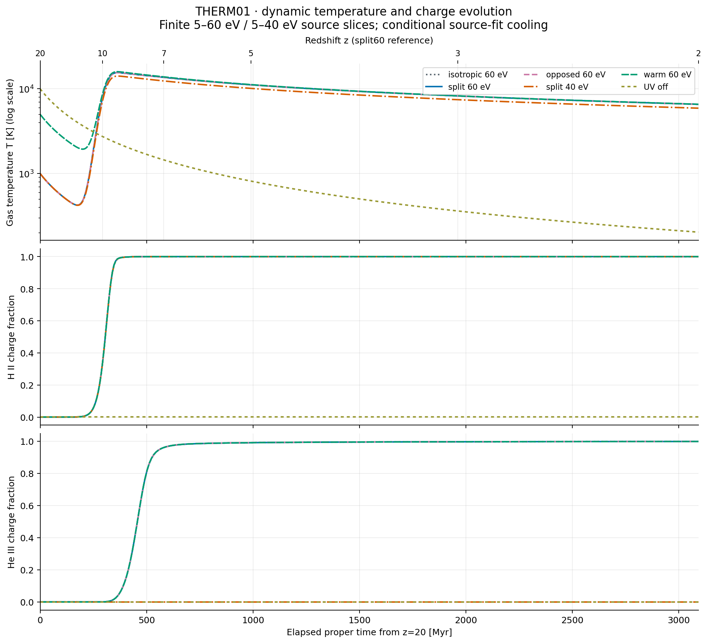
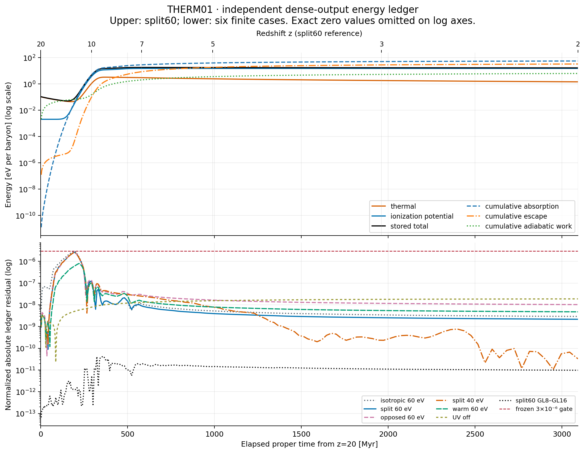
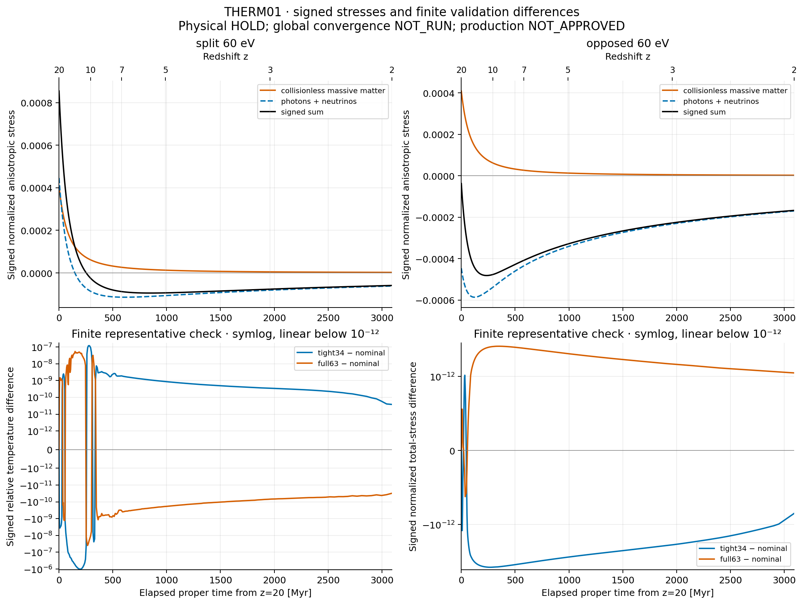

# THERM01: source를 고정한 유한 thermal / ionic-yield 단계

## 결과와 주장 범위

**새 THERM01 사례 8개를 완료했고, 고정한 수용 기준과 독립 검토를 통과했다.**
기존 REI PR220의 축약을 재사용하여 동적 열에너지 변수 하나를 추가했다.
새 상태는 compact34이며, 검증용 원좌표 상태는 full63이다. 21 population을
명시적으로 복원한다. 온도는 새 열방정식으로 진화하고 UV envelope는 여전히
prescribed이다. retained-process energy ledger를 닫았지만, 모든 물리 과정의
열역학적 폐쇄나 완전 핵반응망을 완료한 것은 아니다.

이번 계산은 새로 선택한 **5–60 eV smoothed ground-state continuum** 및
5–40 eV source control에 관한 조건부 결과다. 기존 5–200 eV pilot의 재계산이나
전대역 ionic-yield 완료로 해석하지 않는다. RR/DR rate fit으로부터 유도한
kinetic-energy moment의 구현과 수치 일관성을 검증했으며, 그 cooling의 독립적인
물리 정확도는 아직 측정하지 않았다.

**유지 상태:** Physical HOLD; REC U5 HOLD_9_FAIL/HOLD_8_FAIL;
CLOSED_HOLD_NOT_RESET; global convergence NOT_RUN; production NOT_APPROVED;
REI_activation=false.

## 1. 인계 기준과 실행 회계

| 묶음 | 고정 근거 | 완료 계산 | 이번 재실행 |
|---|---|---:|---:|
| REC 복구 | PR119, `ad93fa1c71f8a2b2a0b19836be3c7b739b11b0c7`, recovery comment6327410942 | 125main+1control=126 | 0 |
| REI 축약 | PR220, `8be7533cc97b3302bf42608699d6e8313ed6af8a` | 127main+2full62oracle=129 | 0 |
| warm729 및 다른 완료 campaign | 기존 완료 지점 유지 | 기존 회계 유지 | 0 |
| THERM01 | 이 디렉터리의 frozen contract와 각 RESULT identity | 6nominal+1tight34+1full63oracle=8 | 새 IVP8개, 실패0 |

REC 원본 ZIP의 whole-byte/685payload 복구 PASS는 기존 복구 증거로 읽었으며
이번에 그 계산이나 복구 검사를 다시 실행하지 않았다. REI 첫 실패의 약33MB raw는
당시 local-only였다는 보존 범위를 유지한다. 이후 완료 archive의 보존 상태를
그 첫 실패 raw에 소급하지 않는다. 새 THERM01 raw는 8개 모두 이 산출물에 포함한다.

PR220의 불변 donor57파일을 byte 단위로 유지했다. unique source coefficient row는
photo6, RR6, DR3이다. 이 수는 isotope 복제 행 수, 21 population 수, IVP 수와 다르다.
별도 REI PR219의 passive DD/quotient 결과는 source lead로만 기록했고 이 모델에
핵변환을 가져오지 않았다.

원문 연결: [REC PR119 recovery](https://github.com/cosmosapjw-quantum/rec_bianchi/pull/119#issuecomment-6327410942),
[REI PR220](https://github.com/cosmosapjw-quantum/rei_bianchi/pull/220),
[새 Draft PR120](https://github.com/cosmosapjw-quantum/rec_bianchi/pull/120).

## 2. Source 선택과 ionic yield

광자 number spectrum은 E^-2.5, 5–Emax eV이며 각 source를 후기
Gamma_HI=1e-12 s^-1에 정규화했다. 시간 envelope는
Q(z)={1+tanh[(7-z)/0.8]}/2이다. 동일한 H I 이온화율 정규화가 동일한 총
광자 에너지 입력을 뜻하지 않으므로 40/60 eV 차이는 이 특정 source 계약의 비교다.

채택한 continuum photochannel에서는 최종 전하 증가와 방출전자 수가 각각1이고
E_gamma=chi+E_heat이다. Emax60은 직접 Li I1s-hole 채널 문턱 약64.39 eV보다
낮고, He/Li의 다중이온화 채널을 포함하지 않는다. 54.4 eV 부근 이상의
He II photoionization은 60 eV source에 남지만 40 eV source에서는 닫힌다.[S1,S2]

**Source 문구 교정:** “core excitation is zero”라는 frozen contract의 한 문장은
지나치게 넓다. 정확히는 **retained direct Li I1s-photoionization branch가0**이다.
실제 Li에는 50–60 eV에도 공명 core excitation이 존재한다.[S3] 이 공명과 그
decay는 이번 smoothed continuum 모델에서 제외했다. 생략 오차가0이라는 주장은
하지 않는다. 원 계약은 실행 identity이므로 byte를 보존했고,
[SOURCE_SCOPE_CLARIFICATION.md](SOURCE_SCOPE_CLARIFICATION.md)가 그 문장을 정정한다.
이는 새 물리항이나 수용 기준의 변경이 아니며 ODE 재실행을 요구하지 않는다.

2026 Müller 등의 CCC 연구는 Li의 correlated single/double photoionization을
다루지만 논문의 Data Availability는 수치자료가 공개 게시되지 않았고 저자에게
요청할 수 있다고 명시한다.[S3] 실제 수치표를 취득·도입했다고 주장하지 않으며
저자에게 연락하지 않았다. 모든 K-shell 흡수를 고정된 두 전자 Auger yield로
처리하는 임의 규칙도 넣지 않았다.

## 3. 열방정식과 energy ledger

SI 단위를 쓰며 Y_i=n_i/n_b, Y_e=q·Y, eta=sum_iY_i+Y_e,
dot(n_b)=-3Hn_b이다. I_i는 각 ground-state charge의 누적 ionization energy다.
바리온당 에너지를

\[
\epsilon_{\rm th}=\frac32\eta k_BT,\qquad
\epsilon_{\rm ion}=I\cdot Y,\qquad
w=\epsilon_{\rm th}/k_B
\]

로 정의했다. x=ln[a/(1/21)]를 독립변수로 쓰면

\[
T=\frac{2w}{3\eta},\qquad
\frac{dw}{dx}=-2w+\frac{\mathcal H_{\rm photo}-\mathcal C_{\rm rec}}
{n_b k_B H}.
\]

이 선택은 이온화로 자유전자가 늘 때 생기는 열용량 변화를 포함한다. 온도로
직접 쓰면 -T dot(Y_e)/eta 항이 필요하다. 지정한 T(z)나 숨은 온도 floor를
새 결과에 사용하지 않았다.

온도에 직접 의존하지 않는 microscopic cross section의 Maxwellian rate에서

\[
\alpha(T)=CT^{-3/2}\int E\sigma(E)e^{-E/(k_BT)}dE
\]

를 미분하면 kinetic-energy moment는

\[
\boxed{\beta(T)=k_BT^2\alpha'(T)+\frac32 k_BT\alpha(T)}
\]

이다. 이는 원래 적분에 대한 항등식이고, fitted alpha에 적용하면 명시적인
**fit-derivative closure**가 된다. alpha의 fit 오차가 beta의 오차를 자동으로
제한하지는 않는다. RR의 온도의존 B 항까지 미분했고, DR의 Kelvin 에너지 fit은

\[
\alpha_{\rm DR}=T^{-3/2}\sum_jc_je^{-E_j/T},\qquad
\beta_{\rm DR}=k_BT^{-3/2}\sum_jc_jE_je^{-E_j/T}
\]

로 평가했다.[S4,S5] signed fit 항은 개별 확률로 바꾸지 않았다. Wolfram 기호
검산과 별도의 수치 미분 검사는 유도·구현을 확인하며 독립 cooling 관측자료를
대신하지 않는다.

각 recombination event의 thermal loss는 beta이고, escaping photon energy는
chi*alpha+beta다. 따라서 장부는

\[
\boxed{\frac{d}{dt}(\epsilon_{\rm th}+\epsilon_{\rm ion})
+2H\epsilon_{\rm th}=\frac{P_{\rm abs}-P_{\rm escape}}{n_b}}
\]

로 닫힌다. binding energy를 thermal cooling에 다시 넣거나 DR excitation을
별도 항으로 중복 차감하지 않는다. 이 식은 외부에서 prescribed된 UV의 입력과
선언한 photon escape를 포함하는 gas 장부이며, UV radiative transfer까지
자기일관적으로 푼 우주 전체 에너지 방정식은 아니다.

## 4. 축약 재사용의 조건

| 상태 | geometry | atomic coordinates | tau | thermal w | 합계 |
|---|---:|---:|---:|---:|---:|
| 기존 compact |23|9|1|0|33|
| 새 compact |23|9|1|1|34|
| 새 full oracle |40|21|1|1|63|

공통 scalar T, isotope 간 electronic-rate equality, 국소 isotropy와 reflection-even
LRS 조건에서는 기존 상수 restriction/lift가 계속 불변 부분공간을 나타낸다.
새 thermal RHS와 diagnostics를 작성했고 prescribed-T Jacobian을 가져오지 않았다.
세 개의 frozen state에서 compact/full RHS 차이는3e-16 수준이었다.
핵변환이나 isotope별 서로 다른 rate를 추가하면 이 불변성은 새로 검토해야 한다.

바리온 gas는 pi_b=0인 test fluid다. 별도의 collisionless massive matter와
photon+neutrino stress를 signed 값으로 각각 기록한 뒤 합했다. 선택한 작은
thermal-energy trace 비율의 수치 검사는 완전한 GR 열역학 backreaction 승인이 아니다.

## 5. 실제 새 결과

모든 사례는 z20→2, 193 저장 시각이다. BDF nominal rtol2e-8,
max_step0.025이고 tight34는 rtol2e-10과100배 작은 atols를 사용했다.
온도 source 정의역은100–1e6K이며 clipping이나 renormalization이 없다.

| 사례 | 초기 T[K] | Emax[eV] | 최종 T[K] | 최종 tau_T | 최대 energy residual |
|---|---:|---:|---:|---:|---:|
| isotropic60 |1000|60|6571.438612|0.0718002389|2.93562946e-6|
| split60 |1000|60|6571.354824|0.0717918637|2.58693522e-6|
| opposed60 |1000|60|6571.347785|0.0717916727|2.59849692e-6|
| split40 |1000|40|5917.452911|0.0680864530|2.60942318e-6|
| warm60 |5000|60|6579.461402|0.0718069243|7.97785862e-7|
| UV off |10000|60, amplitude0|204.081698|0.0000375797|1.87977325e-8|
| split60 tight34 |1000|60|6571.354824|0.0717918630|4.92225239e-8|
| split60 full63 |1000|60|6571.354824|0.0717918637|2.72005631e-6|

입력 Sigma_F/matter_A/radiation_A는 isotropic에서0/0/0,
split에서0.15/0.6/0.15, opposed에서0.15/0.6/-0.15다. 나머지 control은 split
geometry를 사용한다. 정확한 설정은 각 RESULT.json의 config에 있다.

해석은 이 유한 source/model 안에 한정한다. split60은 최종 H II fraction
0.999996612, He III0.998367445, Li II0.999999075다. split40은 H II가 비슷하지만
He III는 정확히0이고 He II0.999992901이다. 동일한 H I rate 정규화에서 source
상한을 낮추면 최종 T와 tau가 함께 낮아진다. warm60은 초기 열상태 차이가 남지만
최종 T 차이는 split60 대비 약8.11K다. UV-off의204.081698K는
10000*(3/21)^2=204.081633K라는 adiabatic 기준에 가깝다. UV-off에도 잔류 전자와
재결합이 있으므로 순수 무반응 해와 완전히 같아야 한다는 주장은 하지 않는다.

선택한 isotropic/split/opposed의 최종 T 차이는0.1K 미만이다. 이것을 임의의
anisotropy·source 전체에 대한 작은 영향의 정리로 확대하지 않는다.

## 6. 사전 수용 기준과 실제 여유

각 사례의 15개 gate가 모두 통과했다. 전체 trial T는
204.081697621–15940.124567K였고 최저 isotope-scaled population은0이다.
최대 baryon 오차8.882e-16, Einstein algebraic residual5.183e-16,
signed stress 합 잔차5.421e-20, trace energy fraction1.877e-8이다.
Neutron/tritium population과 실제 decay flux는 정확히0이다.

에너지 residual은 저장 w,Y로 얻은 끝점 에너지와, 매 저장 구간 dense output에서
별도로 적분한 absorption/escape/adiabatic work의 차이다. 정규화 분모는
초기·현재 총에너지 절댓값과 누적 세 에너지 항의 크기 중 최댓값이다.
GL8/GL16 적분량 차이의 최대값은1.84330327e-10이다.

**가장 가까운 gate는 isotropic60 에너지 잔차다.** 2.93562946e-6으로
고정 기준3e-6의97.8543%이며, 여유는2.1457%다. 넉넉한 수렴이라고 표현하지 않는다.
독립 검토자는 이 사례의 저장 GL16 dense state3072개에 별도의 photon adaptive
integral과 RR/DR 식을 적용했다. 재구성한 peak는2.9356294759e-6이고 저장
적분량과의 최대 정규화 차이는4.215e-14다. 새 ODE를 실행하지 않았다.

| nominal split60 대비 | max relative T | max charge-fraction abs | max tau abs | max signed normalized observable abs |
|---|---:|---:|---:|---:|
| tight34 |1.02123322e-6|6.16713198e-8|8.18729221e-10|3.83776834e-9|
| full63 oracle |5.41920954e-8|3.72777909e-8|5.96659111e-11|1.96096181e-9|
| 사전 기준 |3e-5|3e-5|3e-7|3e-7|

이는 대표 사례의 유한 정확도/좌표 비교다. global convergence는 NOT_RUN이다.
실행 시간26.518s는 예산 내 실행 완료 증거일 뿐 성능 benchmark나 속도비 주장이 아니다.

Stage B에서는 inherited midpoint photon quadrature의 He II heating 차이가
0.0060065703으로 고정0.005 기준을 넘었다. 새 science ODE를 시작하기 전에
실패를 보존하고 각 bin 내부만 GL4로 교정했다. source·계수·정규화·기준은
바꾸지 않았다. 이후64/128-bin 최대 차이7.25355e-13, 독립 adaptive integral
차이7.29600e-13을 확인했다. 초기 NumPy boolean JSON 직렬화 오류도 보존했다.
이 두 구현 기록은 science IVP 실패 또는 역사적 cohort 재실행으로 세지 않는다.

## 7. 원자료와 실제 그림

8개 data/<case>/에 trajectory.npz, solver_return.npz, RESULT.json을 보존했다.
trajectory에는193시각,21population,full63 lift, 실제 T 진단, signed observable,
GL8/GL16 적분량과 dense sampling state가 들어 있다. raw와 config의 hash를
검토자가 확인했다. 완료 결과의 plot 복구는 cached raw만 읽으며 재적분하지 않는다.

PNG3종, PDF3종, CSV10종을 생성했다. root·executor·독립 검토자가 PNG3개를 실제로
확인했다. 시간은 z20에서부터 elapsed proper time[Myr], 상단 redshift는 명시된
reference trajectory 기준이다. log 축에서0을 생략한 것은 표시뿐이며 raw에는
남아 있다. PDF 직접 렌더 검토는 NOT_RUN이다. 독립 검토는 figure/CSV16개 hash와
history CSV8개의193행·21species를 raw와 확인했다.

독립 검토 결과는 **PASS_SCOPED_THERM01_WITH_SOURCE_CLARIFICATION**이다.
검토자는 새/과거 IVP0개, unit suite 재실행0개, benchmark0개였다.
[INDEPENDENT_REVIEW.md](evidence/INDEPENDENT_REVIEW.md)에 재계산 범위를 기록했다.

## 8. 미완료 입력과 다음 단계

이번 유한 closure에서는 rapid Maxwellian thermalization, 공통 T, 저밀도
case-A photon escape를 가정한다. 공명·excited levels, secondary ionization,
collisional ionization/excitation, CX, 분자, free-free, Compton 교환, 핵반응과
핵붕괴 에너지 등은 제외했다. 이들 생략의 전체 물리 오차를 이번 gate로 제한하지 않는다.

다음은 [NEXT_SOURCE_INPUTS.md](NEXT_SOURCE_INPUTS.md)의 N1–N5다.
현재 band 안의 Li 공명과60–200eV correlated channel에 대해 실제 확보한
final charge/level, 전자 수, 잔류 excitation, electron kinetic energy,
escaping photon energy 자료를 먼저 고정한다. Total absorption과 net ionic
cross section을 중복 합산하지 않고 threshold·charge·energy ledger를 점검한다.
독립 cooling 자료는 우선 확보 가능한 H/He partial channel부터 유한 witness를
만든다. 같은 rate fit의 재미분은 독립 물리 검증으로 세지 않는다.

그 입력이 준비된 뒤 새 adapter/state 필요성과 축약 불변성을 결정하고, 새 source
identity에 묶인 소수의 새 IVP를 사전 고정한다. 완료된 THERM01 8개 및 기존
REC126/REI129/warm729는 기본 재실행 대상으로 두지 않는다.

단계별 Git/backup receipt는 delivery/, 현재 DAG는 DAG.json에 있다.
원격 저장 ACK/size 확인과 whole-byte 원격 readback은 별도 상태로 기록하며,
이 새 archive의 ACK를 과거 REC 복구의 whole-byte PASS와 혼동하지 않는다.

## Primary sources

- **S1** Verner et al.(1996), ApJ465,487; Verner & Yakovlev(1995), A&AS109,125. [Author photoionization data](https://www.pa.uky.edu/~verner/photo.html).
- **S2** Huang et al.(1999), *Single and double photoionization of lithium*, PRA59,3397. [DOI](https://doi.org/10.1103/PhysRevA.59.3397), [author PDF](https://pfwww.kek.jp/azuma/MV5.pdf).
- **S3** Müller, Kheifets, Bray & Fursa(2026), PRA113,033105, published2026-03-09. [DOI](https://doi.org/10.1103/l4xt-3sxy), [published primary text](https://journals.aps.org/pra/pdf/10.1103/l4xt-3sxy).
- **S4** Verner & Ferland(1996), ApJS103,467. [Author RR data](https://www.pa.uky.edu/~verner/rec.html).
- **S5** Badnell author data and fit conventions: [RR](https://amdpp.phys.strath.ac.uk/tamoc/RR/), [DR](https://amdpp.phys.strath.ac.uk/tamoc/DR/).

문헌 검색에는 Exa와 SciSpace를 사용했고, primary text를 확인했다. Maxwellian
moment·입자수·장부 식의 Wolfram 검산은 provenance/WOLFRAM_SYMBOLIC_CHECK.json에 있다.
첫 symbolic call의 protected-symbol 경고와 이름을 교정한 clean return을 함께
보존했다. 논문 사실, 유도, fit 가정, 수치 PASS의 근거를 서로 구분한다.

## 전달 재개 후 복구 기록

사용자 재개 요청 뒤 scratch가 비어 있음을 실제 확인했다. Stage C 원격 ZIP은
12,257,739B였고 최초 로컬 기록12,583,886B와 달랐다. 완전한 local member85개
뒤에 central directory 없이 끝나 정상 ZIP으로 채택하지 않았다. 원인 자체는
특정하지 않았다. 다만85개 payload와 그 안의 rawNPZ16개·PNG/PDF6개가 모두
원래 byte length·SHA256·Git blob SHA와 일치했다. 나머지62개를 고정
science commit d562d03415e37488cd4b5444488c77555260e0fb에서 복원했고,
총147개 기대 payload가 모두 원래 바이트로 확인됐다.

누락CSV2개는 Git text 게시가 CRLF를LF로 정규화한 상태였으므로, 원래CRLF를
복원한 후보가 기존SHA256·GitSHA와 정확히 일치할 때만 채택했다. CSV10개는
이후base64blob으로 게시하여 원래 줄바꿈도 보존한다. 수치값·raw·방정식·그림은
변경하지 않았으며 복구ODE실행은0이다. 새 최종archive는 완전히 닫아CRC검증한
뒤 atomic rename으로 노출하고 실제 원격byte검사를 진행한다. 이는 원인 확정이
아닌 전달 방어조치다. 최초ZIPwhole-byte복구PASS는 주장하지 않는다.

상세 증거는 delivery/RECOVERY_RECEIPT.json과 delivery/recovery/에 있다.
이 연구payload의 마지막원격ACK·전체byte결과는 별도최종delivery receipt와PR120의
완료댓글을 따른다. 최종ZIP은 post-upload receipt가 생기기 전 고정된 payload
snapshot이며, 나중Git문서commit이 업로드반환을 덧붙이는 구조다.

## 최종 전달 완료 — 실제 원격 검증

새 최종 파일은 **REC_REI_THERM01_FINAL_RECOVERED_20261022_5445e15edb1d.zip**이다.
크기 **12,639,251바이트**, **157 payload + manifest 1개**이며 SHA256은
`5445e15edb1d580af8b819e8d6a1b73fc2b9958d76bae92967c38ee0763bf0e0`이다.
Dropbox의 실제 전체 GET을 통해 전체 바이트·ZIP CRC·manifest·157 payload SHA256이
모두 일치함을 확인했다. Google Drive는 업로드 성공과 같은 크기까지 확인했으며,
그 사본의 whole-byte readback은 NOT_RUN이다.

최종 ZIP은 업로드 ACK 이전의 고정 snapshot이다. 그 뒤 생긴 실제 반환과 최종
DAG/handoff 갱신은 Git 문서 supplement인 delivery/FINAL_PUBLICATION_BACKUP.json과
delivery/FINAL_REMOTE_READBACK.json으로 보존한다. 검증한 ZIP은 다시 쓰지 않는다.
현재 R1–R10/C1–C10은 COMPLETE_SCOPED이며 다음 N1이 READY_TO_SELECT다.
복구 중 새 IVP 0개, 과거 cohort 재실행 0개이며 기존 HOLD/NOT_RUN/NOT_APPROVED와
REI_activation=false는 그대로다.
