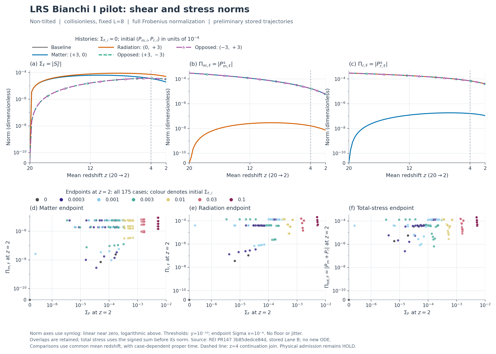
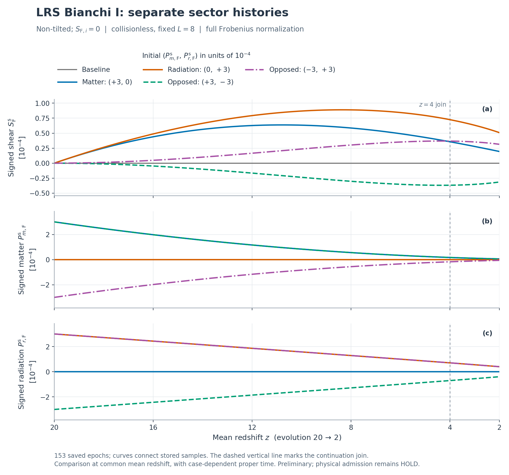
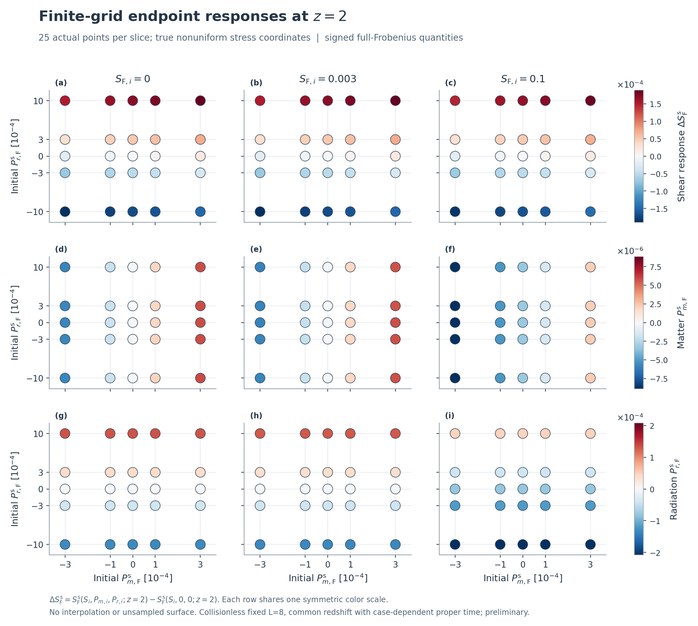
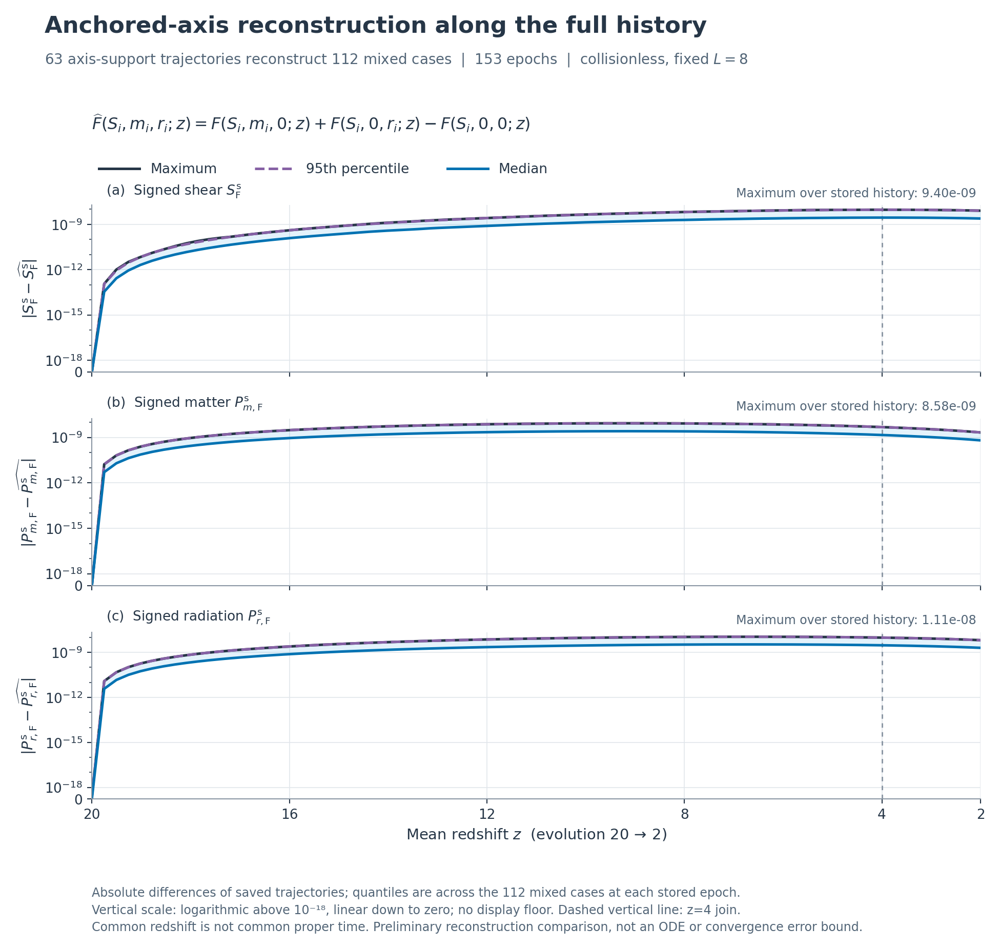
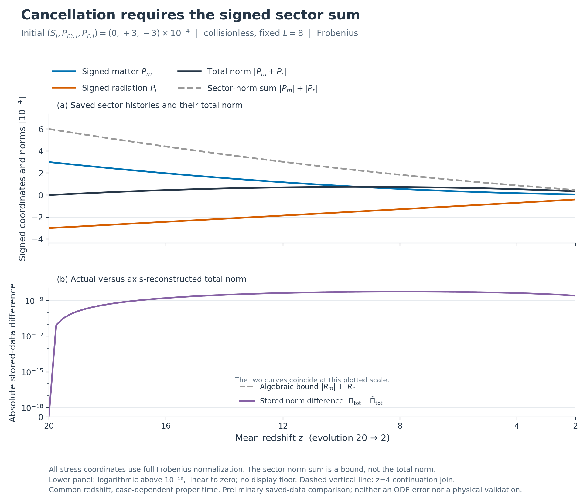

# REC_TRAJECTORY63: matter/radiation z20→2 예비 그림

**완료된 REI collisionless 175 궤적을 재사용해 63축 support와 112 mixed 궤적을 153 epoch 전체에서 비교했다.** 새 ODE/NCP/benchmark는 0, focused tests 8 PASS, 독립 수학·코드·원자료 대조 PASS_SCOPED다. 총 signed stress의 최대 저장 차이는 1.9152545950075223e-8이며 z≈7.877에서 발생한다.

전체 설명은 [REPORT_KO.md](REPORT_KO.md), 계약은 [CONTRACT_KO.md](CONTRACT_KO.md), 단계 상태는 [DAG.json](DAG.json), 실제 게시·보존 identity는 [DELIVERY.json](DELIVERY.json)을 따른다. 이 README의 그림은 이미 완료한 물리 실행의 저장값으로 생성했으며 새로운 ODE 해를 뜻하지 않는다.

## 그림

### 요청한 Sigma/Pi norm의 진화와 전175-case endpoint

### 1. Signed shear와 독립 matter/radiation 진화

### 2. 독립 성분 격자의 z2 endpoint

### 3. 혼합 112 궤적의 축 응답 재구성 차이

### 4. 초기 상쇄와 total norm

PNG와 동일 내용의 PDF가 `figures/`에 있다. 그림에서 초기/진화 좌표는 full Frobenius다. signed S=sqrt(6)s/H, signed P_A=sqrt(6)kappa_t p_A/H², kappa_t=8piG/c²; norm은 절댓값이고 total은 signed m+r를 합한 뒤 norm을 취한다. half-contraction을 쓰면 모든 좌표를 sqrt(2)로 나눈다.

## 결과와 재현

- 초기 S: 0, .0003, .001, .003, .01, .03, .1; 초기 Pm: -.0003, -.0001, 0, .0001, .0003; 초기 Pr: -.001, -.0003, 0, .0003, .001.
- 175=7×5×5, support 63, mixed 112, epoch 153, mixed 비교 17,136점. common redshift z20→2, z4 join; case별 proper clock은 다르다.
- [SUMMARY.json](results/SUMMARY.json), [NPZ](results/TRAJECTORY_ANALYSIS.npz), [CSV.gz](results/MIXED_TRAJECTORY_COMPARISON.csv.gz), [추가 진단](results/ADDITIONAL_DIAGNOSTICS.json).
- [독립 C9](evidence/C9_INDEPENDENT_REVIEW_KO.md), [actual audit](evidence/C9_ACTUAL_RESULTS_AUDIT.json), [최종 테스트](evidence/FINAL_FOCUSED_TEST_STDERR.log), [최종 실행](results_final/EXECUTION.json), [parity](evidence/FINAL_GUARD_PARITY.json).
- [Codex handoff](CODEX_HANDOFF_KO.md), [다음 대화 handoff](NEXT_THREAD_HANDOFF_KO.md).

입력은 최종 archive의 `intake/unified_z2_20261021`에 있다. source/input identity는 `provenance/SOURCE_LOCK.json`을 따른다. 생성 명령은 보고서와 `evidence/PLOT_REVIEW.json`에 있으며 기존 출력은 덮어쓰지 않는다. 완료 자료를 새 대기열에 등록하지 않는다.

## 유지되는 판정

Physical HOLD; global convergence NOT_RUN; production NOT_APPROVED; 원 REC U5 HOLD_9_FAIL/HOLD_8_FAIL 및 CLOSED_HOLD_NOT_RESET; REC REI_activation=false.

작은 저장 차이는 참해 오차·physical decoupling·미검사 parameter/시간의 인증이 아니다. warm C15의 729와 이번 collisionless 자료는 source/구간/closure가 달라 행·계수를 합치지 않는다. 이전 153+90 sentinel 제안은 NOT_SUBMITTED이며 정확 반례는 보존한다.
