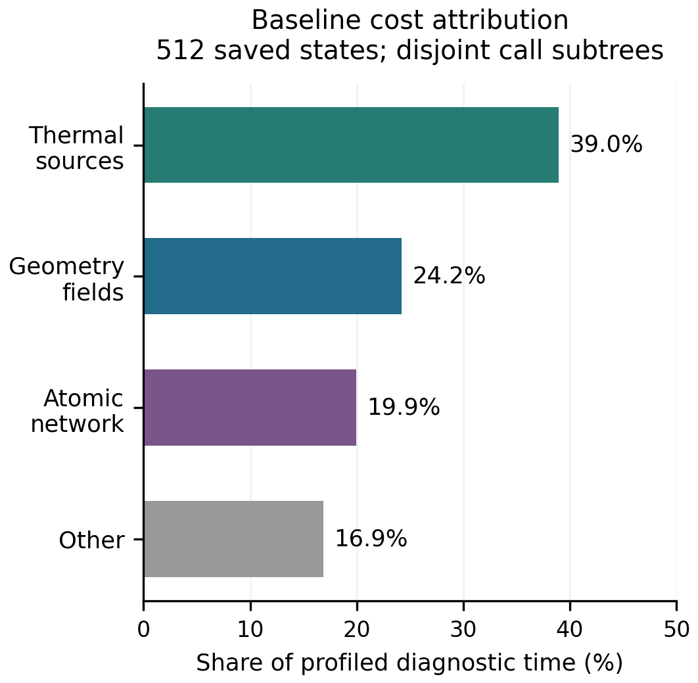
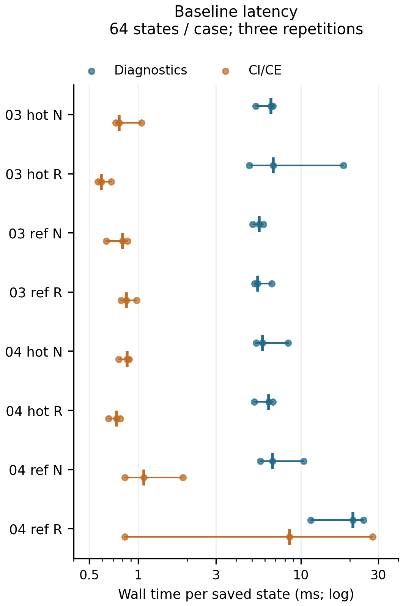

# 저장된 Compton 진단 재사용 연구: C2 실행 결과

2026-10-23 KST / 2026-10-22 UTC

**현재 실행에서 확인한 것은 동일 물리 상태의 중복 진단 경로와 그 실제 비용이다.**
8개 기존 경로에서 64점씩, 총 512개 저장 상태를 선택해 기존 진단을 다시
평가했다. 비교한 주요 진단 16개 배열과 collision 점별 34개 배열은 모든
사례에서 저장된 값과 정확히 일치했다. 새 IVP와 기존 IVP 재실행은 모두 0회다.
후보 최적화의 구현·가속비·전체 16,170행 동등성은 아직 실행하지 않았다.

## 1. 재개 지점과 선택 범위

이전 Compton 단위의 과학 계산, 독립 검토, GitHub draft PR 124, private
Dropbox 백업은 완료되어 있었다. 이번 작업은 이를 다시 수행하지 않고
그 단위의 `NEXT_UNIT_CONTRACT.md`를 목표와 제약의 입력으로 재사용했다.
`physmath-research-loop` 1.3.0의 단계 선택 규칙과 사용자의 재개 요청에 따라
선택한 범위는 **C2: 수식–데이터–코드 대응**이며, 실제 호출 비용을 확인하기
위한 작은 saved-state profile을 해당 단계의 근거로 수행했다.

| 항목 | 현재 상태 |
|---|---|
| 이전 과학·게시 결과 | 완료된 증거를 identity로 재사용 |
| 후속 목표·600 s 예산 | 기존 successor contract를 입력으로 채택 |
| 수식·자료·코드 대응 | 정적 문서 작성 및 실제 호출 수 대조 |
| 512점 baseline 진단 | 실행·저장값 비교 완료 |
| 순서에 따른 시간 변동 검사 | 두 사례에 한정해 1회 수행 |
| 후보 최적화 | 구현하지 않음 |
| 전체 동등성·paired speedup | 실행하지 않음 |
| 다음 미완료 단계 | C3 설계 선택 |

정확한 prerequisite는 [C2_SCOPE.md](C2_SCOPE.md)에 고정했다. 이전 local
commit은 `40f7cf12b509377350e9a16da461e8ef97cdcb62`, remote commit은
`e6ecef7624e39bee66b39e09d99fe355f76e2eae`, 공통 tree는
`a136dea6c4ade8c6be442843800d0eb1458caa5f`다. Compton runtime identity
`c89f576e2c7f15a0a1d0d3f96ce72de516245cbb83b5d4fbaeede342a76e86ac`를
현재 사용에 대해 다시 확인했다. 관련 source lock과 40개 저장 NPZ,
8개 collision reference NPZ를 검사했다. 근거는
[INPUT_MANIFEST.json](evidence/profile/attempt_001/INPUT_MANIFEST.json)이다.

## 2. 물리적 동등성의 기준

새 근사식을 넣지 않고 현재 physical owner를 먼저 확인했다. 독립변수는
\(x=\ln(a/a_{\rm ref})\), \(a_{\rm ref}=1/21\), \(dt/dx=1/H\)다.
full63 벡터의 처음 40개 성분은 기하·복사, 다음 21개는 scale로 나눈
동위원소 abundance, index 61은 누적 Thomson 광학깊이, index 62는
\(\ln T_g\)다. 진단에서 실제 온도는 \(e^{y_{62}}\)이며 처방된 UV
history의 온도를 다시 가져오지 않는다.

\[
n_e=n_b q\cdot Y,\qquad \eta=(1+q)\cdot Y,
\qquad K=\frac{\sigma_T c}{m_e c^2}.
\]

기존 두 Compton branch의 source owner는 다음과 같이 유지된다.

\[
Q_{C,\mathrm{actual}}=-4K n_e k_BT_g U_{\gamma,\mathrm{actual}},
\qquad U_{\gamma,\mathrm{actual}}=\rho_{c0}\Omega_\gamma y_4/a^4,
\]

\[
Q_{C,\mathrm{ref}}=4K n_e k_B U_{\mathrm{ref}}(T_{\mathrm{ref}}-T_g),
\qquad T_{\mathrm{ref}}=2.7255/a.
\]

한 branch만 기체 온도 방정식에 들어간다. 두 branch 모두 공통의 희박한 UV
항 \(K n_e(M_{\mathrm{UV}}-4k_BT_gU_{\mathrm{UV}})\)을 사용한다.
현재 photon/Einstein 방정식에는 반대 에너지 source가 적용되지 않는다.
그 반대량은 장부에만 기록되므로 test-fluid라는 이전 범위가 유지된다.

재사용을 설계할 때 보존해야 할 핵심 검사는 서로 독립적으로 구성한
두 gas source의 일치다.

\[
Q_{\mathrm{gas}}^{(1)}=Q_{\mathrm{kin}}+n_bI\cdot F,
\qquad
Q_{\mathrm{gas}}^{(2)}=Q_{\mathrm{absorbed}}-Q_{\mathrm{escape}}+Q_C+Q_{\mathrm{UV}}.
\]

하나를 다른 하나에 복사하면 잔차가 작아져도 photo/RR/DR 분할의 검증력이
사라진다. 같은 상태의 primitive 계산을 공유하되 두 합계는 별도로 구성해야
한다. CI/CE도 kinetic·binding·particle source와 원자 charge-state target을
보존해야 한다. unavailable, fit-domain continuation, underflow는 서로 다른
상태이며 0이라는 숫자 하나로 합칠 수 없다. 자세한 수식·함수·배열 대응은
[FORMULA_CODE_MAP_KO.md](FORMULA_CODE_MAP_KO.md)에 수록했다.

## 3. 측정한 중복 호출과 비용

`gather_set`은 한 상태에서 `sample`, `diagnostics`, `geometry.fields`,
`geometry.normalized`를 호출한다. 상속된 diagnostics가 동적으로 다시
`thermal_diagnostics → sample`을 호출하므로 단순한 함수 이름 나열보다
실제 재계산이 많다. 512개 상태의 cProfile 호출 횟수는 정적 매핑과 일치했다.

| 경로 | 한 상태당 실제 호출 | 512점의 전체 호출 |
|---|---:|---:|
| `Geometry.fields` | 7 | 3,584 |
| prepared massive `moments` | 7 | 3,584 |
| `AtomicNetwork.evaluate` | 3 | 1,536 |
| `AtomicNetwork.rates` | 3 | 1,536 |
| `ThermalSources.evaluate` | 2 | 1,024 |
| `ThermalSources.coefficients` | 2 | 1,024 |
| `RecombinationMoments.evaluate` | 2 | 1,024 |
| `compton_terms` | 3 | 1,536 |
| `Geometry.normalized` | 2 | 1,024 |
| 129각도 Legendre 행렬 | 1 | 512 |
| `mao_factor` | 26 | 13,312 |

UV 단면적·bin 적분과 Compton UV moment는 이미 생성자에서 준비되어 있다.
점마다 이를 다시 적분한다는 가설은 현재 코드에 맞지 않는다. 별도 collision
분석도 저장된 \(H,n_b,n_e,\eta\)를 읽으므로 geometry·number network를
다시 평가하지 않는다. 이 경로의 반복은 점당 collision provider 한 번과
grid당 19개 retained integrals다.

합산한 `gather_set` profiler self time은 **5.399687069 s**였다. 중첩되지 않는
세 호출 하위 경로의 cumulative time과 나머지는 다음과 같다.

| 상호 비중첩 경로 | 계측 시간 | 진단 시간 비중 |
|---|---:|---:|
| `ThermalSources.evaluate` 및 그 내부 | 2.103796 s | 38.9614% |
| `Geometry.fields` 및 그 내부 | 1.308247 s | 24.2282% |
| `AtomicNetwork.evaluate` 및 그 내부 | 1.076296 s | 19.9326% |
| 나머지 | 0.911348 s | 16.8778% |

여기서 열원은 이미 평가한 network를 인자로 받으므로 `AtomicNetwork.evaluate`
안에 중첩되지 않는다. `Geometry.fields`도 이 두 경로의 내부가 아니다.
반면 `FUNCTION_PROFILE.csv`의 모든 cumulative time을 더하면 중복 계산된다.
단일 함수의 self time 최댓값은 prepared massive moment의 0.602040 s였지만,
전체 경로의 가장 큰 비중은 열원이었다. **geometry가 전체 병목의 최대라는
주장은 이 측정으로 뒷받침되지 않는다.**

이 분포는 profiler가 동작하는 동안의 관측이다. unprofiled 전체 시간을
정밀하게 분해한 값이나 향후 가속비로 해석하지 않는다. 근거:
[CALL_COUNTS.csv](results/CALL_COUNTS.csv),
[DISJOINT_SUBTREE_TIMES.csv](results/DISJOINT_SUBTREE_TIMES.csv),
[FUNCTION_PROFILE.csv](results/FUNCTION_PROFILE.csv).



## 4. 표본·동등성·시간 변동

표본은 각 `dense_1025.npz`의 저장 상태 중에서 선택했다. 양 끝점, 온도
최고점, source/transfer residual 및 backreaction diagnostic의 최대점,
fit-domain·underflow 경계의 양쪽 점을 우선 포함했다. 남는 자리는 저장
index의 최대 거리 규칙과 작은 index 우선 tie-break로 채웠다. 선택 결과와
이유, 정확한 x/raw-state 바이트 해시는
[CORPUS_MANIFEST.json](evidence/profile/attempt_001/CORPUS_MANIFEST.json)에 있다.

각 경로를 1회 warmup하고, profiler 없이 3회, cProfile로 1회 평가했다.
마지막 profiled point 배열을 원래 1025점 배열의 정확히 같은 index와
비교했다. `gather` 16개 배열에는 45열의 주요 diagnostics, 42열의 inherited
diagnostics, 6열 signed observables, 9열 integrands 등이 포함된다. collision은
계수·source·forcing·available domain·underflow 등 34개 점별 배열을 비교했다.
모든 비교는 dtype·shape와 배열 값의 정확한 일치를 요구했고 허용오차를
늘려 통과시키지 않았다. 전체 격자의 cumulative 값은 64점 격자 결과와
직접 비교하지 않았다. 이 부분 적분은 해당 부분 격자에서 다시 계산한 값이다.

| 사례 | diagnostics 중앙값, ms/상태 | CI/CE 중앙값, ms/상태 |
|---|---:|---:|
| 03 hot nominal | 6.568 | 0.762 |
| 03 hot refined | 6.749 | 0.593 |
| 03 reference nominal | 5.537 | 0.800 |
| 03 reference refined | 5.425 | 0.844 |
| 04 hot nominal | 5.831 | 0.854 |
| 04 hot refined | 6.333 | 0.733 |
| 04 reference nominal | 6.694 | 1.084 |
| 04 reference refined | 20.925 | 8.532 |

이 표의 마지막 사례가 느린 것을 physical branch/refinement의 원인으로
판정하지 않았다. 같은 source와 같은 표본을 사용하는 두 reference 사례를
R–N–N–R–R–N 순서로 추가 검사하자 refined diagnostics는 약 3.81–5.22
ms/상태, nominal은 약 3.67–19.10 ms/상태였다. CI/CE에서도 refined 한
반복의 지연이 다시 나타났다. 따라서 큰 지연은 특정 사례에 고정되어
재현되지 않았으며, 시스템 수준의 원인은 이번 계측으로 규명하지 않았다.
이 값에서 branch별 속도 우열이나 최적화 가속비를 추론하지 않는다.

첫 profile 실행은 **34.169123 s**, 원인 구분을 위한 한정된 순서 검사는
**6.128955 s**였다. 두 계측 실행의 합은 **40.298078 s / 600 s**다.
집계·그림 렌더·독립 검토에 사용한 실제 시간은 각 receipt와 마지막 budget
ledger에 별도로 더한다. profiler 과정의 peak RSS는 **92,732 KiB**였다.
단일 수치 thread·worker를 사용했고 IVP 진입점 guard의 호출 시도도 0회였다.



그림의 가로선은 관측된 최소–최대 범위이며 신뢰구간이 아니다. 첫 렌더의
범례 겹침은 V2에서 수정했고 데이터 바이트는 동일하다. 자세한 캡션과
판독 기준은 [FIGURE_CAPTIONS_KO.md](FIGURE_CAPTIONS_KO.md)에 있다.

## 5. 다음 설계에 넘기는 근거와 한계

한 상태 안에서 `field`, number-network, thermal source, Compton terms를
명시적으로 구성해 여러 진단 소비자가 공유하는 후보가 우선 검토 대상이다.
이 선택은 7/3/2회라는 재계산과 세 경로의 합산 비용 83.1222%에 근거한다.
이 비중을 그대로 제거할 수 있다는 뜻은 아니다. 적어도 한 번의 계산과
진단 조립은 남으며, 실제 후보의 overhead와 가속비는 아직 측정하지 않았다.

중첩 dense513 점 재사용도 가능성으로 남아 있다. 기존 contract의 관측처럼
1025점의 짝수 index와 513점은 x가 같아도 별도 dense output 호출의 마지막
반올림으로 raw state 바이트가 다를 수 있다. 새 결과의 provenance를 별도로
남기고 513점 자체의 quadrature·cumulative·interval support·gates를 다시
계산해야 한다. 1025점 cumulative를 단순히 절반씩 취하면 안 된다.

이 단계는 finite saved corpus의 현재 구현 대응만 확인한다. 물리 상태는
**HOLD**, production은 **NOT_APPROVED**, global convergence는 **NOT_RUN**,
REI activation은 **false**, U5는 **CLOSED**를 유지한다. 이 scientific status가
이미 승인된 checkpoint·draft publication·private backup 권한을 막는 것은 아니다.

독립 검토는 `evidence/independent_review/`의 별도 실제 검토 기록을 권위로
삼는다. 이 문서는 작성자 보고서다. 다음 선택 경계는
[NEXT_STAGE_C3.md](NEXT_STAGE_C3.md)에 남겼다.

## 6. 실행·재현 안내

완료된 실행을 재현한다는 이유로 자동 재실행하지 않는다. 저장된 evidence를
먼저 읽고 필요한 identity relation을 확인한다. 새 독립 실험이 필요하면
기존 결과를 보존하고 별도 output/예산을 명시한다.

```bash
python research/rec_saved_diagnostic_reuse_20261023/code/profile_saved_diagnostics.py
python research/rec_saved_diagnostic_reuse_20261023/code/probe_timing_variation.py
python research/rec_saved_diagnostic_reuse_20261023/code/summarize_profile.py
python research/rec_saved_diagnostic_reuse_20261023/code/render_latency_v2.py
```

위 명령은 이번 실행에 사용한 실제 명령이다. 기존 output은 create-only이므로
같은 위치에 반복 실행하면 보존 오류로 중단한다. `STARTED`, `FINISHED`, input
manifest, 원시 caller/function table, 실제 출력 NPZ, CSV, plot-data와 그림을
함께 보존했다. predecessor의 코드·수치 결과는 수정하지 않았다.
