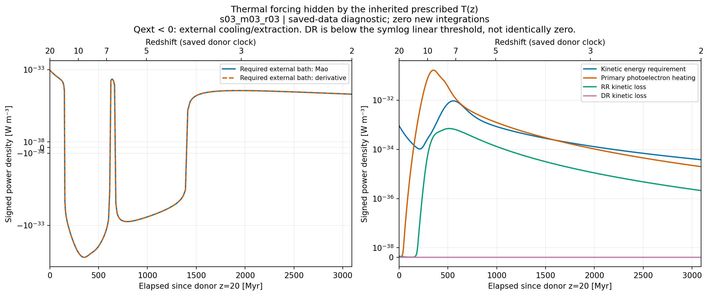
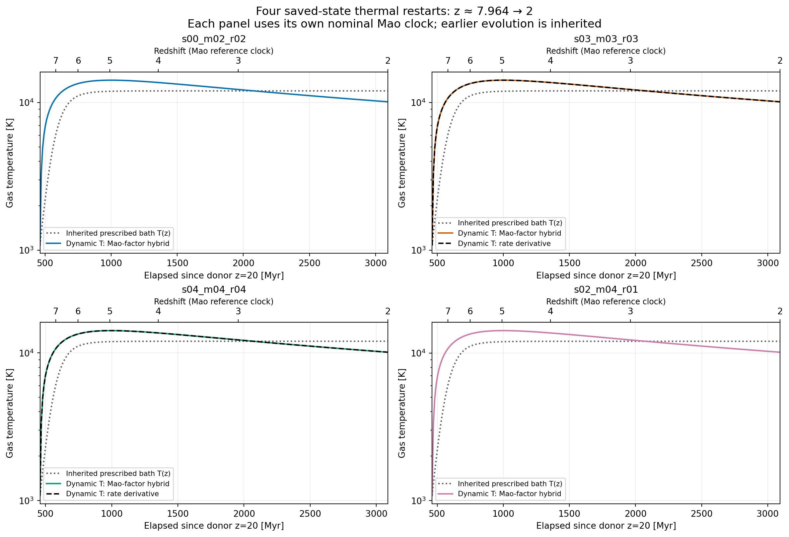
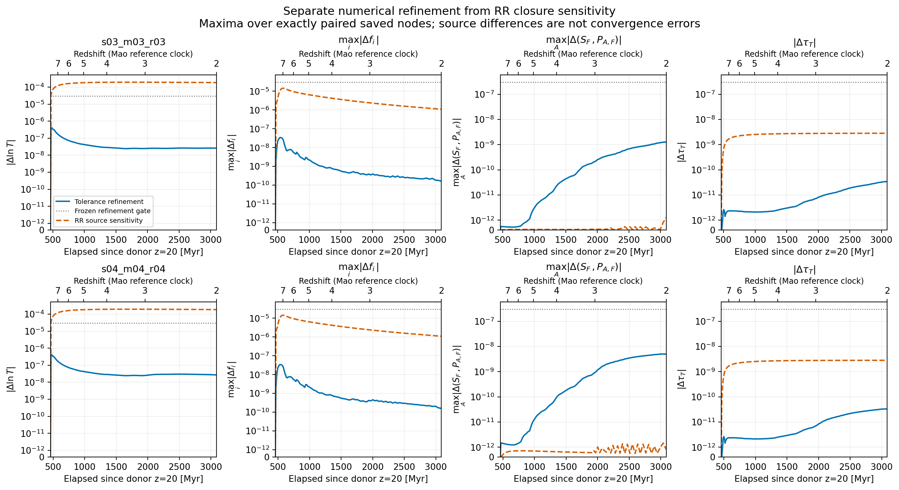

# rec_bianchi 열역학 연구 루프 — 2026-10-22

## 1. 이번에 얻은 결론

REC PR119의 완료된125개 본 계산과1개 opacity control을 재사용해, 처방 온도에 가려져 있던 열량을 계산했다. 기존 수반응률을 그대로 두고 RR/DR 운동에너지 손실을 연결했을 때, 기존 z20→2 온도 경로를 유지하려면 바리온당 **19.6551–19.7207 eV의 순 외부 에너지 제거**가 필요하다. 이는 기존 온도 경로가 어떤 열원을 요구하는지 밝힌 조건부 결과다. 음의 기체 에너지나 새 dynamic-temperature 궤적의 냉각량이라는 뜻은 아니다.

잔여 외부 열원 Qext를0으로 두고 온도를 실제 변수로 추가한 full63 모형을 구현했다. 정확히 저장된 z=7.963732801243163 상태에서 시작하는8개 새 설정이 모두 완료되었다. 기존126개 IVP 재실행은0회다. 네 primary 결과의 저장 표본상 최고 온도는14167.03–14177.03 K이고, z=2 온도는10116.85–10119.08 K다. 기존 prescribed endpoint는11999.95565 K였다. 온도와 이온화가 함께 변하므로 외부 냉각을 제거했다고 전 구간 온도가 일률적으로 증가하는 것은 아니다.

수치 허용오차 축소 비교 두 쌍은 사전에 고정한 기준을 만족했다. RR 에너지 원자료를 바꾼 차이는 온도·이온 분율·광학깊이에서 이 비교의 변화량보다 컸다. 전단과 부호 있는 응력의 작은 차이는 같은 수준으로 해석할 수 없다. 이 finite pilot은 선택한 과정의 열역학적 닫힘을 검증하며, 누락 과정의 작음이나 전체 물리 모형의 수렴을 증명하지 않는다.

주요 수치의 기계 판독 근거는 `results/saved126/SUMMARY.json`, `results/analysis/SUMMARY.json`, `results/thermal8/*/RESULT.json`이다. 유도와 원전 연결은 `THEORY_KO.md`에 있다.

## 2. 재개 기준과 실행 범위

최신 REC PR119 handoff와 recovery comment를 실제로 확인하고, parent `ad93fa1c71f8a2b2a0b19836be3c7b739b11b0c7`에서 재개했다. 코드·원자료·vendor49개를 SHA256으로 고정했고, 기존 궤적은 각 RESULT/완료 기록의 바이트 수와 SHA256을 확인해 재사용했다. 로컬 donor의 tracked 파일은 해당 parent와 차이가 없다. 과거의 큰 branch/PR 전수조사는 이번 실행에서 반복한 것으로 세지 않았다. 이번 원격 확인은 REC 최근10 PR, REI 최근20 PR, 관련 세 저장소의 최근3 PR씩과 선택된 handoff에 한정한다.

REI220의 compact33 129-case cohort와 REI219의 nuclear/daughter 계약은 별도 계보로 유지한다. 새 n/T 공급은 compact isotope equivalence를 깨뜨릴 수 있으므로, 여기서는 native21 isotope/ion 좌표와 정확한 zero n/T inventory를 유지했다. 수동으로 누적한 nuclear history나 H의 이온 분율을 T의 결합 예측으로 가져오지 않았다.

새 모형은 geometry/radiation40 + isotope/ion21 + optical depth1 + log-temperature1이다. non-tilted LRS Bianchi-I, 기존 UV 스펙트럼·위상공간 모형·Thomson 블록·수반응률은 고정한다. baryon thermal energy는 geometry에 새로 되먹임하지 않는 test-fluid 근사다. 지표 부호는(-,+,+,+), SI의 c와 k_B를 유지한다.

| 설정 | RR 운동에너지 손실 | 오차 설정 | 목적 |
|---|---|---|---|
| s00_m02_r02 | Mao-factor hybrid | nominal | 등방성 기준 |
| s03_m03_r03 | Mao-factor hybrid | nominal | 대표 사례 |
| s04_m04_r04 | Mao-factor hybrid | nominal | 큰 전단 사례 |
| s02_m04_r01 | Mao-factor hybrid | nominal | 부호가 섞이는 응력 사례 |
| s03_m03_r03, s04_m04_r04 | Mao-factor hybrid | refined | 같은 초기조건의 수치 비교2개 |
| s03_m03_r03, s04_m04_r04 | number-rate derivative | nominal | 원자료/에너지 모형 민감도2개 |

nominal rtol=2e-8, maxstep=0.025; refined rtol=2e-9, maxstep=0.0125이며 각 성분 atol도10배 줄였다. 초기62개 좌표와 누적 optical depth는 기존 index84의 저장 바이트를 그대로 사용하고, 초기 T=1081.319779971744 K를 추가했다. 보간이나 z20부터의 재적분으로 초기조건을 만들지 않았다. 각 새 궤적은109개 공통 x 노드를 저장한다. 따라서 새로 닫힌 열역사는 restart 이후에만 해당한다.

## 3. 실제로 닫은 에너지 방정식

Y_i=n_i/n_b, F_i=dY_i/dt, n_e=n_b q^T Y, eta=(1+q)^T Y라 두면 공통 온도의 비상대론적 기체는

\[
u_{\rm th}=\frac32 k_BT n_b\eta,\qquad p=k_BT n_b\eta
\]

를 갖는다. x=ln(a/a_ref), dn_b/dt=−3Hn_b를 사용하면

\[
\frac{d\ln T}{dx}
=-2+\frac{2Q_{\rm kin}/(3k_BTn_b)-(1+q)^TF}{H\eta}.
\]

입자수 변화 항은 photoionization/recombination에 의해 자유 전자 수가 변할 때 필요하다. Qkin은 primary photoelectron heating에서 RR/DR의 전자 운동에너지 손실을 뺀 값이다. 이온화 결합에너지는 별도 저장소 I^T Y에 두며, radiative escape와 중복 계산하지 않는다. zero n/T의 물리 상태에서는

\[
Q_{\rm abs}-Q_{\rm escape}=Q_{\rm kin}+n_bI^TF
\]

가 성립한다. 바리온당 전체 기체 에너지 e=3k_BT eta/2+I^T Y는

\[
\frac{de}{dx}=\frac{Q_{\rm abs}-Q_{\rm escape}}{n_bH}-3k_BT\eta
\]

를 만족해야 한다. 코드의 수반응률, 이온화 저장소, photon absorption, core escape, RR/DR escape를 이 원장에 각각 배정했다.

온도에 무관한 단면적·공명 커널, Maxwellian 전자분포, 고정된 initial ionic state라는 조건 아래

\[
L_{\rm RR}=k_BT\left(\frac32\alpha_{\rm RR}+\frac{d\alpha_{\rm RR}}{d\ln T}\right)
\]

를 유도했다. 그러나 경험적 alpha fit의 값 오차만으로 미분 오차까지 제한할 수는 없다. 그래서 이를 대안으로 두고, primary는 Mao, Kaastra & Badnell(2017)의 에너지 factor f를 사용한

\[
L_{\rm RR}^{\rm primary}=k_BT\,\alpha_{\rm parent}\,f_{\rm Mao}
\]

로 택했다. alpha까지 Mao의 계산으로 교체한 것은 아니므로 **Mao-factor hybrid**라고 명시한다. 원전은 [A&A599,A10](https://doi.org/10.1051/0004-6361/201629708), [arXiv1612.01017](https://arxiv.org/abs/1612.01017), [CDS J/A+A/599/A10](https://cdsarc.cds.unistra.fr/viz-bin/cat/J/A+A/599/A10)이다.

Mao Eq7은 eV 온도와 자연로그를 사용한다. 원표의 electron-count는 recombined ion 기준이므로 initial ion(Z,q)에 대해 s=Z−q+1로 연결했다. 원표6개 행×19개 온도점을 재구성했고, log10·K/eV·행 매핑의 잘못을 넣었을 때 검출되는지도 확인했다. 허용오차는 출판된 최대 편차와 수치 반올림만 반영한다.

DR의 c_j와 E_j가 alpha=1e-6 T^(−3/2) sum c_j exp(−E_j/T)에 들어갈 때, E_j를 K 단위로 두어 L_DR=k_B 1e-6 T^(−3/2) sum c_j E_j exp(−E_j/T)를 사용한다. signed fit component를 제거하지 않았고, 수치 underflow로0이 된 항과 구조적으로 없는 channel을 구분했다.

Li-I의 단일 1s photoionization 모델에서는 primary electron 에너지는 국소적으로 열화하고 나머지 core energy는 radiative escape로 배정했다. 이 상태의 빠른 방사 수명은 prompt 근사를 지지하지만 escape photon의 재흡수 부재까지 증명하지는 않는다. [Saghiri et al., Phys.Rev.A60,R3350](https://doi.org/10.1103/PhysRevA.60.R3350)의 Li+ metastable 수명 측정은 그 시간척도 판단의 원전이다. direct double ionization/shake-off와 재복사 전달은 여전히 별도 과정이다.

## 4. 기존126개에 숨겨진 외부 열원

기존 prescribed T(x)에 필요한 열량을

\[
Q_{\rm req}=\frac32 k_Bn_b\eta H(T_x+2T)
+\frac32 k_BTn_b(1+q)^TF,\quad
Q_{\rm ext}=Q_{\rm req}-Q_{\rm kin}
\]

로 계산했다. 양수는 외부 입력, 음수는 외부 제거다. 다음은193개 저장 노드에서 Q/(n_bH)를 적분한 eV/baryon 값이다.

| 대표 s03_m03_r03의 z20→2 항목 | eV/baryon |
|---|---:|
| 처방 온도 경로의 caloric requirement | 7.772840293 |
| primary photoelectron heating | 28.314723804 |
| RR kinetic cooling | 0.824989572 |
| DR kinetic cooling | 1.02769e-16 |
| 순 외부 요구량 Qext | **−19.716893939** |
| Qext의 양의 부분 적분 | +0.787977102 |
| Qext의 음의 부분 적분 | −20.504871041 |

125개 본 사례의 순 요구량 범위는−19.720704913~−19.655141169 eV/baryon이다. 별도 opacity-off control은−19.716893937 eV/baryon이다. 대표 사례에서 rate-derivative 대안은−19.714524734 eV/baryon이다. 본 사례24,125개 저장 상태 중12,350개에서 Qext가 음수였지만 이 부호를 지우거나 값을 clipping하지 않았다.

전체126×193=24,318개 상태의 source energy residual 최대는3.999e-16이다. 독립적인 기존 원장 Qold,net+Qescape−Qabs로 재구성한 Qext와의 차이는 최대3.558e-16이다. 193노드와97노드 trapezoid 적분의 최대 차이는1.01525e-4 eV/baryon이다. 이는 저장 격자에서의 quadrature 민감도이며 연속시간 오차 증명은 아니다. 후처리 자체는 약4초, ODE 호출은0회였다.

그림은 signed symlog를 사용한다. DR은 이 축의 선형 구간보다 작아0처럼 보일 수 있지만 구조적으로0이라고 결론 내리지 않는다. 외부 요구량은 기존 온도 경로 전체의 누적 진단이며 새 restart 궤적에 그대로 더하거나 온도 차이로 환산하지 않는다.

## 5. 새 full63 열역사와 이온화 응답

| primary case | 저장된 최고 T [K] | 최고 T 표본의 z | T(z=2) [K] | 누적 tau(z=2) |
|---|---:|---:|---:|---:|
| s00_m02_r02 | 14177.029710 | 4.976223 | 10119.075675 | 0.069376422326 |
| s03_m03_r03 | 14176.447240 | 4.976223 | 10118.948509 | 0.069369206519 |
| s04_m04_r04 | 14167.031370 | 4.976223 | 10116.846481 | 0.069253365849 |
| s02_m04_r01 | 14177.004096 | 4.976223 | 10119.069058 | 0.069376114005 |

최고값은109개 저장 표본의 최대이며, 연속 궤적 극값 탐색으로 위치를 확정한 수치가 아니다. 시간축은 donor z20부터 누적된 경과시간이고 restart 이후 시간이나 우주 나이가 아니다. 같은 redshift에서 비교하며 각 panel에 명시된 nominal 궤적의 시간 좌표를 사용한다.

대표 사례의 z=2 conditional ionic fractions는 다음과 같다. 분모는 해당 동위원소의 양의 전체 inventory다. zero n/T의 수치 scale을 물리적 분율 분모로 취급하지 않았다.

| 상태 | 기존 처방 T | 새 Mao hybrid |
|---|---:|---:|
| H1 I | 2.20672346e-6 | 2.49540397e-6 |
| He4 II | 3.73134390e-4 | 4.18384291e-4 |
| He4 III | 0.9996268641 | 0.9995816139 |
| Li7 III | 0.0082626026 | 0.0092221726 |
| Li7 IV | 0.9917345354 | 0.9907742424 |

전체 저장 구간의 최대 conditional ionic fraction 변화는 네 primary에서0.120121–0.120350이며 z=7.349838의 Li IV에서 나타났다. Li6/Li7 중 어느 것이 부동소수점 최대가 되는지는 전자분율 동일성 근사 아래의 수치 차이로, 동위원소별 물리적 우열이 아니다. 또 희귀 Li의 conditional fraction 변화가 크다는 사실은 Li가 절대 전자 수의 변화를 지배한다는 뜻이 아니다. 이 값은 말기 분율만 보면 놓칠 수 있는 과도 응답이다. 누적 tau의 변화는 최대 약3.567e-5다. 그중 z20→restart의 tau prefix는 동일하게 물려받았으므로 비교 차이는 restart 이후에서 발생했다. geometry는 baryon thermal pressure를 직접 받지 않고 ne를 통한 기존 opacity 연결만 받는다.

## 6. 수치 비교와 원자료 민감도

아래 값은 두 paired case 각각에서 동일한 x 노드끼리 비교하고, 그 둘의 최대를 취한 것이다. 이온 분율은 absolute fraction 차이다. 부호 벡터는 S_F와 다섯 stress component를 포함하는 기존6-vector이며, shear와 stress의 정의를 뒤섞어 노름 이름을 바꾸지 않는다.

| 측정량 | nominal↔refined 최대 | 사전 기준 | Mao↔rate derivative 최대 |
|---|---:|---:|---:|
| abs(delta ln T) | 4.181404e-7 | 3e-5 | 1.934096e-4 |
| conditional ionic fraction | 3.403057e-8 | 3e-5 | 1.432494e-5 |
| 부호 있는 전단·응력6-vector | 4.989190e-9 | 3e-7 | 1.456599e-12 |
| optical depth | 3.442546e-11 | 3e-7 | 2.822665e-9 |

대표 사례에서 RR 에너지식을 바꾸면 종점 T가1.860211 K 달라진다. refined 종점과 nominal의 차이는0.000262597 K다. 따라서 이번 선택된 두 에너지식의 온도 차이는 관찰된 수치 refinement 변화보다 크다. 이 비교는 확률적 오차막대, 원자 데이터 전체의 정확도, 누락 과정의 영향 크기를 뜻하지 않는다.

전단·응력6-vector의 source 차이는 refinement 차이보다 작다. shear를 제외한 stress-only 다섯 성분에서도 source 차이/refinement 차이의 비는 두 사례에서 각각 약0.224와0.616으로1보다 작다. 이를 RR 원자료가 중력적 비등방성을 바꾸는 검출 결과로 제시하지 않는다. 또 primary↔기존 prescribed-path 차이에서도 geometry 수준의 작은 신호를 정밀하게 판단하려면 양쪽 경로에 대해 별도 수치 근거가 필요하다. 이번8개 구성에는 derivative 대안 자체의 별도 refinement가 없으므로, primary refinement를 두 에너지식의 엄밀한 오차 상계로 사용할 수 없다.

계수 자체에서는100–12000 K 범위의 max abs(f_derivative/f_Mao−1)가 HII0.370%, HeII2.265%, HeIII0.593%, LiII3.468%, LiIII2.070%, LiIV1.264%다. 공통 허용 domain100–1e6 K 전체에서는 HeII12.86%, LiII14.31%까지 커진다. 큰 domain의 계수 차이를 실제 이번109-node 궤적의 오차로 대체하지 않았다.

## 7. 검증 근거와 실패 기록

| 층 | 실제 수행과 결과 |
|---|---|
| 실행 환경 | Python와 C++ 실행 probe 모두 성공; 실제 numerical runtime 사용 |
| 기호 유도 | Wolfram에서 RR log derivative, DR moment, caloric balance의 residual0 |
| moment 구현 | 고유 test method9개 PASS;129개 온도에서 RR/DR number rates의 바이트 일치;1001개 domain 표본 양성; 독립 power-kernel 적분 상대오차 최대1.60e-13 |
| thermal 연산자 | 고유 test method10개 PASS;63개 Jacobian column 검사; 두 closure×3개 T×4개 mixed direction=24개 JVP |
| Jacobian 수치차분 | componentwise max(1,abs(RHS),abs(Jv))로 정규화한 오차: 모든 column 최대4.9323e-11, mixed JVP 최대9.6574e-11; 기준3e-6 |
| 원표 연결 |6행×19점=114점 통과; log10/K/electron-count 오류 주입이 각각13/114/70점에서 검출됨 |
| caloric/source identity |18개 물리 상태에서 source balance 최대1.7381e-16; 새 dynamic diagnostics 별도 회귀검사 residual0 |
| 저장126 |24,318개 상태의 hash·zero n/T·source 원장 확인 |
| 새8 |8개 모두 COMPLETE, 각109개 상태 저장; 모든 declared finite gates PASS |
| 수치 비교 | 같은 초기조건의 nominal/refined2쌍 PASS |
| 독립 검토 | PHYS-MATH와 IMPLEMENTATION/NUMERICS 검토의 저자·의존성·검증 범위를 별도 receipt에 명시 |

첫 full63 Jacobian checker는 legacy coordinate3의 u=0 경계에서 중앙차분을 음수 방향으로 적용해 domain guard에 걸렸다. 해당 실패와 당시 code identity는 `thermal_system_tests.json`의 prior_runs에 보존했다. 수정은 이 boundary column에4차 forward stencil을 쓰는 것이었으며, 원자 물리식이나 허용오차를 완화하지 않았다. 시험 온도와 방향을 늘린 수를 고유 test method 수에 더하지 않았다.

새8 실행의 최대 baryon residual은1.11e-15, 저장 상태의 최대 source energy residual은3.202e-16이다. 저장된 trace-energy fraction 최대는2.188e-8로 inherited1e-5 gate 아래다. 이 수치들은 retained equations의 유한 표본 검사다. BDF 내부의 모든 accepted step에서 population positivity를 증명했다는 뜻은 아니다.

1025-node dense diagnostic quadrature에서 실행 당시 기록된 에너지 residual 최대는8.5452e-6이며 사전 gate3e-4 아래였다. 513→1025 차이는 최대4.1010e-5다. **dense 중간 표본과 interpolant는 별도 파일로 보존되지 않았다.** 독립 사후 검토는 이 receipt의 산술, endpoint energy, 저장872개 상태의 source 원장을 재구성했다. 저장109점만으로 독립 Simpson 적분한 coarse residual은 최대5.90787e-4로,1025-point gate의 기준보다 크다. 이 별도 coarse-grid 수치로 dense gate를 재확인했다고 주장하지 않는다. dense quadrature 값을 독립적으로 다시 적분하지 않았다는 증거 한계를 유지한다. 이번 증거를 보강하려고8개 IVP를 중복 실행하지 않았으며, 다음 실행 설계에서는 diagnostic grid 자체를 저장한다.

독립 numerical review에서 나타난 약1e-16의 scalar-summary 차이10개도 보존했다. 저장 Y 배열의 Fortran/C memory order에 따른 합산 순서와3*H*H 대3*H**2의 부동소수점 결합 차이를 원래 산술로 재현해 모두 설명했다. 과학적 gate를 바꾸지 않았다. 첫 figure manifest는 열린 stdout 로그를 빈 파일로 hash한 metadata 오류가 있었고, 원본을 보존한 뒤 명시적인 산출물 목록만 hash하도록 고쳤다. 수정 전후 과학 수치가 같은 것을 검증했다.

새8은 한 번의 fresh invocation에서 serial 실행되었고, wall71.976452초, process CPU 합계71.060064초였다. RHS8,521회, Jacobian138회, LU622회이며 가장 긴 사례는20.781217초였다. BLAS/OMP1 thread, cooperative per-case240초·campaign1200초의 사전 범위 안이다. peak-memory telemetry는 별도로 보존하지 않았다. 과거 U5 예산을 재설정한 것이 아니다. 실패한 새 IVP는0개이고 재실행0회다.

## 8. 유지되는 물리적 제한

공통 Maxwellian 온도, 순간적 primary-electron 열화, RR/DR 방사와 Li core energy의 escape, zero n/T, ground-state electronic rate 및 동위원소 간 electronic-rate equality를 사용했다. 현재 방정식은 선택한 process set 안에서 닫혀 있다.

collisional ionization, collisional excitation, charge exchange, secondary ionization, free-free, Compton energy transfer, nuclear energy와 daughter별 결합 진화, direct multiple photoionization/shake-off, radiative reabsorption/transport는 이번에 추가하지 않았다. 이들이 작다는 검증도 수행하지 않았다. 기존 Thomson 블록은 이 탄성 모델의 범위를 유지한다. 따라서 수치적으로 통과한 온도 궤적을 완성된 재이온화 열역사나 production 예측으로 승격하지 않는다.

상태는 Physical HOLD, production NOT_APPROVED, global convergence NOT_RUN, REC U5 HOLD_9_FAIL/HOLD_8_FAIL, CLOSED_HOLD_NOT_RESET, REI_activation=false로 유지한다. RR source 차이에 global model uncertainty라는 이름을 붙이지 않는다.

## 9. 다음으로 이어질 연구 단위

다음 과학 노드는 **이미 저장한 새8개 궤적에서 누락된 thermal process의 source-bound budget을 평가하는 것**이다. 우선 Compton energy transfer와 collisional excitation/ionization의 원자료·에너지 소유권·상대 크기를 정하고, 단순히 현재 T 범위만 보고 무시하지 않는다. 그 결과 retained-source 원장에 필요한 항을 선택한 뒤 다음 finite execution 계약을 만든다. n/T 공급을 시작하는 경우에는 nuclear energy와 daughter ionic state의 소유권을 먼저 닫아야 하며, 현재 compact/native 관계를 그대로 가정할 수 없다.

추가 ODE를 하기 전에 dense diagnostic samples 보존을 실행 계약에 포함한다. 이미 완료된126개와 새8개의 code/data/config/hash가 같으면 그대로 재사용한다. 현재 결과의 scope를 넓혀 적는 방식으로 HOLD를 해제하지 않는다.

## 10. 전달 상태

이 보고서·수식·코드·원표·기존126개 입력과 새8개 결과·그림·검토 receipt는 검토 가능한 local commit 및 최종 archive로 묶는다. 상세 경로와 integrity 검증은 `DELIVERY_STATUS.json`, 이어받기 순서는 `HANDOFF_KO.md`에 있다.

새 branch의 GitHub push는 자동 승인 검토가 거절했다. 거절 사유는 현재 사용자 메시지에서 새 연구 코드·원자료·provenance의 외부 게시 권한이 확인되지 않았다는 것이다. 다른 API로 우회하지 않았다. 따라서 새 remote branch, draft PR, Dropbox/Drive 업로드 성공을 주장하지 않는다. 외부 전달만 사용자 승인 뒤에 수행할 수 있는 상태로 준비한다.
