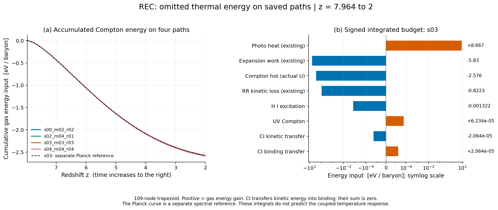
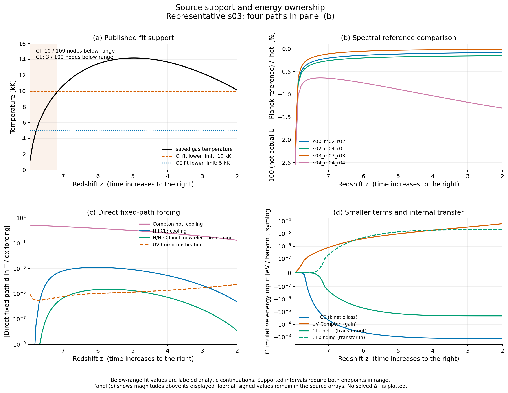
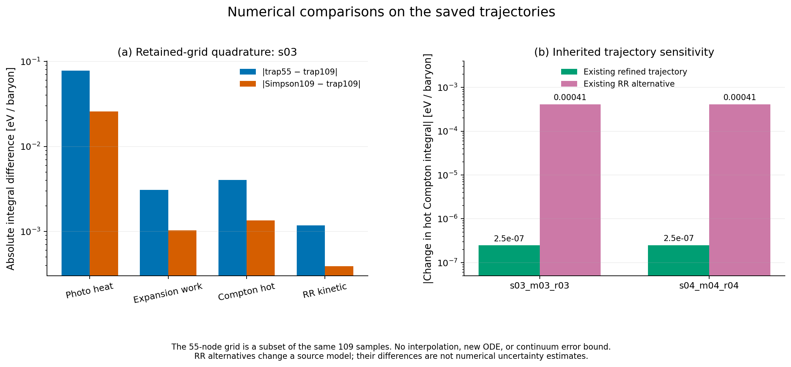

# REC 누락 열과정 예산: Compton 결합을 다음 순서로 확정

## 결론과 계산 범위

저장된 thermal8 궤적에서 식별 가능한 hot-electron Compton 항을 계산한 결과,
네 기본 궤적의 누적 기체 에너지 소스는 **−2.57604∼−2.59186 eV/baryon**이다.
같은 구간의 기존 광이온화 병진열 가열의 **29.72∼29.92%**, RR 병진열 냉각의
**3.133∼3.155배**, 팽창 일의 **44.19∼44.49%**에 해당한다. 다음 유한 연구
단위는 Compton을 기체 온도 방정식에 결합하는 작업으로 정한다.

이 결론은 현재 궤적의 소스 우선순위에 관한 것이다. 전체 CMB 순교환을 완결하거나,
새 온도 이력을 예측하거나, 모든 누락 과정의 오차 상한을 증명한 결과는 아니다.
완료 상태는 `COMPLETE_SCOPED_FIXED_PATH_BUDGET`이며 physical `HOLD`, production
`NOT_APPROVED`, global convergence `NOT_RUN`, REI activation `false`,
U5 `CLOSED_HOLD_NOT_RESET`을 유지한다.

새 연구 단위는 `rec_thermal_omitted_budget_20261022`다. 기존 열 연구의 실제
완료 NPZ 8개에서 각109점, 총 **872개 상태**를 읽었다. 새 배경·화학·열·보조
ODE는 **0회**, 기존126개와 thermal8 IVP 재실행도 **0회**다. 이 단위의 적분
구간은 실제 재시작점인 \(z=7.963732801243163\)에서 \(z=2\)까지다. 저장된
elapsed Myr는 원래 donor의 \(z=20\)부터 누적된 proper time이므로 새 적분의
시작 시각이나 우주 나이로 바꾸어 부르지 않았다.

근거: [실제 실행 결과](results/budget_v1/RESULT.json),
[전체 수치 요약](results/budget_v1/SUMMARY.json),
[네 기본 궤적의 비교표](figures/v3/PRIMARY_TABLE.csv).
실행 source identity는
`88edf8e7e5ccff94509e03ff2979b3b93e5e988641c5dbd4a5d64f4583bca02c`다.

## 1. 네 기본 궤적의 결과

아래 값은 모두 원래109개 저장점의 양의 가중치 사다리꼴 적분이다. 양수는 기체
에너지 증가, 음수는 감소다. 이 표의 CI 항은 운동에너지 저장고에서 나가는 값이며
같은 양이 결합에너지 저장고로 들어간다. He II CE 냉각량의 크기는 기본 궤적에서
약\((1.8\text{–}1.9)\times10^{-13}\) eV/baryon으로, 표에 표시한 H I CE보다 매우 작다.

| 기본 궤적 | 실제 U의 hot Compton | H I CE | CI 운동에너지 | UV Compton | 전체 직접 logT 강제항 적분 |
|---|---:|---:|---:|---:|---:|
| s00_m02_r02 | −2.578528 | −0.001322146 | −2.064871e−5 | +6.233629e−5 | −1.024038 |
| s02_m04_r01 | −2.580089 | −0.001322120 | −2.064819e−5 | +6.233622e−5 | −1.024651 |
| s03_m03_r03 | −2.576045 | −0.001321565 | −2.063682e−5 | +6.233512e−5 | −1.023080 |
| s04_m04_r04 | −2.591856 | −0.001312218 | −2.044582e−5 | +6.231574e−5 | −1.029554 |

에너지 열의 단위는 eV/baryon, 마지막 열은 무차원이다. 마지막 열은 hot Compton,
UV Compton, 공급된 CI/CE의 직접 RHS 기여를 더한 것이다. 별도 Planck 기준선을
다시 더하지 않았다. 기존 photo/RR/DR 및 팽창 소스는 비교 대상으로 저장했으며
새 누락항 합계에 중복으로 넣지 않았다.

대표 s03의 같은 구간 기존 photo-primary 가열은 +8.667267 eV/baryon, RR
병진열 냉각은 −0.8223043, 팽창 일은 −5.829574다. hot Compton은 이 기존 열
장부와 비교해 무시하기 어려운 크기다. 저장 경로의 끝 병진열은 약2.215
eV/baryon이지만, 시간에 걸친 소스 적분을 그 끝점 저장량에서 단순히 빼서 새
온도를 정할 수는 없다. 가열·팽창·전자수·원자 분율이 함께 변하기 때문이다.

## 2. 실제 광자 에너지가 정하는 항과 별도 스펙트럼 가정

기존 Bianchi 상태는 광자의 에너지·수 angular multipole을 별도로 갖는다.
proper 광자 에너지 밀도는 기존 정규화를 그대로 사용해

\[
U_\gamma=U_{\gamma,0}E_{\gamma,0}/a^4
\]

로 복원했다. raw-state의 광자 에너지 모노폴 index4만 사용하며 neutrino
에너지나 전체 radiation 밀도를 넣지 않았다. 현재8개 궤적의
\(E_{\gamma,0}\) 범위는 약0.9990427–1.0123976이다.

비기울어진 등방 Maxwellian 전자의 비상대론·Thomson leading-order에서

\[
Q_{\rm hot}=-4\sigma_Tc\,n_e U_\gamma\frac{k_BT}{m_ec^2}
\]

를 평가했다. 이는 실제 에너지 모노폴로 계산할 수 있는 열운동 성분이다.
입사 광자장의 방향 구조가 있어도 등방 전자에 대한 이 성분의 방향 적분은
에너지 모노폴로 정리된다. 원문 kernel moment와 유도는
[THEORY_KO.md §5](THEORY_KO.md), [Sazonov–Sunyaev 원문](https://arxiv.org/abs/astro-ph/9910280),
[원문·코드 소유권 표](provenance/SOURCES.json)에 기록했다.

완전한 순교환에는 recoil과 induced scattering에 필요한 스펙트럼 정보가 더
필요하다. 같은 광자수와 에너지를 가지면서 제곱 에너지 모멘트가 다른 양의
분포를 실제 테스트에 구성했다. 이 반례는 현재 저장 모멘트만으로 recoil이
정해지지 않음을 보여 준다. 추가 스펙트럼 공급이나 다른 모형 구성이 불가능하다는
주장은 하지 않는다.

비교를 위해 \(T_{\rm ref}=T_0/a\)인 등방 Planck장을 별도로 정의하고 그 장의
자체 \(U_{\rm ref}=a_RT_{\rm ref}^4\)를 사용했다. 대표 s03에서 이 기준의 순
Compton 적분은 −2.574162 eV/baryon이다. s04에서는 −2.569691이므로 실제-U
hot 성분과 약0.02217 eV/baryon 차이가 난다. 이 차이는 원래 광자장에 대한
오차막대가 아니며, 두 식은 방사장 가정과 포함 성분이 다르다. 실제-U 정규화의
기존 Stefan 상수와 독립 Planck 상수의 미세한 반올림 차이도 소유권을 혼합하지
않도록 각자 유지했다.

외부 UV장은 기존5–200 eV의71개 bin을 그대로 사용했다. \(\Phi=cn_\gamma\)
관례에서 \(U=\sum\Phi_jE_j/c\), \(M=\sum\Phi_jE_j^2/c\)를 계산한 뒤

\[
Q_{\rm UV}=\frac{\sigma_Tc n_e}{m_ec^2}(M-4k_BT U)
\]

를 적용했다. 채택된 smooth power law의 최대 점유수는 UV scale1에서
\(6.0802\times10^{-20}\), Compton 온도는91741.7 K다. 현재 gas 온도보다
높아 UV 순항은 양수다. 최대 광자에너지는 \(3.9139\times10^{-4}m_ec^2\),
최대 \(k_BT/(m_ec^2)\)는 약\(2.391\times10^{-6}\)다. 이 수치는 채택된
근사의 매개변수를 확인하며, 지정되지 않은 고에너지 UV 꼬리의 기여까지
제한하는 결과는 아니다. bin과 연속 power law의 U/M 차이는 약0.0258%이며
기존 bin 표현을 임의로 교체하지 않았다.

## 3. 충돌 이온화의 에너지와 새 전자

Hui–Gnedin Appendix A의 H I/He I/He II CI와 H I/He II CE 계수를 원문에서
확인하고, 원래 native21 동위원소 좌표에 연결했다. 이온화 계수는 cgs에서 SI로
\(10^{-6}\), 여기 에너지 계수는 \(10^{-13}\)을 곱한다.
[HG97 원문](https://arxiv.org/pdf/astro-ph/9612232),
[전사된 source 데이터](data/HG97_COLLISIONAL_SOURCE.json).

CI 사건률을 \(r_i=n_e C_iY_i\), 기존 이온화에너지 차이를
\(\chi_i=I_{i+1}-I_i\)라 두면

\[
Q_{\rm CI,kin}=-n_b\sum_i\chi_i r_i,\qquad
Q_{\rm CI,bind}=n_bI\cdot F_{\rm CI}=+n_b\sum_i\chi_i r_i.
\]

CI는 이 단위에서 복사 탈출 손실을 만들지 않는다. 총 gas 에너지에서는 이 두
항이 상쇄된다. 후속 재결합 사건의 방출을 CI에 미리 붙이지 않았다. 반면 CE는
명시한 ground-state·prompt-escape 근사에서 병진열이 광자로 나가고 이온
전하는 바뀌지 않는다.

rate의 HG97 threshold와 기존 결합 저장고의 에너지는 약\(10^{-4}\) 이하의
관례 차이가 있다. CI rate에는 원문 threshold를, 에너지 이동에는 기존
\(\chi_i\)를 사용했다. 원래 결합에너지 소유권을 유지해야 에너지 장부가 닫힌다.

온도 소스는 입자수도 포함한다. \(\eta=\sum(1+q_i)Y_i\)라 하면

\[
\delta g=\delta\!\left(\frac{d\ln T}{dx}\right)
=\frac{2Q_{\rm kin}}{3k_BT n_bH\eta}-\frac{\delta\dot\eta}{H\eta},
\qquad
\delta g_{\rm CI}=-\frac{1}{H\eta}\sum_i r_i
\left(1+\frac{2\chi_i}{3k_BT}\right).
\]

대표 s03의 CI 직접 강제항 적분은 −7.86587e−6이다. 이 중 에너지 손실 항은
−6.96982e−6, 새 전자에 따른 입자수 항은 −8.96051e−7이다. CI 전체의 크기는
작지만 입자수 항을 빠뜨리면 이 과정 자체의 온도 효과를 약11.4% 누락한다.
전체872점에서 독립적으로 계산한 binding-gradient 잔차와 전하에서 얻은
particle-source 잔차의 최대 scaled 값은 각각2.025e−16,2.211e−16이다.
구성상0인 공통 사건 장부만을 독립 검증으로 세지 않았다.

## 4. 출처가 지지하는 온도 구간과 남은 과정

HG97의 CI 정확도 범위는 \(10^4\)–\(10^9\) K, CE는
\(5\times10^3\)–\(5\times10^5\) K다. 원문은 각각 약3%, 약10%의 fit 정확도를
제시하지만 이는 현재 전체 Bianchi 모형의 오차막대가 아니다. 모든8개 저장
궤적에서109점 중 CI 구간 아래10점, CE 구간 아래3점이 있다.

기본 provider는 구간 밖 입력을 거절한다. 이번 budget은 명시적으로 continuation을
요청하고, 계산값·support mask·underflow mask를 함께 저장했다. 지원된 적분
부분은 양 끝 저장점이 source 구간 안에 있는 구간만 합산한다. 대표 s03의 CI
운동에너지 적분 −2.06368e−5 중 −1.09464e−7 eV/baryon이 continuation/boundary
구간이다. CE H I는 −0.001321565 중 −1.21723e−8이다. 이 분리는 원문 범위 밖
정확도를 확보한 것으로 해석하지 않는다.

합계의 공통 support mask가 false인 구간에서도 별도 출처의 Compton 항 자체가
무효가 되는 것은 아니다. 합계 summary의 `continuation_or_boundary_contribution`
에는 그 구간의 Compton도 포함될 수 있으므로, 원자 fit 범위 밖 기여를 알고
싶을 때는 **CI/CE 개별 열**을 읽어야 한다.

He I CE/metastable closure와 Li CI/CE는 공급하지 않았다. 해당 native mask는
미공급 상태를 나타내며 인증된 물리적0이 아니다. 다른 코드에서 He I라고
이름 붙인 metastable 냉각식을 ground-state \(n_en_{\rm HeI}\) 항으로 복사하지
않았다. 기존의 다른 미포함 열과정과 방사 전달 의무도 이 결과로 해소되지 않는다.

## 5. 수치 검증이 확인한 범위

대표 s03의 hot Compton 적분은109점 사다리꼴 −2.57604458,
55점 사다리꼴 −2.57199466,109점 Simpson −2.57739455 eV/baryon이다.
차이의 크기는 각각0.00404992와0.00134997이다. 이는 −2.58이라는 누락 소스의
크기를 뒤집지 않지만, 연속 궤적 적분의 엄밀한 오차 상한이나 새로운 수렴성
증명도 아니다. 초기 photo 가열의 quadrature 차이는 더 커서 약0.0777
eV/baryon이다. 모든 에너지 적분에 같은 정확도를 붙이지 않았다.

기존 nominal/refined 궤적에서 hot Compton 적분 차이는 s03/s04에서
약2.48e−7 eV/baryon이다. 기존 RR 에너지모멘트를 바꾼 대안 궤적에서는
약4.07e−4와4.10e−4다. 전자는 물려받은 궤적 정밀화 민감도, 후자는 source
모형 변경 민감도다. 같은 오차막대로 합치지 않았다.

실행은 첫 시도에 완료되었다. 실제 wall0.6769초, CPU0.6551초, 최대RSS67140
KiB였으며 Python3.12.14/NumPy2.3.5/SciPy1.17.0, 수치 thread1개를 사용했다.
짧은 후처리 실행시간은 기존 IVP 비용을 포함하지 않는다.

| 검증 | 실제 근거와 결과 |
|---|---|
| Compton6개 테스트 | 독립 cgs 변환, 등방 전자 방향 적분, Planck induced identity·평형, 모멘트 반례, UV 점유수·단위, particle 항: PASS |
| 충돌10개 테스트 | Wolfram35자리 CI 기준값9개, 독립 cgs 식, SI emissivity, native 보존·에너지, domain·underflow·미공급·잘못된 입력: PASS |
| 독립 물리 재계산 | 새 runtime 모듈을 import하지 않고 원래 NPZ872점에서 재계산. 최대 상대 차이: power1.493e−14, 계수7.866e−14, forcing1.698e−15, 적분3.286e−15 |
| 구현·산출물 검토 | RESULT에 묶인20개 파일, NPZ8개, 복사된 상태·진단, mask·격자·소유권 등65개 확인: PASS |
| 그림 | 실제 v3 PNG3개를 직접 확인. 부호·단위·기준장·source/domain·수치 비교의 표시: PASS |

검토자는 자신의 작성 범위를 공개했다. 물리 담당자는 이론 문서의 저자이면서
root 구현에 대한 독립 원시 NPZ 계산을 수행했다. 구현 검토자는 collision
provider 저자이므로 그 코드의 자기 검토를 독립 검증으로 확대하지 않았다.
root Compton/driver는 두 검토 범위에 포함된다.

근거: [Compton 테스트](evidence/COMPTON_TESTS.json),
[collision 테스트](evidence/COLLISIONAL_TESTS.json),
[물리 검토](evidence/PHYSICS_REVIEW.json),
[구현 검토](evidence/IMPLEMENTATION_REVIEW.json),
[그림 검토](evidence/PHYSICS_FIGURE_AUDIT.json).

## 6. 산출물 교정과 다음 재개

첫 그림 버전은 제목 겹침으로 채택하지 않았다. v2의 두 번째 PNG는 checksum이
끝나지 않은 불완전 파일이었고, 메모리 버퍼에서 렌더·PNG 검증을 마친 뒤 파일을
쓰도록 고쳐 v3를 생성했다. v3 전체 PNG CRC와 실제 표시를 확인했다. 이 변화는
수치 후처리나 source identity를 바꾸지 않았다. `figures/v1`, `figures/v2`는
교정 이력이며 현재 그림은 **`figures/v3`**다.

다음 단위의 구체적인 제안은 [NEXT_UNIT_CONTRACT.md](NEXT_UNIT_CONTRACT.md)에
있다. 두 대표 seed에서 actual-U hot 분기와 별도 Planck-reference 분기를
nominal/refined로 실행하는 최대8개 full63 IVP이며 기존 기준 궤적을 재사용한다.
기존 test-fluid 가정 아래 gas↔bath 반대 부호 전달 원장을 저장하고, 그 원장을
실제로 진화한 photon backreaction으로 부르지 않는다. 결합 RHS와 Jacobian,
energy ownership을 확인한 다음 실행한다. 해당8개 미래 IVP는 이번 단위에서
실행하지 않았다.

재개 순서는 [HANDOFF_KO.md](HANDOFF_KO.md), 단계별 근거는
[LOOP_EVIDENCE_KO.md](LOOP_EVIDENCE_KO.md), 게시·백업의 실제 응답은 별도
delivery receipt를 읽는다. 과거 완성본의 전달 차단 기록은 당시 상태로 보존하고
이번 사용자의 명시적 승인 및 새 응답 기록으로 갱신 관계를 표시한다.
